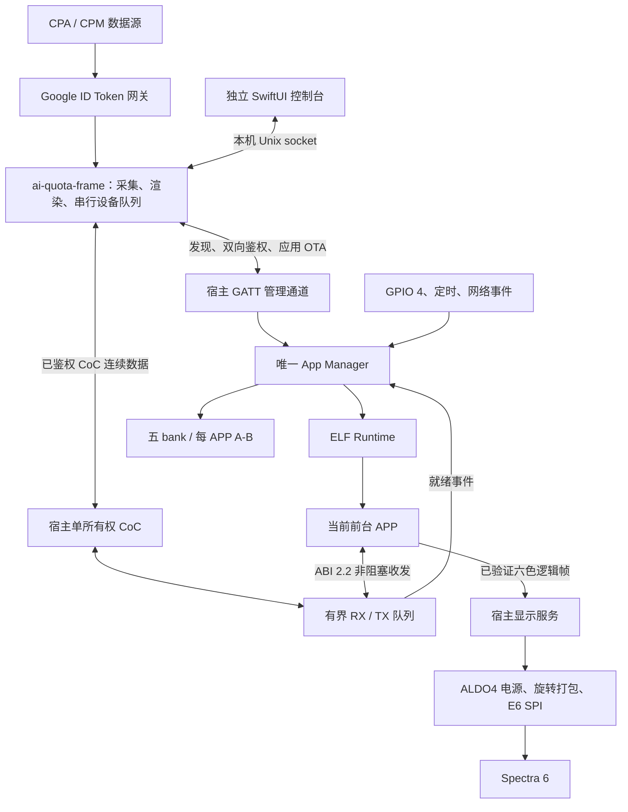

# PhotoPainter 仓库职责与架构

更新日期：2026-10-27。系统由电脑后台制作内容，常驻宿主提供通信与运行服务，唯一前台 APP 处理业务，电子纸完成显示。可视化控制台独立成仓，操作能力与开发原理文档分别维护。源码发布与实机状态见 [证据页](wiki/Status-and-Evidence.md)。

## 五个仓库

| 仓库 | 运行位置 | 职责 | 产物 |
|---|---|---|---|
| esp32s3 | 不运行 | Wiki、跨仓架构与导航 | 文档 |
| photopainter-host | ESP32-S3 factory | Wi-Fi、NimBLE、鉴权、A/B、ELF 加载、Manager、SDK、板级显示 | 宿主 bin |
| photoframe | 由宿主加载的唯一前台 | PNG 校验、收图状态、首屏、业务回执 | 独立 app.elf / pkg |
| ai-quota-frame | Mac / Windows / Linux | 数据采集、Chrome 渲染、设备客户端、串行后台和本机 IPC | Go 程序、LaunchAgent 等 |
| photopainter-console | macOS | 设备状态、操作、通信和诊断界面 | SwiftUI Console.app |

独立控制台源码：[photopainter-console](https://github.com/M1nt-Ch0c0/photopainter-console)。它通过受文件权限保护的 Unix socket 调用 Go 后台，后台仍是唯一设备操作入口。控制台不另开 BLE 连接，也不读取普通服务日志或源端凭据。

## 运行链路

现有 HTTP 输入/管理和旧宿主 PNG opcode 15/16/17 保留兼容。新图片路径属于 photoframe：GATT 先鉴权和查询能力，CoC 传连续数据，APP 负责 BEGIN/CHUNK/COMMIT/QUERY/CANCEL、整图 SHA、PNG 和最终显示回执。业务发送不自动抢回前台应用。

## ABI 与单所有权

应用是可卸载 ELF，与宿主共享地址空间，不是独立进程。只有一个应用运行；框架仍支持最多五个已安装 APP、每个 APP 两个 1 MiB 数据槽。设备目前实际保留哪些版本以签名目录和 [状态页](wiki/Status-and-Evidence.md) 为准。

- ABI 2.0：START、INPUT、TIMER、NETWORK、STOP；显示、缓存、时间等通用服务。
- ABI 2.1：一个受管 GATT 服务、最多四个特征、每值最多 128 字节，BLE 事件编号 6。
- ABI 2.2：一个由前台运行代次独占的 CoC 注册/连接，COC 事件编号 7，不改变旧结构布局。

CoC 的 `open/info/recv/send/close` 不提供多应用 socket 表。APP 事件内非阻塞调用；数据由宿主复制、有界排队。普通断线清空连接队列并更新 session，保留注册；切出/卸载撤销所有权。无线任务不保存 ELF 回调或借用指针。

Mac CoreBluetooth 提供字节流，宿主增量解析长度封套，NimBLE 处理 SDU 分段重组与 credits。典型 4 KiB 预算对应 4058 字节应用记录，photoframe 的 CHUNK 图片部分为 4036 字节。GATT 的 128 字节限制不影响 CoC。

接口见 [ABI 与版本](wiki/ABI-and-Versioning.md)、[CoC](wiki/Application-CoC.md)；精确无线字段以宿主 `docs/abi-2-2-coc.md` 为准。

## 调度、显示与恢复

所有 APP 入口由 Manager 串行调用。每次有效入口恰好报告一次结果；普通逻辑预算 5 秒，同步显示与旧 ABI 1 调用预算 650 秒。CoC 每次事件有限批量处理，数据事件不反复扫描全部 Flash 应用槽。

切换顺序为 STOP → 撤销 timer/GATT/CoC/旧事件 → 卸载 → 加载目标 → START → 就绪与确认。独立 Wi-Fi/NimBLE 系统任务仍属于宿主，不是 APP 的后台执行环境。

显示 APP 的 START 要求 APP_READY 与所声明的首屏完成。更新写备用槽，显式激活后确认；失败或确认前重启按目录恢复。启动 active 失败只尝试 previous 一次，再失败则保持可管理故障空闲。保留框架恢复能力与设备实际只安装一个版本并不矛盾。

发送进度、包暂存成功、ELF 加载、运行就绪、版本确认和实体显示完成是不同事实。只有匹配请求 ID/长度/SHA 的最终 APP 回执，才能证明本次刷新及最终 POWER_OFF 成功；画面方向和颜色仍需人工确认。电子纸保留图像不证明设备在线。

## 电脑端与数据源

CPA/CPM 数据经 HTTPS 网关读取。电脑使用 Google 服务账号换取 ID Token，网关 oauth2-proxy 校验后由 nginx 注入管理认证；设备不保存远端管理、OAuth 或服务账号凭据。源端连接参数与设备独立令牌放在私有运行目录，不能写入仓库、日志示例或 GUI。

Mac 后台使用 `PhotoPainter Renderer.app` 身份和 `com.m1ntch0c0.ai-quota-frame` LaunchAgent，控制台使用独立的 `PhotoPainter Console.app` 身份。关闭控制台不关闭后台。迁移时保留主题、平台行、时区、刷新间隔及代理依赖；后台继续只主动访问数据源和设备，不恢复旧的公网/本机 TCP 健康端口。

Windows 历史看门狗只检查进程是否存在。硬件操作前要停掉计划任务、看门狗及子进程；不能使用已经不存在的 `:8787/healthz` 来强杀服务。Linux/Windows 当前 CoC 后端尚未接入时继续使用原 GATT 图片路径，不据 ESP 能力直接假定电脑支持 CoC。

## 实测与边界

2026-10-27 已完成宿主 factory 更新与分区外 MD5 比对，photoframe v20 确认运行，Mac CoC 收发成功。67,509 字节发送阶段为 2.477 秒，平均 26.6 KiB/s；01:49:21（UTC+8）取得最终显示回执。该发送计时不含全部连接和刷屏过程，也不等于各种环境下的吞吐保证。

此前 POWERON 下线原因仍未定位；当前遥测没有电池电压或 PMIC 关机原因，不能把重启码单独归因于 USB、没电或软件。更换传输方式也不构成此问题已经修复的证据。

当前没有通用 APP Wi-Fi socket/HTTP client、宿主整机 OTA、应用后台线程或进程沙箱。宿主通过 USB 更新 factory；应用通过既有 OTA 独立更新。完整 Flash/SD 备份属于恢复材料，和可清理的构建产物、旧包、日志分开管理。

## 改动影响

| 想改什么 | 修改位置 |
|---|---|
| 页面主题、数据源、更新间隔 | ai-quota-frame |
| 控制台设备操作与诊断呈现 | photopainter-console + 后台 console IPC |
| 相框图片业务和启动内容 | photoframe |
| 通用通信接口、调度或驱动 | photopainter-host；同步 SDK 和应用副本 |
| 规范、维护说明、跨仓导航 | esp32s3/wiki |

宿主不构建或嵌入业务 ELF。设备两仓固定使用 ESP-IDF `5e6f53cdb31fe5708eae3f55af9737be2822db22` 与未修改的 Registry elf_loader 1.3.3；APP 同步 SDK 头与导入列表，包格式和分区布局保持兼容。
