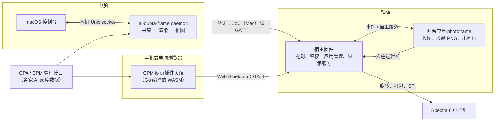

# 项目介绍

这一页讲 PhotoPainter 相框是什么、能做什么、由哪些部分组成，以及数据从哪里来、怎么一路走到屏幕上。适合第一次接触这个项目的所有人。读完你应该知道五个仓库各管什么，想改某个功能该去哪里找代码。

## 相框能做什么

PhotoPainter 是一块放在桌上的彩色电子纸相框。它最主要的用途是显示 **AI 订阅额度看板**：电脑或网页定时读取你在各家 AI 服务（Codex/ChatGPT、Claude、Antigravity、Grok、Kimi）上的用量和剩余额度，画成一张图，通过蓝牙推到相框上。

电子纸只在换图时耗电，断电后画面还会一直留在屏幕上，很适合这种“隔一段时间刷新一次”的看板。

相框本身不需要联网，也不运行网页。它只做三件事：

- 和电脑或浏览器配对，确认对方是自己的主人；
- 接收图片并显示；
- 安装、切换和更新运行在它上面的小程序（叫“应用”）。

显示额度看板的就是其中一个应用 `photoframe`。以后也可以写别的应用，比如时钟或日历，见[编写一个应用](04-writing-an-app.md)。

## 硬件

| 部件 | 说明 |
|---|---|
| 主板 | 微雪 ESP32-S3 PhotoPainter |
| 屏幕 | 7.3 寸 Spectra 6 电子纸，800×480，六种颜色：黑、白、红、黄、绿、蓝 |
| 存储 | 16 MiB Flash，带 PSRAM，可选 microSD 卡 |
| 电源管理 | AXP2101 电源芯片，负责给屏幕供电 |
| 按键 | GPIO4 **功能键**、GPIO0 BOOT 键、GPIO5 电源键 |

日常只会用到功能键，它的几种用法见[上手使用](02-getting-started.md#开始之前)。

一次完整的屏幕刷新大约需要 20 秒，这是这种电子纸本身的特性。

## 整体架构

整个系统分成三层：

1. **数据和画面**在电脑或浏览器里生成。电脑上由 `ai-quota-frame` 常驻后台负责，浏览器里由 CPM 网页插件负责。两者用同一套 Go 代码采集数据，生成 800×480 的六色 PNG。
2. **蓝牙**负责把图片送到相框。电脑和浏览器都要先和相框配对，之后每次连接时双方都会互相验证身份。
3. **相框**上的软件分两部分。**宿主**是固定的底层固件，负责蓝牙、配对、应用管理和驱动屏幕。**前台应用**是宿主加载运行的小程序，负责具体业务，比如收图、校验图片、决定显示什么。

几点说明：

- 图中蓝牙箭头上的 CoC 和 GATT 是两种蓝牙传输方式，CoC 更快，目前只有 Mac 客户端使用。两个词的解释见[术语表](10-glossary.md#蓝牙与配对)。
- 电脑后台和浏览器插件是两个独立的客户端，相框同一时间只认其中一个当主人。换主人的方法见[上手使用](02-getting-started.md#一台相框只认一个主人)。
- 图片的收取和校验由应用完成，宿主只提供通信通道和“把一帧画到屏幕上”的服务。
- 应用和宿主怎么配合、应用怎么安装和更新，见[设备是怎么工作的](03-how-the-device-works.md)。

### 一张看板是怎么生成的

电脑端的 `ai-quota-frame daemon` 按设定的间隔循环做三件事：

1. 从 CLIProxyAPI（简称 CPA，一个代理多家 AI 服务的程序）的管理接口读取各服务商的额度和用量。
2. 按选定的主题生成 HTML 页面，用本机的 Chrome 或 Chromium 截成 800×480 的图，再量化成六色 PNG。
3. 通过蓝牙把 PNG 推给相框，等相框返回“显示完成”的回执。

网页插件走的是同一套代码。页面里的 WASM（编译成 WebAssembly 的 Go 代码）生成同样的 HTML，由浏览器绘制，再用同样的规则量化成 PNG。最后，页面通过访问者设备上的 Web Bluetooth 把图发出去。两条路生成的画面是一致的。

## 五个仓库

| 仓库 | 运行在哪里 | 负责什么 | 产物 |
|---|---|---|---|
| `photopainter-host` | 相框 Flash 上存放宿主固件的 factory 分区 | 宿主固件，负责蓝牙、配对、应用管理和屏幕驱动。仓库里还有应用 SDK 头文件 `sdk/photopainter_app.h` 和打包工具 | 宿主固件 `.bin`，通过 USB 刷写 |
| `photoframe` | 相框的应用槽，由宿主加载 | 相框应用，负责开机首屏、接收和校验图片、显示，并给客户端返回签名回执。仓库里还有几个示例应用 | 应用 ELF，打成 `.pkg` 后通过蓝牙安装 |
| `ai-quota-frame` | Mac、Windows、Linux 电脑，以及运行 CPA 的服务器 | Go 程序，负责采集数据、渲染看板、通过蓝牙推图。`web/` 和 `plugins/photopainter/` 两个目录是 CPM 网页插件 | `ai-quota-frame` 可执行文件、Mac 上的 `PhotoPainter Renderer.app`、插件 `.so` |
| `photopainter-console` | macOS | SwiftUI 图形控制台，用来看设备状态、装应用、推图和诊断。它把所有操作交给电脑后台排队执行，自己不连蓝牙 | `PhotoPainter Console.app` |
| `esp32s3` | 不运行 | 项目文档（就是你正在读的这些） | 文档 |

宿主和应用分开发布：宿主很少改，要用 USB 刷写；应用可以随时通过蓝牙单独安装和回退，不需要动宿主。

### 想改什么去哪个仓库

| 想改的东西 | 去哪里 |
|---|---|
| 看板的主题、布局、显示哪些服务商、刷新间隔 | `ai-quota-frame` |
| 数据从哪里读、怎么鉴权 | `ai-quota-frame`（`internal/cliproxy`、`internal/sources` 等） |
| 网页插件的页面和功能 | `ai-quota-frame` 的 `web/`（页面）和 `plugins/photopainter/`（CPA 插件外壳） |
| Mac 控制台的界面 | `photopainter-console`；如果要新增后台操作，还要改 `ai-quota-frame` 的控制台接口 |
| 相框开机显示什么、怎么收图、图片校验规则 | `photoframe` |
| 写一个新的相框应用 | 在 `photoframe` 里参照示例新建，见[编写一个应用](04-writing-an-app.md) |
| 应用能用的接口（事件、显示、定时、蓝牙通道） | `photopainter-host`，改完同步 SDK 头文件到 `photoframe` |
| 配对、蓝牙协议、应用安装与回退规则、屏幕驱动 | `photopainter-host` |
| 文档 | `esp32s3` |

## 推荐阅读顺序

| 顺序 | 页面 | 什么时候读 |
|---|---|---|
| 1 | [上手使用](02-getting-started.md) | 想先把相框用起来：配对、推图、日常操作 |
| 2 | [设备是怎么工作的](03-how-the-device-works.md) | 想理解宿主、应用、应用槽和启动保护 |
| 3 | [编写一个应用](04-writing-an-app.md) | 想自己写一个相框应用 |
| 4 | [应用接口参考](05-app-api-reference.md) | 写应用时查事件、宿主服务和限制 |
| 5 | [蓝牙通信](06-bluetooth.md) | 想了解配对、管理协议、图片事务，或给应用做通信 |
| 6 | [电脑端、控制台与网页插件](07-clients.md) | 想部署或修改电脑后台、Mac 控制台、网页插件 |
| 7 | [维护与排错](08-maintenance.md) | 要刷宿主、备份、恢复，或者遇到问题 |
| 8 | [版本与已知限制](09-versions-and-limits.md) | 查各组件版本、兼容关系和已知限制 |
| 9 | [术语表](10-glossary.md) | 遇到看不懂的词随时查 |

只想使用相框的人，读第 1 页和第 7 页就够了。要改文档的人请先读[文档写作规范](11-writing-guide.md)。
