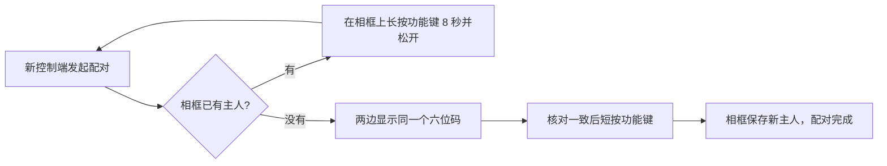

# 上手使用

这一页写给想把 AI 额度显示到相框上的使用者。读完你能完成三件事：让相框认一个“主人”（配对），把额度画面推到相框上，以及日常换主题、选服务商、暂停自动推送。

推图有两种方式，任选一种即可：

| 方式 | 适合谁 | 画面在哪里生成 | 需要什么 |
|---|---|---|---|
| **网页插件** | 已经在用 CPM 管理中心，想用手机或电脑浏览器推图 | 访问者的浏览器 | 支持 Web Bluetooth 的 Chrome，通过 HTTPS 打开 CPM |
| **电脑后台** | 想让一台常开的电脑全天自动推图 | 这台电脑 | `ai-quota-frame` 程序、Chrome/Chromium、CPA 管理密钥 |

两种方式用的是同一套采集和渲染代码，画面一致。区别只在于谁来生成画面、谁负责通过蓝牙发送。更深入的说明见[电脑端、控制台与网页插件](07-clients.md)。

## 开始之前

- 相框已经刷好宿主固件，并装好了 `photoframe` 相框应用。如果还没有，先看[维护与排错](08-maintenance.md)。
- 相框插着电并且开机，放在电脑或手机旁边。推图走蓝牙，相框不需要连 Wi-Fi；但生成画面的那一端（浏览器或电脑）需要能上网取额度数据。
- 认识相框上的三个键：

| 按键 | 用途 |
|---|---|
| **功能键**（GPIO4） | 配对时短按表示同意；长按至少 8 秒再松开会清除配对；平时短按切换到下一个应用 |
| BOOT 键（GPIO0） | 只用于刷写固件，日常用不到 |
| 电源键（GPIO5） | 开关机 |

## 一台相框只认一个主人

相框同一时间只信任一个控制端，这个控制端叫它的“主人”。电脑后台算一个主人，某个浏览器算另一个主人，两台电脑也是两个主人。主人通过一次**配对**确定：控制端和相框各自算出同一个六位数字并显示出来，你核对两边一致后，在相框上短按功能键表示同意。之后相框和这个控制端都会记住这层关系，以后每次连接都自动验证身份，不用再输入密码。

一个控制端可以记住多台相框，但一台相框只能有一个主人。所以：

- 已经有主人的相框，会拒绝新控制端的配对请求。
- 想换主人，先在相框上**长按功能键至少 8 秒再松开**，清除原来的配对，再用新控制端重新配对。
- 长按重置只清除配对关系，Wi-Fi 设置和已安装的应用都保留。
- 如果相框正在刷新屏幕，重置会等这次刷新完成后再生效。在这段时间里，相框会拒绝新的操作。

换主人之前，先让原来的主人停止自动推送：网页上关掉定时推送，电脑上暂停或停止后台。这样它就不会在你换完之后还反复尝试连接。完整步骤见[从网页换到电脑，或反过来](#从网页换到电脑或反过来)。

配对协议本身的细节见[蓝牙通信](06-bluetooth.md#4-配对-v2)。



## 方式一：浏览器网页插件

网页插件挂在 CPM 管理中心的插件菜单里，菜单名是“发送到相框”。CPM 是 CPA 的网页管理界面。插件页面在你的手机或电脑浏览器里运行：浏览器读取 CPM 的额度数据，在本地生成画面，再用这台手机或电脑的蓝牙推到相框。服务器只提供页面，蓝牙连接由浏览器所在的设备发起，所以这台设备必须放在相框附近。

### 第一次使用

1. 用 Chrome 通过 HTTPS 打开 CPM，进入插件菜单“发送到相框”。
2. 看页面顶部的“数据源”。如果你在这个浏览器里登录过 CPM 并保存了登录，插件会直接用它，显示为已就绪。否则点“数据源”，填入管理密钥，可以勾选“在此浏览器记住手动配置”。
3. 在“相框”卡片里点 **添加相框**，在浏览器弹出的设备列表里选你的相框。
4. 页面弹出配对窗口，相框屏幕上也会显示一个六位数字。两边数字一致时，**短按一下相框的功能键**。
5. 页面显示“配对完成”后就可以用了。以后在同一个浏览器里连接这台相框，不用再配对。

如果配对窗口提示相框已有主人，按上一节的方法长按功能键 8 秒重置后再试。

### 推一张图

1. 点 **更新画面**。页面会拉取最新额度并生成画面，预览区显示的就是相框上会出现的样子。
2. 点 **发送到相框**。进度条显示相框已经确认收到的字节数。
3. 上传完后相框开始刷新电子纸，大约需要 20 秒。页面收到相框签名的“显示完成”回执后，才会提示发送成功。

相框应用支持 ABI 2.3 时（ABI 是应用和宿主之间的接口版本），手机网页传一张约 66 KiB 的画面大约 8 秒，加上刷新总共半分钟左右。

如果连上后页面提示相框应用没有就绪，并出现 **打开相框应用** 按钮，说明相框正在运行别的应用，比如你短按功能键切走了。点这个按钮，页面会让相框切回相框应用。

### 定时推送

“定时推送”卡片可以让页面按固定间隔自动更新并发送：

1. 打开 **启用定时推送**。
2. 设置 **检查间隔**，范围 1–1440 分钟，默认 15 分钟。
3. 开启后页面立刻检查一次，之后每到间隔就先更新额度、生成画面，只有画面内容变了才发送。

定时推送靠页面自己计时，所以**页面必须一直开在前台**。锁屏、切到别的应用或关掉页面后，定时推送会暂停；回到页面后继续，错过的轮次不补发。手机上可以勾选 **定时期间保持屏幕唤醒**，让浏览器在定时期间不熄屏。需要全天无人值守地推图，请用方式二的电脑后台。

### 上次发送未确认

如果上传过程中连接断了，或者没收到相框的完成回执，页面会显示“上次发送未确认”卡片。这时页面只向相框查询那一次的结果，避免相框重复刷新。处理方法见[维护与排错](08-maintenance.md#发送结果未知)。

## 方式二：电脑后台

电脑后台是 `ai-quota-frame` 程序的 `daemon` 子命令。它常驻运行，按固定间隔从 CPA 的管理接口采集额度，用 Chrome 生成 800×480 的六色画面，然后通过蓝牙推给相框。Windows、Linux 和 macOS 都能运行；macOS 上可以装成登录后自动启动的服务。

### 1. 构建并准备配置

需要准备：

- Go，版本不低于仓库 `go.mod` 里写的版本；
- Chrome 或 Chromium，找不到时可以用环境变量 `CHROME_BIN` 指定路径；
- macOS 上还需要 Xcode Command Line Tools，因为蓝牙部分要通过 CGO（Go 调用 C 代码的机制）编译。

```sh
cd ai-quota-frame
cp .env.example .env
chmod 600 .env
make check          # 测试并构建，产物在 dist/ai-quota-frame
```

编辑 `.env`，至少填好数据源：

```dotenv
CLIPROXY_BASE_URL=http://127.0.0.1:8317
SOURCE_AUTH_MODE=management-key
CLIPROXY_MANAGEMENT_KEY=你的 CPA 管理密钥
PHOTOFRAME_PUSH_TRANSPORT=ble
```

其他可选项（主题、显示的服务商、刷新间隔、用量统计）见[配置项](07-clients.md#配置项)。`.env` 里有密钥，不要提交到 Git。

### 2. 配对

```sh
./dist/ai-quota-frame ble scan
```

`ble scan` 扫描 10 秒，列出附近相框的设备 ID（12 位十六进制数，例如 `001122334455`）。然后用这个 ID 配对：

```sh
./dist/ai-quota-frame ble pair --device-id 001122334455 --name "PhotoPainter desktop"
```

终端会打印六位配对码，相框屏幕上也会显示。核对一致后**短按相框的功能键**。配对成功后，终端输出这次配对的摘要。`--name` 是显示在相框上的控制端名字，可以不填。

配对关系保存在本机用户配置目录里的 `ai-quota-frame/` 下（设备选择存在 `ble-device.json`，密钥存在 `ble-bonds/`，文件权限 0600）。最近一次配对的相框会被后台自动选用，所以 `.env` 里一般不用写设备 ID。

macOS 上请先完成第 4 步的安装，再用 `python3 deploy/pp.py pair ...` 配对，原因见下文。

### 3. 启动后台

```sh
set -a; . ./.env; set +a
./dist/ai-quota-frame daemon
```

程序启动时先检查 Chrome 能否使用，然后开始采集和推图。推送细节见[后台是怎么推图的](07-clients.md#后台是怎么推图的)。

启动后台一定要写 `daemon` 子命令。`ai-quota-frame` 不带参数时只打印帮助。

### 4. 在 Mac 上装成常驻服务

macOS 按“应用”授予蓝牙权限，直接在终端里运行的程序可能拿不到稳定的权限。安装脚本会把程序包装成一个应用，再用 LaunchAgent（macOS 的用户级自启动服务）在登录后自动启动：

```sh
python3 deploy/install-macos.py --env-file .env
```

它做了这些事：

- 把程序、`.env` 和 USB 维护脚本复制到 `~/Library/Application Support/ai-quota-frame/`。
- 编译一个小启动器，生成 `~/Applications/PhotoPainter Renderer.app`。
- 写入 LaunchAgent `com.m1ntch0c0.ai-quota-frame`，登录后自动运行 `ai-quota-frame daemon`，异常退出后自动重启。
- 日志写到 `~/Library/Logs/photopainter-render.log` 和 `photopainter-render.error.log`。

第一次运行时，系统会弹窗请求蓝牙（以及本地网络）权限，在 Mac 的图形界面上允许即可。

还没确认推图正常时，可以加 `--no-start`。这样只安装文件，服务保持禁用状态。确认没问题后，再不带这个参数运行一次安装命令。

安装后，在 Mac 上用 `deploy/pp.py` 执行蓝牙命令。它以已安装应用的身份运行，并使用应用的私有配置：

```sh
python3 deploy/pp.py scan
python3 deploy/pp.py pair --device-id 001122334455 --name "PhotoPainter Mac"
python3 deploy/pp.py status
```

`pp.py` 的参数和 `ai-quota-frame ble` 完全一样，它只是自动在前面加上 `ble`。

### Windows 和 Linux 上常驻运行

- Linux：仓库里有 systemd 单元示例 `deploy/ai-quota-frame.service`，它从 `/etc/ai-quota-frame.env` 读配置，执行 `ai-quota-frame daemon`。
- Docker：镜像默认命令就是 `daemon`，并自带 Chromium。
- Windows：用 `GOOS=windows` 交叉编译出 `ai-quota-frame.exe`，用计划任务等方式启动 `ai-quota-frame.exe daemon`。

这些平台都通过 GATT 推图，速度比 Mac 慢。平台差异见[电脑端、控制台与网页插件](07-clients.md#各平台差异)。

## 日常操作

| 想做什么 | 网页插件 | 电脑后台 |
|---|---|---|
| 换主题 | 点 **显示设置** → 主题 | 改 `.env` 里的 `FRAME_THEME`，重启后台 |
| 选显示哪些服务商 | **显示设置** → 显示的服务，勾 1–5 个 | 改 `DISPLAY_PROVIDERS`，重启后台 |
| 改更新频率 | **显示设置** → 更新间隔，或定时推送的检查间隔 | 改 `REFRESH_INTERVAL`（最少 `1m`），重启后台 |
| 暂停自动推送 | 关掉 **启用定时推送** | Mac：`console pause`；其他平台：停掉服务 |
| 恢复自动推送 | 打开 **启用定时推送** | Mac：`console resume`；其他平台：启动服务 |
| 手动推一次 | 点 **更新画面** 再点 **发送到相框** | `ai-quota-frame ble push --file frame.png` |
| 让本端忘记相框 | 相框信息里点 **移除此相框** | `ai-quota-frame ble forget` |

### 主题

| 主题 | 配置值 | 说明 |
|---|---|---|
| 薄巧 | `mint-skin` | 插画背景。选 4–5 个服务商时自动压缩每行，5 行时不显示重置时间 |
| 经典 | `classic` | 基础布局，1–5 行都能完整显示 |
| 街机 | `arcade` | 带像素画装饰的配色风格 |
| 波普 | `pop` | 另一种像素画装饰的配色风格 |

网页插件默认用薄巧，电脑后台默认用经典。

### 服务商

可以显示的服务商有 Codex（ChatGPT）、Claude、Antigravity、Grok（xAI）和 Kimi，每行一个，最多 5 行。

- 网页插件默认显示 Claude、Codex、Grok 三行，在显示设置里勾选即可。
- 电脑后台默认显示 Codex、Grok、Kimi 三行，用 `DISPLAY_PROVIDERS` 修改，例如：

```dotenv
DISPLAY_PROVIDERS=codex,claude,antigravity:AGY
```

这个变量的完整格式和可用的服务商 ID 见[配置项](07-clients.md#画面)。

### 在 Mac 上暂停和恢复

Mac 上的后台带一个本机控制接口，可以不停服务就暂停自动推送：

```sh
RUNTIME="$HOME/Library/Application Support/ai-quota-frame"
"$RUNTIME/ai-quota-frame" console pause      # 暂停自动推送
"$RUNTIME/ai-quota-frame" console snapshot   # 查看后台状态，不连接相框
"$RUNTIME/ai-quota-frame" console resume     # 恢复，可能马上推一张最新的
```

暂停状态会被保存，后台重启后依然是暂停的。暂停后，已经开始的刷新会照常完成，之后不再发起新的推送。也可以用 [macOS 控制台](07-clients.md#macos-控制台) 的开关来操作。

要彻底停掉服务：

```sh
launchctl bootout gui/$(id -u)/com.m1ntch0c0.ai-quota-frame     # 停止
launchctl bootstrap gui/$(id -u) ~/Library/LaunchAgents/com.m1ntch0c0.ai-quota-frame.plist   # 重新加载
```

如果安装时用过 `--no-start`，服务处于禁用状态，要先执行 `launchctl enable gui/$(id -u)/com.m1ntch0c0.ai-quota-frame` 再加载，或者直接重新运行安装脚本。

## 从网页换到电脑，或反过来

1. 停掉原来的主人：网页关掉定时推送并断开；电脑后台执行 `console pause` 或停止服务。
2. 在相框上长按功能键至少 8 秒再松开。
3. 用新的控制端配对：网页点“添加相框”，电脑执行 `ble pair`。
4. 在新控制端推一张图，确认屏幕正常后再开启自动推送。

原来的控制端里还留着旧的配对记录，可以顺手删掉（网页“移除此相框”，电脑 `ble forget`）。删掉的只是本地记忆，不影响相框。
