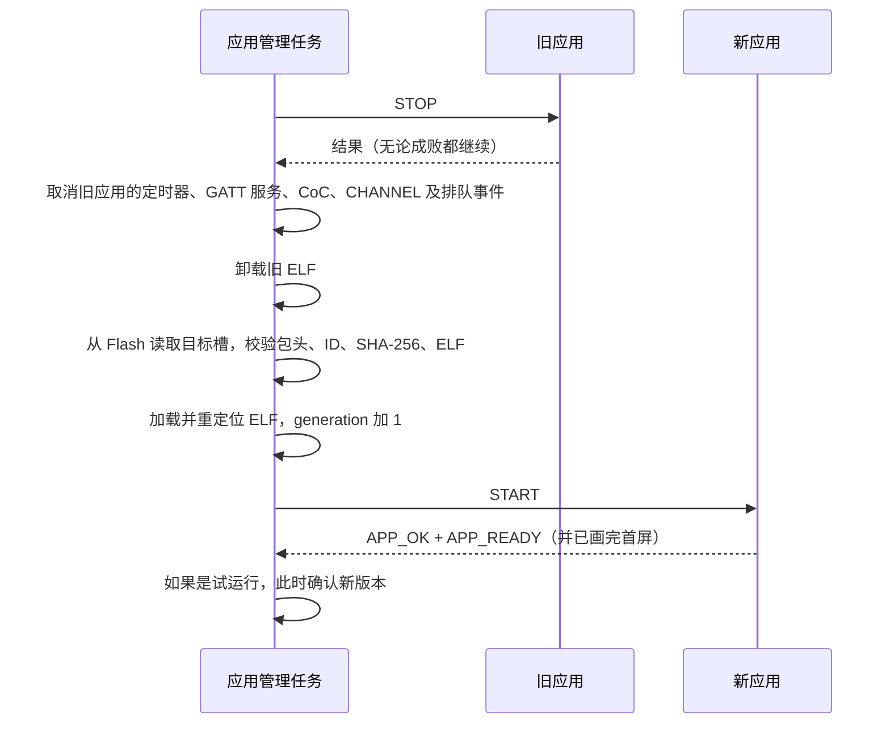

# 设备是怎么工作的

这一页讲相框内部的运行原理：宿主和应用怎么分工，应用怎么被加载、调用和卸载，应用怎么安装、更新和回退，开机时的启动保护怎么判断失败，以及一帧画面怎么最终出现在电子纸上。适合想理解原理、排查问题或准备写应用的人。具体接口参数在[应用接口参考](05-app-api-reference.md)，蓝牙协议在[蓝牙通信](06-bluetooth.md)。

## 宿主与应用

相框上的软件分成两层：

- **宿主**（`photopainter-host`）是写在 factory 分区里的固件，开机就运行，通过 USB 更新。它负责所有“底层且共用”的事：蓝牙、配对与鉴权、应用目录和应用槽、加载与调度应用、屏幕驱动、按键。
- **应用**是宿主从 Flash 里读出来、加载运行的 ELF 程序，通过蓝牙单独安装。它负责具体业务。默认应用 `photoframe` 负责开机首屏、接收图片、校验 PNG、显示，并给客户端返回签名的完成回执。

| 事情 | 谁负责 |
|---|---|
| 蓝牙广播、配对、每次连接的鉴权 | 宿主 |
| 安装、激活、切换、回退、删除应用 | 宿主 |
| 决定何时调用应用、一次只调用一个入口 | 宿主 |
| 屏幕供电、像素旋转打包、SPI 传输、等待刷新完成 | 宿主 |
| 开机显示什么、收什么数据、数据格式和校验 | 应用 |
| 画面内容（一帧 800×480 的六色像素） | 应用 |

应用和宿主运行在同一个地址空间里，不是独立的进程，也没有自己的线程。同一时间只有一个应用在运行，叫**前台应用**。应用只在宿主调用它的时候执行，做完就返回。

## 应用的生命周期

### 事件

宿主通过“事件”调用应用。每次调用都进入应用的同一个入口函数，应用用 `app_host_context_v2()` 取得本次事件的信息（事件类型、编号、数据指针等），处理完后报告结果再返回。

| 事件 | 什么时候来 | 起始 ABI |
|---|---|---|
| `START` | 应用刚被加载 | 2.0 |
| `INPUT` | 收到一张 PNG 输入（宿主旧的推图通道） | 2.0 |
| `TIMER` | 应用自己设的定时器到点 | 2.0 |
| `NETWORK` | Wi-Fi 连接状态变化 | 2.0 |
| `STOP` | 应用即将被卸载 | 2.0 |
| `BLE` | 应用自定义 GATT 服务有连接、断开、写入 | 2.1 |
| `COC` | 应用独占的 L2CAP CoC 通道有数据或状态变化 | 2.2 |
| `CHANNEL` | 通用消息通道有消息或状态变化 | 2.3 |

ABI 版本的含义见[应用接口参考](05-app-api-reference.md)。

### 三条硬规则

**1. 事件严格串行。** 宿主里只有一个“应用管理”任务，所有应用调用和所有会改动应用目录的操作（安装、激活、切换、回退、删除、显示）都在这个任务里排队执行。应用永远不会同时被调用两次，也不会在被调用时碰上安装或切换。空闲时，宿主每次只取一个待处理事件，优先级是：蓝牙管理命令等排队作业 > 网络状态变化 > 定时器 > BLE 事件 > CoC 事件 > CHANNEL 事件。

**2. 每个入口必须恰好报告一次结果。** 应用在每次调用里都要调用一次 `app_host_complete_v2()`（SDK 里的 `app_complete()` 帮你填好字段）。结果里的事件编号和 generation 必须和本次事件一致，状态码必须是 SDK 定义的值。下面任何一种情况，宿主都把这次调用当成运行错误：

- 没报告结果；
- 报告了两次；
- 编号或 generation 对不上；
- 在 `START` 以外的事件里带了 `APP_READY` 标志。

入口函数的返回值宿主拿不到（ELF 加载库不传递它），所以只靠 `return` 不算报告。运行错误发生后，宿主会立刻卸载这个应用，相框进入“故障空闲”状态，直到有人切换或重新激活应用。

**3. 时间预算。** 宿主在每次调用前启动一个看门狗：

| 情况 | 预算 |
|---|---|
| 普通事件逻辑 | 5 秒 |
| 调用 `app_host_display_v2()` 画屏期间 | 650 秒（画完后恢复成 5 秒） |

超时后宿主直接重启整台设备，不会强行卸载还在执行的代码。所以应用在一次事件里只能做有限的工作，比如分块接收时只处理当前这一块，不要在事件里等待后续数据。

### START 什么时候算成功

`START` 成功需要同时满足：

1. 应用报告 `APP_OK`，并带上 `APP_READY` 标志；
2. 如果应用在清单里声明了 `APP_REQUIRES_DISPLAY`（需要首屏），那么这次 `START` 里必须真的成功画完一帧。

`photoframe` 声明了需要首屏。它在 `START` 里先恢复上次缓存的画面；没有缓存时画一张写着 `WAITING FOR IMAGE` 的白底页面。缓存放在内存里，重启后就没了，所以相框每次开机都会先显示 `WAITING FOR IMAGE`，等客户端再推一张图。

### 加载、切换和卸载

切换应用（按功能键、蓝牙 `SWITCH` 命令、激活新版本）都走同一个流程：

- **generation** 是“第几次加载”的计数，每加载一次加 1。宿主给每个事件、每个通道会话都带上 generation，旧应用遗留下来的事件或回复会因为 generation 不符被丢弃。
- 宿主能自动取消的只有它替应用管理的资源（定时器、蓝牙注册、队列）。应用自己 `malloc` 的内存要在 `STOP` 里释放。
- 如果切换到另一个应用时目标 `START` 失败，宿主会取消这次切换，重新加载原来的应用。

功能键短按会切到下一个“有已确认版本、并且是 ABI 2”的应用，按应用目录里的顺序循环。只有一个应用时按了没有反应。宿主正忙（正在画屏、安装或切换）时的短按会被直接忽略，不会事后补做。

## 应用目录与 A/B 槽

### 目录结构

宿主最多管理 **5 个应用**。每个应用固定占一个 **bank**（目录里的一个位置），每个 bank 有两个 1 MiB 的**槽**：A 槽（编号 0）和 B 槽（编号 1）。一个槽里放一个安装包：前 4 KiB 是包头（版本号、长度、SHA-256、应用 ID），后面是 ELF，所以应用本身最大是 1 MiB 减 4 KiB。

Flash 布局如下：

| 分区 | 偏移 | 大小 | 内容 |
|---|---|---|---|
| `nvs` | `0x9000` | 24 KiB | 配对关系、Wi-Fi 等宿主配置 |
| `factory` | `0x10000` | 5 MiB | 宿主固件 |
| `elf_a`、`elf_b` | `0x510000`、`0x610000` | 各 1 MiB | bank 0（`photoframe`）的 A、B 槽 |
| `elf_state` | `0x710000` | 24 KiB | 应用目录和启动保护记录（NVS） |
| `app_slots` | `0x720000` | 8 MiB | bank 1–4 的 A、B 槽 |

每个应用在目录里记录四个字段：

| 字段 | 含义 | 没有时的值 |
|---|---|---|
| `active` | 当前确认可用的版本在哪个槽，开机就加载它 | `-1` |
| `previous` | 可以回退到的旧版本在哪个槽 | `-1` |
| `pending` | 已上传、等待激活的新版本在哪个槽 | `-1` |
| `trial` | 是否正在试运行 `pending` 里的版本 | `0` |

目录另外记录全局的 `selected`（开机加载哪个应用）和 `trial_app`（哪个应用正在试运行或切换中）。

### 管理命令

所有命令都要求客户端是已鉴权的主人，并且由应用管理任务串行执行。

| 命令 | 作用 |
|---|---|
| 上传（`BEGIN` / `CHUNK` / `COMMIT`） | 把安装包写进这个应用的**非当前槽**，成为 `pending`；不运行它 |
| `ACTIVATE` | 试运行 `pending` 版本，启动成功就确认 |
| `SWITCH` | 把前台换成另一个已安装应用的 `active` 版本；不碰 `pending` |
| `ROLLBACK` | 有 `pending` 时丢弃它；否则把 `active` 和 `previous` 互换 |
| `REMOVE` | 删除一个应用的目录项。只能删当前不在运行的应用 |

宿主没有“激活某个指定槽”的命令，也没有单独擦除某个槽的命令。

### 上传 → 激活 → 试运行 → 确认

上传时宿主按这个顺序写：

1. 先在目录里清空 `previous`（因为即将覆盖的就是它）并保存；
2. 擦除目标槽，写入 ELF；
3. 读回并重新校验 SHA-256；
4. 最后写包头，再把目录里的 `pending` 指向这个槽。

目标槽总是“不是 `active` 的那一个”；还没有任何版本时写 A 槽。任何一步中断，`active` 都不受影响，写了一半的槽也不会被当成有效版本。

激活时宿主把这个应用标成试运行，加载 `pending` 槽并发 `START`。`START` 成功（含首屏）后**确认**：`pending` 变成新的 `active`，原来的 `active` 变成 `previous`。`START` 失败就取消试运行：丢弃 `pending`，重新加载原来的版本。试运行期间如果重启，下次开机宿主会先取消试运行，再按原来的 `active` 启动。

### 举例

下面用 `photoframe` 举例。初始状态：B 槽是 v20 并且正在运行，A 槽是空的。

| 步骤 | 操作 | A 槽 | B 槽 | `active` | `previous` | `pending` | `trial` |
|---|---|---|---|---|---|---|---|
| 0 | 初始 | 空 | v20 | B | — | — | 0 |
| 1 | 上传 v21 | v21 | v20 | B | — | A | 0 |
| 2 | `ACTIVATE`，正在试运行 | v21 | v20 | B | — | A | 1 |
| 3 | v21 启动成功，确认 | v21 | v20 | A | B | — | 0 |
| 4 | `ROLLBACK` | v21 | v20 | B | A | — | 0 |
| 5 | 再 `ROLLBACK` | v21 | v20 | A | B | — | 0 |
| 6 | 上传 v22 | v21 | v22 | A | — | B | 0 |
| 7 | `ACTIVATE` 后 v22 启动失败 | v21 | v22 | A | — | — | 0 |

几个要点：

- 第 2 步如果 v21 启动失败，状态回到第 1 步之前的样子，只是 A 槽里留着一份不会被使用的数据。
- 第 6 步上传时 B 槽里的 v20 被覆盖，所以 `previous` 立刻变成空。**上传新版本会消耗掉回退机会**，从这一刻起只剩一个可用版本，直到新版本激活成功。
- 第 7 步失败后 `previous` 仍然是空的。B 槽里的 v22 还在 Flash 上，但目录已经不再引用它；想再试只能重新上传。

## 启动保护

启动保护防止“一个坏版本让相框每次开机都崩溃”。代码在 `photopainter-host` 的 `main/app_boot.c`、`main/photoframe_plugin.c` 和 `main/module_slots.c`。

### 规则

每次开机，宿主按这个顺序处理：

1. 如果上次关机时有应用在试运行，先取消试运行（丢弃 `pending`）。
2. 读 `elf_state` 里的启动记录。
3. **没有未完成的记录**：写一条“正在启动”记录，记下当前应用和它的 `active`、`previous`，然后正常加载 `active`。
4. **有未完成的记录**（上一次开机写了记录、却没来得及清掉）：宿主认为上次启动失败了。
   - 如果这次开机是 USB 维护复位（复位原因 `ESP_RST_USB`，即电脑通过 USB 串口触发的复位），不算失败，重新写记录，照常加载 `active`。
   - 否则，如果有 `previous`，就把 `previous` 改成 `active`、清空 `previous`，加载这个旧版本。
   - 如果没有 `previous`，或者这条记录说明已经回退过一次，宿主不加载任何应用，停在故障空闲。
5. 应用加载完成、`START` 成功（包括画完首屏）后，清除启动记录。

另外，如果第 3 步加载 `active` 时直接失败（比如 `START` 报错），宿主会在同一次开机里立刻按第 4 步的方式回退到 `previous`。

每个应用最多只自动回退一次。回退后的版本如果也启动失败，下次开机不会再试，避免无限循环刷屏。

### 为什么“只是重启一下”也会切槽

宿主判断失败的依据只有一条：**启动记录写下之后、清除之前，设备复位了。** 它不区分复位的原因。而这个窗口包含了加载应用和画首屏，首屏刷新本身就要大约 20 秒。

所以下面这些情况，只要发生在开机后的这二十多秒里，都会被当成启动失败：

- 拔电、电池没电、供电抖动；
- 按电源键关机再开；
- 软件看门狗或别的原因导致的复位。

结合上面的规则，会出现两种结果：

| 复位前的状态 | 下次开机的结果 |
|---|---|
| 有 `previous`（比如刚升级到 v21，B 槽还留着 v20） | 自动退回旧版本，并清空 `previous`。相框能正常工作，但运行的是旧版本 |
| 没有 `previous`（比如两个槽是同一版本、刚上传过新包、或者已经回退过一次） | 不加载任何应用，停在故障空闲。屏幕保留断电前的画面，但相框不再收图 |

例如：A 槽 v21 是 `active`、B 槽 v20 是 `previous`，开机画首屏时断了一下电。再开机后 `active` 变成 B 槽 v20，`previous` 为空。

从故障空闲恢复的办法：

- 通过蓝牙对同一个应用发一次 `SWITCH`（网页插件开发者工具或 `ai-quota-frame ble switch --app photoframe`），宿主会重新加载它的 `active`，成功后清除启动记录；
- 或者做一次 USB 维护复位。

这是一个已知问题，计划中的修复见[当前状态](09-status.md)。恢复两个槽版本的具体步骤见[维护与排错](08-maintenance.md)。

## 显示链路

应用不直接操作屏幕。它把一帧画面交给宿主，宿主负责后面的所有硬件步骤。

- **逻辑帧**：应用按“从左上角开始、一行一行”的顺序写像素，每个像素一个字节，取值是 SDK 里的颜色常量：`APP_BLACK`=0、`APP_WHITE`=1、`APP_YELLOW`=2、`APP_RED`=3、`APP_BLUE`=4、`APP_GREEN`=5。应用不用关心屏幕实际的安装方向和硬件色码。
- **先校验再动硬件**：宿主先检查整帧，有任何一个值超出范围就直接返回 `APP_ERR_COLOR`，不碰屏幕。
- **一次事件最多画一帧**：同一次事件里第二次调用会被拒绝。画屏期间看门狗预算放宽到 650 秒。
- **成功的含义**：`app_host_display_v2()` 返回 `APP_OK`，表示刷新完成并且面板已经断电，画面已经稳定在屏幕上。
- **电子纸断电保留画面**：刷新完成后面板不再耗电，画面会一直保留，相框断电也一样。反过来说，屏幕上有画面不代表相框正在运行。

`photoframe` 收到 PNG 后会先完整解码，确认是 800×480、只含六种精确颜色，再转成逻辑帧交给宿主。客户端只有收到应用发回的、与本次请求 ID、长度、SHA-256 都匹配的签名完成回执，才算这张图真的显示成功。图片事务的细节见[蓝牙通信](06-bluetooth.md)。
