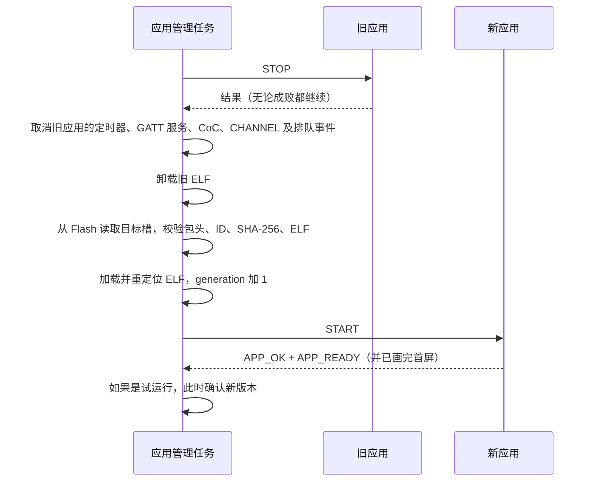

# 设备是怎么工作的

这一页讲相框内部的运行原理，适合想理解原理、排查问题或准备写应用的人。读完你会知道：宿主和应用怎么分工，应用怎么被加载和卸载，应用怎么安装、更新和回退，开机时的启动保护怎么工作，以及一帧画面怎么出现在电子纸上。具体接口参数在[应用接口参考](05-app-api-reference.md)，蓝牙协议在[蓝牙通信](06-bluetooth.md)。

## 宿主与应用

相框上的软件分成两层：

- **宿主**（`photopainter-host`）是写在 Flash 的 factory 分区里的固件，开机就运行，通过 USB 更新。它负责所有应用共用的底层工作，分工见下表。
- **应用**是一个 ELF 程序，通过蓝牙单独安装。宿主从 Flash 读出它，加载后运行。应用负责具体业务。默认应用 `photoframe` 负责开机首屏、接收和校验图片、显示，并给客户端返回签名的完成回执。

| 事情 | 谁负责 |
|---|---|
| 蓝牙广播、配对、每次连接的鉴权 | 宿主 |
| 安装、激活、切换、回退、删除应用 | 宿主 |
| 决定何时调用应用、一次只调用一个入口 | 宿主 |
| 屏幕供电、像素旋转打包、SPI 传输、等待刷新完成 | 宿主 |
| 开机显示什么、收什么数据、数据格式和校验 | 应用 |
| 画面内容（一帧 800×480 的六色像素） | 应用 |

应用和宿主运行在同一个地址空间里，不是独立的进程，也没有自己的线程。同一时间只有一个应用在运行，叫**前台应用**。应用只在宿主调用它的时候执行，做完就返回。

## 应用的生命周期

### 事件

宿主通过“事件”调用应用。每次调用都进入应用的同一个入口函数。应用先用 `app_host_context_v2()` 取得本次事件的信息，比如事件类型、编号和附带的数据，处理完后报告结果，再返回。

| 事件 | 什么时候来 | 起始 ABI |
|---|---|---|
| `START` | 应用刚被加载 | 2.0 |
| `INPUT` | 收到一张 PNG 输入（宿主旧的推图通道） | 2.0 |
| `TIMER` | 应用自己设的定时器到点 | 2.0 |
| `NETWORK` | Wi-Fi 连接状态变化 | 2.0 |
| `STOP` | 应用即将被卸载 | 2.0 |
| `BLE` | 应用自定义 GATT 服务有连接、断开、写入 | 2.1 |
| `COC` | 应用独占的 L2CAP CoC 通道有数据或状态变化 | 2.2 |
| `CHANNEL` | 通用消息通道有消息或状态变化 | 2.3 |

表里的“起始 ABI”是应用至少要声明的接口版本。ABI 是应用和宿主之间的接口约定，版本含义见[应用接口参考](05-app-api-reference.md#abi-版本)。

### 三条硬规则

**1. 事件严格串行。** 宿主里只有一个“应用管理”任务。所有对应用的调用，以及安装、激活、切换、回退、删除、显示这些操作，都在这个任务里排队执行。因此应用同一时间只会被调用一次，被调用期间也不会碰上安装或切换。

空闲时，宿主每次只取一个待处理的工作，优先顺序如下：

1. 蓝牙管理命令等排队作业；
2. 网络状态变化；
3. 定时器；
4. BLE 事件；
5. CoC 事件；
6. CHANNEL 事件。

**2. 每次调用必须恰好报告一次结果。** 应用在每次调用里都要调用一次 `app_host_complete_v2()`，SDK 里的 `app_complete()` 会帮你填好字段。结果里的事件编号和 generation（加载次数，见下文）必须和本次事件一致，状态码必须是 SDK 定义的值。下面任何一种情况，宿主都把这次调用当成运行错误：

- 没报告结果；
- 报告了两次；
- 编号或 generation 对不上；
- 在 `START` 以外的事件里带了 `APP_READY` 标志。

宿主用来加载 ELF 的库不传递入口函数的返回值，所以只写 `return` 不算报告。

运行错误发生后，宿主会立刻卸载这个应用，相框进入**故障空闲**状态：没有应用在运行，但宿主仍然可以通过蓝牙管理。有人切换或重新激活应用后，相框恢复正常。各种结果的完整处理规则见[应用接口参考](05-app-api-reference.md#结果报告规则)。

**3. 时间预算。** 宿主在每次调用前启动一个看门狗：

| 情况 | 预算 |
|---|---|
| 普通事件逻辑 | 5 秒 |
| 调用 `app_host_display_v2()` 画屏期间 | 650 秒（画完后恢复成 5 秒） |

超时后宿主直接重启整台设备，因为还在执行的代码没法安全地卸载。所以应用在一次事件里只做有限的工作。比如分块接收数据时，每次事件只处理当前这一块，后续数据留给下一次事件。

### START 什么时候算成功

`START` 成功需要同时满足：

1. 应用报告 `APP_OK`，并带上 `APP_READY` 标志；
2. 如果应用在清单里声明了 `APP_REQUIRES_DISPLAY`（需要首屏），那么这次 `START` 里必须真的成功画完一帧。

`photoframe` 声明了需要首屏。它在 `START` 里先恢复上次缓存的画面，没有缓存时画一张写着 `WAITING FOR IMAGE` 的白底页面。缓存放在内存里，重启后就清空了。所以相框每次开机都会先显示 `WAITING FOR IMAGE`，等客户端推来新图。

### 加载、切换和卸载

切换应用（按功能键、蓝牙 `SWITCH` 命令、激活新版本）都走同一个流程：

- **generation** 是“第几次加载”的计数，每加载一次加 1。宿主给每个事件、每个通道会话都带上 generation。旧应用遗留的事件或回复，generation 对不上，会被丢弃。
- 宿主会自动取消它替应用管理的资源，包括定时器、蓝牙注册和事件队列。应用自己 `malloc` 的内存要在 `STOP` 里释放。
- 如果切换到另一个应用时目标 `START` 失败，宿主会取消这次切换，重新加载原来的应用。

短按功能键会按应用目录里的顺序，切到下一个有已确认版本的 ABI 2 应用。只装了一个应用时，短按没有反应。宿主正忙（正在画屏、安装或切换）时，短按会被忽略，事后也不补做。

## 应用目录与 A/B 槽

### 目录结构

宿主最多管理 **5 个应用**。每个应用固定占一个 **bank**，也就是应用目录里的一个位置。每个 bank 有两个 1 MiB 的**槽**：A 槽（编号 0）和 B 槽（编号 1）。

一个槽里放一个安装包。安装包的前 4 KiB 是包头，记录版本号、长度、SHA-256 和应用 ID；后面是 ELF。所以应用 ELF 最大是 1 MiB 减 4 KiB。

Flash 布局如下：

| 分区 | 偏移 | 大小 | 内容 |
|---|---|---|---|
| `nvs` | `0x9000` | 24 KiB | 配对关系、Wi-Fi 等宿主配置 |
| `factory` | `0x10000` | 5 MiB | 宿主固件 |
| `elf_a`、`elf_b` | `0x510000`、`0x610000` | 各 1 MiB | bank 0（`photoframe`）的 A、B 槽 |
| `elf_state` | `0x710000` | 24 KiB | 应用目录和启动保护记录（NVS） |
| `app_slots` | `0x720000` | 8 MiB | bank 1–4 的 A、B 槽 |

每个应用在目录里记录四个字段：

| 字段 | 含义 | 没有时的值 |
|---|---|---|
| `active` | 当前确认可用的版本在哪个槽，开机就加载它 | `-1` |
| `previous` | 可以回退到的旧版本在哪个槽 | `-1` |
| `pending` | 已上传、等待激活的新版本在哪个槽 | `-1` |
| `trial` | 是否正在试运行 `pending` 里的版本 | `0` |

目录另外记录两个全局字段：`selected` 表示开机加载哪个应用，`trial_app` 表示哪个应用正在试运行或切换中。

### 管理命令

客户端必须先以主人身份通过鉴权，才能发这些命令。命令由应用管理任务依次执行。蓝牙上的命令格式见[蓝牙通信](06-bluetooth.md#6-管理命令)。

| 命令 | 作用 |
|---|---|
| 上传（开始、数据块、提交三步） | 把安装包写进这个应用的**非当前槽**，成为 `pending`。上传后不运行 |
| `ACTIVATE` | 试运行 `pending` 版本，启动成功就确认 |
| `SWITCH` | 把前台换成另一个已安装应用的 `active` 版本，`pending` 保持不变 |
| `ROLLBACK` | 有 `pending` 时丢弃它；否则把 `active` 和 `previous` 互换 |
| `REMOVE` | 删除一个应用的目录项。只能删当前不在运行的应用 |

宿主只提供上面这几条命令，要换到某个槽里的版本，只能通过它们间接完成。

### 上传 → 激活 → 试运行 → 确认

上传时宿主按这个顺序写：

1. 先在目录里清空 `previous` 并保存，因为即将被覆盖的就是这个槽；
2. 擦除目标槽，写入 ELF；
3. 读回并重新校验 SHA-256；
4. 最后写包头，再把目录里的 `pending` 指向这个槽。

目标槽总是 `active` 以外的那一个；还没有任何版本时写 A 槽。任何一步中断，`active` 都保持原样，写了一半的槽也不会被当成有效版本。

激活时，宿主把这个应用标成试运行，加载 `pending` 槽并发 `START`。之后有三种结果：

- `START` 成功（包括画完首屏）：宿主**确认**新版本。`pending` 变成新的 `active`，原来的 `active` 变成 `previous`。
- `START` 失败：宿主取消试运行，丢弃 `pending`，重新加载原来的版本。
- 试运行期间设备重启：下次开机时宿主先取消试运行，再按原来的 `active` 启动。

### 举例

下面用一个应用举例。初始状态：B 槽装着 v1 并且正在运行，A 槽是空的。

| 步骤 | 操作 | A 槽 | B 槽 | `active` | `previous` | `pending` | `trial` |
|---|---|---|---|---|---|---|---|
| 0 | 初始 | 空 | v1 | B | — | — | 0 |
| 1 | 上传 v2 | v2 | v1 | B | — | A | 0 |
| 2 | `ACTIVATE`，正在试运行 | v2 | v1 | B | — | A | 1 |
| 3 | v2 启动成功，确认 | v2 | v1 | A | B | — | 0 |
| 4 | `ROLLBACK` | v2 | v1 | B | A | — | 0 |
| 5 | 再 `ROLLBACK` | v2 | v1 | A | B | — | 0 |
| 6 | 上传 v3 | v2 | v3 | A | — | B | 0 |
| 7 | `ACTIVATE` 后 v3 启动失败 | v2 | v3 | A | — | — | 0 |

几个要点：

- 第 2 步如果 v2 启动失败，状态回到第 1 步之前的样子，只是 A 槽里留着一份不会被使用的数据。
- 第 6 步上传时 B 槽里的 v1 被覆盖，所以 `previous` 立刻变成空。**上传新版本会消耗掉回退机会**，从这一刻起只剩一个可用版本，直到新版本激活成功。
- 第 7 步失败后 `previous` 仍然是空的。B 槽里的 v3 数据还在，但目录不再引用它，想再试要重新上传。

## 启动保护

启动保护防止“一个坏版本让相框每次开机都崩溃”。代码在 `photopainter-host` 的 `main/app_boot.c`、`main/photoframe_plugin.c` 和 `main/module_slots.c`。

### 规则

每次开机，宿主按这个顺序处理：

1. 如果上次关机时有应用在试运行，先取消试运行（丢弃 `pending`）。
2. 读 `elf_state` 里的启动记录。
3. **没有未完成的记录**：写一条“正在启动”记录，记下当前应用和它的 `active`、`previous`，然后正常加载 `active`。
4. **有未完成的记录**（上一次开机写了记录、却没来得及清掉）：宿主认为上次启动失败了。
   - 如果这次开机是 USB 维护复位（复位原因 `ESP_RST_USB`，即电脑通过 USB 串口触发的复位），不算失败，重新写记录，照常加载 `active`。
   - 否则，如果有 `previous`，就把 `previous` 改成 `active`、清空 `previous`，加载这个旧版本。
   - 如果没有 `previous`，或者这条记录说明已经回退过一次，宿主停在故障空闲，不加载应用。
5. 应用加载完成、`START` 成功（包括画完首屏）后，清除启动记录。

另外，如果第 3 步加载 `active` 时直接失败（比如 `START` 报错），宿主会在同一次开机里立刻按第 4 步的方式回退到 `previous`。

每个应用最多自动回退一次。回退后的版本如果也启动失败，下次开机停在故障空闲，这样相框就不会无限循环刷屏。

### 为什么“只是重启一下”也会切槽

宿主判断失败的依据只有一条：**启动记录写下之后、清除之前，设备复位了。** 除了 USB 维护复位，它不区分复位的原因。这段时间包含加载应用和画首屏，光是首屏刷新就要大约 20 秒。

所以下面这些情况，只要发生在开机后的这二十多秒里，都会被当成启动失败：

- 拔电、电池没电、供电抖动；
- 按电源键关机再开；
- 软件看门狗或别的原因导致的复位。

结合上面的规则，会出现两种结果：

| 复位前的状态 | 下次开机的结果 |
|---|---|
| 有 `previous`（比如刚从 v1 升级到 v2） | 自动退回旧版本，并清空 `previous`。相框能正常工作，但运行的是旧版本 |
| 没有 `previous`（比如只装过一个版本、刚上传过新包，或者已经回退过一次） | 停在故障空闲，不加载应用。屏幕保留断电前的画面，但相框不再收图 |

例如：A 槽 v2 是 `active`、B 槽 v1 是 `previous`，开机画首屏时断了一下电。再开机后 `active` 变成 B 槽 v1，`previous` 为空。

从故障空闲恢复的办法：

- 通过蓝牙对这个应用发一次 `SWITCH`，比如在网页插件的开发者工具里点“切换到此应用”，或者运行 `ai-quota-frame ble switch --app photoframe`。宿主会重新加载它的 `active`，成功后清除启动记录；
- 或者做一次 USB 维护复位。

这是已知限制，计划中的改进见[版本与已知限制](09-versions-and-limits.md#后续计划)。让两个槽都装上新版本的方法见[维护与排错](08-maintenance.md#应用层)。

## 显示链路

应用不直接操作屏幕。它把一帧画面交给宿主，宿主负责后面的所有硬件步骤。

- **逻辑帧**（应用交给宿主的一帧画面）：应用从左上角开始逐行写像素，每个像素一个字节，取值是 SDK 里的六个颜色常量（0–5）。屏幕实际的安装方向和硬件色码由宿主处理。
- **先校验再动硬件**：宿主先检查整帧，有任何一个值超出范围，就直接返回 `APP_ERR_COLOR`，屏幕保持原样。
- **成功的含义**：`app_host_display_v2()` 返回 `APP_OK`，表示刷新已经完成、面板已经断电，画面稳定在屏幕上。
- **电子纸断电保留画面**：刷新完成后面板不再耗电，画面一直保留，相框断电后也一样。所以看到画面不代表相框正在运行。

颜色常量、调用次数等接口规则见[应用接口参考](05-app-api-reference.md#显示)。

`photoframe` 收到 PNG 后先完整解码，确认它是 800×480、只含六种精确的颜色，再转成逻辑帧交给宿主。客户端要收到应用发回的签名完成回执，而且回执里的请求 ID、长度和 SHA-256 都与本次请求一致，才算这张图显示成功。图片事务的细节见[蓝牙通信](06-bluetooth.md#7-图片事务)。
