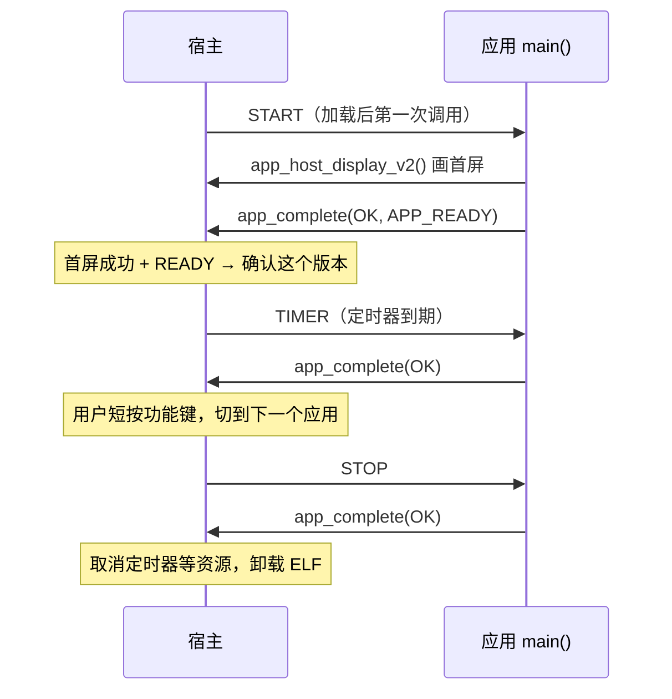

# 编写一个应用

这一页带你从零写一个相框应用，并把它装到设备上。读完你会知道：应用长什么样、怎么构建成 ELF、怎么打包成 `.pkg`、怎么用网页插件或命令行安装激活，以及出问题时去哪里看。

适合第一次写应用的开发者。你需要会写 C，大致知道 ESP-IDF 是什么。应用怎样被加载、A/B 槽怎样切换，原理在 [设备是怎么工作的](03-how-the-device-works.md)；所有接口的精确规则在 [应用接口参考](05-app-api-reference.md)。

## 应用是什么

相框上的**应用**是一个独立编译的 ELF 文件，由宿主固件在运行时加载。它和宿主共享同一块内存，不是独立进程，也没有自己的任务或线程。

应用是**事件驱动**的：宿主每发生一件和应用有关的事（启动、定时器到期、即将切走……），就调用一次应用的 `main()`。应用在 `main()` 里处理这一个事件，向宿主报告结果，然后返回。没有 `app_main()`，也没有永久循环。



有一点要先说清楚：**功能键不会传给应用**。平时短按功能键，宿主会给当前应用发 STOP、卸载它，再加载下一个应用并发 START。应用能感知到的只是“被切走”和“被切回来”。

## 准备环境

### 仓库

把下面两个仓库克隆成兄弟目录（同一个父目录下）：

| 仓库 | 用途 |
|---|---|
| `photopainter-host` | 宿主固件、SDK 原件（`sdk/`）、打包工具（`tools/module.py`） |
| `photoframe` | 相框应用和示例应用；`components/app_sdk/` 里有 SDK 副本和构建辅助脚本 |

安装到设备还需要 `ai-quota-frame`（命令行）或 CPM 网页插件，见 [电脑端、控制台与网页插件](07-clients.md)。

### 固定版本的 ESP-IDF

宿主和应用都必须用同一个 ESP-IDF 提交构建：

| 依赖 | 版本 | 在哪里固定 |
|---|---|---|
| ESP-IDF | v6.0.3，提交 `5e6f53cdb31fe5708eae3f55af9737be2822db22` | 各工程 `CMakeLists.txt` 开头会检查 `$IDF_PATH` 的提交，不一致直接报错 |
| `espressif/elf_loader` | 1.3.3（Component Registry，未修改） | `main/idf_component.yml` 写 `^1.3.3`，`dependencies.lock` 锁定 1.3.3 |

如果电脑上已经有别的 IDF 版本，单独 checkout 一份固定版本，不要改动原有的工具链。

```sh
. /path/to/esp-idf/export.sh
git -C "$IDF_PATH" rev-parse HEAD     # 应输出 5e6f53cd...
```

在 `photopainter-host` 里运行 `python3 tools/doctor.py` 可以检查开发环境。它默认不打开串口，不会让设备复位。

### SDK 头文件

应用只包含一个头文件 `photopainter_app.h`。它的原件在 `photopainter-host/sdk/`，`photoframe/components/app_sdk/` 里是内容完全相同的副本。改了一边就要同步另一边，可以这样检查：

```sh
# 在 photopainter-host 中
cmp sdk/photopainter_app.h ../photoframe/components/app_sdk/include/photopainter_app.h
cmp sdk/abi2_imports.inc   ../photoframe/components/app_sdk/abi2_imports.inc
```

## 现成的示例

`photoframe/examples/` 里有三个可以直接构建的示例，建议先读一遍：

| 示例 | 演示内容 | ABI |
|---|---|---|
| `lifecycle` | 不画屏；START 设 1 秒定时器，TIMER 计数并写缓存，STOP 取消定时器 | 2.0 |
| `color-test` | START 自己生成六色竖条并显示 | 2.0 |
| `ble-echo` | 注册一个自定义 GATT 服务，把写入的值回显到可读特征 | 2.1 |

默认的相框应用 `photoframe/main/entry.c` 是完整的大例子：PNG 解码、等待页、RAM 缓存恢复，以及 GATT、CoC、CHANNEL 三种收图方式（ABI 2.3）。

下面的教程以 `lifecycle` 的工程结构为蓝本，写一个会画屏的应用 `hello-frame`。

## 第一步：建工程目录

在 `photoframe/examples/` 下新建 `hello-frame`，结构如下：

```text
photoframe/examples/hello-frame/
├── CMakeLists.txt
└── main/
    ├── CMakeLists.txt
    ├── idf_component.yml
    └── entry.c
```

放在 `examples/` 下是为了直接用相对路径引用 `../../components/app_sdk` 和 `../../sdkconfig.app.defaults`。放到别处也可以，把这些路径改对即可。

顶层 `CMakeLists.txt`（照抄 `lifecycle`，改工程名）：

```cmake
cmake_minimum_required(VERSION 3.16)
execute_process(COMMAND git -C "$ENV{IDF_PATH}" rev-parse HEAD
    OUTPUT_VARIABLE IDF_REV OUTPUT_STRIP_TRAILING_WHITESPACE COMMAND_ERROR_IS_FATAL ANY)
if(NOT IDF_REV STREQUAL "5e6f53cdb31fe5708eae3f55af9737be2822db22")
    message(FATAL_ERROR "Use the stack's pinned ESP-IDF")
endif()
set(SDKCONFIG "${CMAKE_BINARY_DIR}/sdkconfig")
set(SDKCONFIG_DEFAULTS "${CMAKE_CURRENT_LIST_DIR}/../../sdkconfig.app.defaults")
set(EXTRA_COMPONENT_DIRS "${CMAKE_CURRENT_LIST_DIR}/../../components/app_sdk")
set(PHOTOFRAME_ABI "2")
include($ENV{IDF_PATH}/tools/cmake/project.cmake)
project(hello_frame)
if(NOT IDF_TARGET STREQUAL "esp32s3")
    message(FATAL_ERROR "This example only supports ESP32-S3 PhotoPainter")
endif()
set(ELF_COMPONENTS "")
include("${CMAKE_CURRENT_LIST_DIR}/../../components/app_sdk/app_elf.cmake")
include(elf_loader)
project_elf(hello_frame)
```

`project_elf()` 来自 elf_loader，它把工程链接成可加载的 ELF。`app_elf.cmake` 给 IDF 顺带生成的普通固件塞一个空的 `app_main`，那个固件只是构建副产品。

`main/CMakeLists.txt`：

```cmake
idf_component_register(SRCS "entry.c" REQUIRES app_sdk)
```

`main/idf_component.yml`：

```yaml
dependencies:
  idf: "==6.0.3"
  espressif/elf_loader: "^1.3.3"
```

如果从 `lifecycle` 复制目录，也一并复制 `dependencies.lock`，这样 elf_loader 会锁在 1.3.3。不要复制 `build*` 目录。

## 第二步：写应用代码

`hello-frame` 做四件事：

- **START**：画首屏（白底、黑边框、中间一个彩色方块），设一个 1 小时的定时器，报告 `APP_READY`。
- **TIMER**：换一种方块颜色重画，并把当前页号写进宿主缓存。切走再切回来时，START 从缓存恢复页号。
- **INPUT**：这个应用不接收 PNG，明确拒绝。
- **STOP**：取消定时器。

`main/entry.c`：

```c
/* SPDX-License-Identifier: MIT */
#include <stdlib.h>
#include <string.h>
#include "photopainter_app.h"

/* ID、显示名、输入能力（0 = 不收 PNG）、标志（需要首屏） */
APP_MANIFEST("hello-frame", "Hello frame", 0, APP_REQUIRES_DISPLAY);

#define STATE_VERSION 1u                 /* 缓存内容的格式版本 */
#define REDRAW_MS (60u * 60u * 1000u)    /* 1 小时 */

static uint32_t page;  /* 每次加载 ELF 都会重新初始化 */

static void draw(uint8_t *frame, uint32_t n) {
    static const uint8_t accents[] = {APP_RED, APP_YELLOW, APP_GREEN, APP_BLUE};
    uint8_t accent = accents[n % 4];
    memset(frame, APP_WHITE, APP_FRAME_BYTES);
    for (uint32_t y = 0; y < APP_FRAME_HEIGHT; y++) {
        for (uint32_t x = 0; x < APP_FRAME_WIDTH; x++) {
            int border = x < 16 || x >= APP_FRAME_WIDTH - 16 ||
                         y < 16 || y >= APP_FRAME_HEIGHT - 16;
            int block = x >= 300 && x < 500 && y >= 140 && y < 340;
            if (border) frame[y * APP_FRAME_WIDTH + x] = APP_BLACK;
            else if (block) frame[y * APP_FRAME_WIDTH + x] = accent;
        }
    }
}

static int32_t show(uint32_t n) {
    uint8_t *frame = malloc(APP_FRAME_BYTES);
    if (!frame) return APP_ERR_MEMORY;
    draw(frame, n);
    int32_t r = app_host_display_v2(frame, APP_FRAME_BYTES);
    free(frame);
    return r;
}

int main(int argc, char **argv) {
    (void)argc;
    (void)argv;
    const app_context_v2_t *c = app_host_context_v2();
    if (!c) return APP_ERR_RUNTIME;

    int32_t r = APP_OK;
    switch (c->event) {
    case APP_EVENT_START: {
        uint32_t bytes = 0;
        const uint8_t *saved = app_host_cache_get_v2(STATE_VERSION, &bytes);
        page = 0;
        if (saved && bytes == sizeof(page)) memcpy(&page, saved, sizeof(page));
        r = show(page);
        if (r == APP_OK) r = app_host_timer_v2(1, REDRAW_MS);
        break;
    }
    case APP_EVENT_TIMER:
        page++;
        r = show(page);
        if (r == APP_OK)
            (void)app_host_cache_put_v2(STATE_VERSION, (const uint8_t *)&page, sizeof(page));
        break;
    case APP_EVENT_INPUT:
        r = APP_ERR_UNSUPPORTED;
        break;
    case APP_EVENT_STOP:
        r = app_host_timer_v2(1, 0);
        break;
    default:
        break;
    }
    app_complete(c, r, c->event == APP_EVENT_START && r == APP_OK ? APP_READY : 0);
    return r;
}
```

逐段解释：

**清单（manifest）。** `APP_MANIFEST(...)` 在 ELF 里放一个 128 字节的只读段 `.app_manifest`，告诉宿主这个应用的 ID、名字、ABI 版本和能力。ID 只能用 1–31 个小写字母、数字、`_` 或 `-`，它就是安装、切换、删除时用的应用标识。`APP_REQUIRES_DISPLAY` 表示“START 必须成功画出首屏，这个版本才算启动成功”。`APP_MANIFEST` 声明 ABI 2.0；要用蓝牙服务时换成 `APP_MANIFEST_BLE`、`APP_MANIFEST_COC` 或 `APP_MANIFEST_CHANNEL`，见 [ABI 版本](05-app-api-reference.md#abi-版本)。

**取上下文。** `app_host_context_v2()` 返回本次事件的描述：事件类型 `event`、事件编号、加载代次、输入数据等。指针只在本次 `main()` 返回前有效。

**画屏。** 显示缓冲是 800×480 字节，每字节一个像素，从左上角开始逐行排列，取值 `APP_BLACK`(0)、`APP_WHITE`(1)、`APP_YELLOW`(2)、`APP_RED`(3)、`APP_BLUE`(4)、`APP_GREEN`(5)。应用只管按逻辑坐标画，旋转和面板编码由宿主完成。`app_host_display_v2()` 要等电子纸刷新完、面板断电后才返回，一次大约 20 秒。缓冲 384000 字节，`malloc` 会从 PSRAM 分配。

**报告结果。** 每个事件都必须**恰好调用一次** `app_complete()`。`main()` 的返回值宿主拿不到（elf_loader 1.3.3 不传递入口返回值），只有 `app_complete()` 报告的结果才算数。`APP_READY` 只能在 START 成功时带上。

**缓存。** `app_host_cache_put_v2()` 把数据复制到宿主内存，按应用 ID 隔离。切到别的应用再切回来，缓存通常还在；设备重启后就没了。`STATE_VERSION` 是你自己定义的内容格式号，以后改了存储格式就换个号，旧内容会自动作废。

**STOP。** 宿主在卸载前发 STOP。这里只需要取消定时器。如果应用在静态变量里留着 `malloc` 来的内存，要在 STOP 里释放：宿主会自动取消定时器、蓝牙注册等宿主管理的资源，但不会替你 `free`。STOP 里不能显示，也不能设新的定时器。STOP 要报告 `APP_OK`，否则这次切换会失败。

### 几条硬规则

- 一个事件的逻辑处理时间预算是 **5 秒**（显示调用期间宿主会临时放宽）。超时宿主会让设备重启。耗时的工作要拆到多个事件里做。
- 每个事件最多显示一次。
- 只能调用 SDK 允许导入的函数，清单在 `sdk/abi2_imports.inc`。比如 `snprintf`、`printf`、`strstr` 都不在里面，用了打包会失败。允许的 C 库函数见 [允许导入的函数](05-app-api-reference.md#允许导入的函数)。
- 不要创建 FreeRTOS 任务、注册回调或直接操作 GPIO/SPI/I²C。

## 第三步：构建 ELF

```sh
cd photoframe/examples/hello-frame
idf.py -B build-app -DIDF_TARGET=esp32s3 build
```

产物是 `build-app/hello_frame.app.elf`（文件名取自 `project_elf()` 的参数）。构建目录里还会出现普通的 `.bin` 固件，那是构建副产品，**不能刷进设备**。

## 第四步：打包成 .pkg

打包工具在宿主仓库里。它检查 ELF（必须是 Xtensa 的 ELF32 动态 ELF）、读取 manifest、核对导入函数都在允许清单内，再加上 4096 字节的包头：

```sh
cd photopainter-host
python3 tools/module.py package --version 1 \
  --input ../photoframe/examples/hello-frame/build-app/hello_frame.app.elf \
  --output /tmp/hello-frame-1.pkg
```

成功时输出一行 JSON，包含文件路径、字节数、版本和 SHA-256。

- `--version` 是你自己的发布号（32 位无符号整数，默认 1）。宿主不要求递增，但用清晰可区分的号码，看槽位时才分得清是哪一版。
- 有 manifest 的 ELF 会自动打成 ABI 2 包，应用 ID 取自 manifest。`--app` 可以省略；如果写了，必须和 manifest 里的 ID 一致。
- 包最大 1 MiB（含包头），也就是 ELF 最多 1 MiB − 4 KiB。

不连设备也可以先检查一个包：

```sh
ai-quota-frame ble inspect --file /tmp/hello-frame-1.pkg
```

## 第五步：装到设备上

安装分两步：**上传**把包写进这个应用的非当前槽（变成“待激活”），**激活**让宿主加载它、发 START、等首屏成功后确认这个版本。原先的版本变成可回退槽。槽位规则见 [应用槽与更新](03-how-the-device-works.md)。

相框同一时间只认一个主人（一台电脑的后台，或一个浏览器）。用哪个工具安装，取决于现在谁是主人；换主人要先长按功能键 8 秒重置配对，见 [蓝牙通信](06-bluetooth.md)。

### 方式一：网页插件的开发者工具

在 CPM 网页插件页面，相框卡片下方展开“开发者工具”：

1. 点 **读取槽位**，看每个应用 A/B 两个槽的版本和标记（当前、可回退、待激活、运行中）。
2. 点 **选择安装包**，选 `hello-frame-1.pkg`。页面会在本机先校验包格式、应用 ID、SHA-256 和 ELF 头，不合格不会上传。
3. 点 **上传并激活**。上传完成后宿主加载新应用，屏幕会刷出 `hello-frame` 的首屏。

只想上传、稍后再激活，就点“仅上传”，之后在应用下拉框里选它，点“激活待定版本”。同一面板还有“切换到此应用”“回滚”“删除此应用”。

### 方式二：`ai-quota-frame` 命令行

电脑是主人时用命令行。设备 ID 默认取本机保存的配对关系，也可以用 `--device-id 001122334455` 指定：

```sh
ai-quota-frame ble install  --file /tmp/hello-frame-1.pkg   # 上传到非当前槽
ai-quota-frame ble activate --app hello-frame               # 试运行并确认
ai-quota-frame ble status                                   # 查看状态 JSON
```

`install` 成功只代表包已经写进槽里，必须再执行 `activate`。`activate` 会等待 START 和首屏完成才返回。

之后可以用这些命令管理：

```sh
ai-quota-frame ble switch   --app photoframe    # 切到另一个已安装的应用
ai-quota-frame ble rollback --app hello-frame   # 回到可回退槽的版本
ai-quota-frame ble remove   --app hello-frame   # 删除（只能删不在运行的应用）
```

### 用功能键切换

装好之后，短按功能键会按顺序切到下一个“有已确认版本的 ABI 2 应用”。功能键不会激活待激活的版本；只装了一个应用时短按不会刷新。

## 第六步：更新

改完代码后，用新的 `--version` 重新构建、打包，然后再“上传并激活”一次。新版本写进另一个槽，激活成功后旧版本留作回退。

如果想让 A、B 两个槽都是新版本，就对同一个包做两次“上传并激活”。

## 调试

### 看状态

`ai-quota-frame ble status`（或开发者工具读到的状态）是一段 JSON。排查应用问题最有用的字段：

| 字段 | 含义 |
|---|---|
| `payload_abi` / `payload_abi_minor` | 当前加载的应用的 ABI，例如 2 和 0 |
| `runtime_ready` | 当前应用已经完成启动 |
| `confirmed` | 当前应用就绪，并且没有处在试运行中的版本 |
| `phase` | 宿主最近在做什么；`fault` 表示没有应用在运行 |
| `last_result` | 最近一次操作的结果码 |
| `display_completed` | 最近一个事件里是否真的完成了一次显示 |
| `generation` | 加载代次，每加载一次应用加 1 |
| `runtime_diagnostic` | 复位原因、上次和这次启动走到的阶段，以及启动保护的状态 |
| `cache_bytes` / `free_psram` | 缓存占用与剩余 PSRAM |
| `apps[]` | 每个已安装应用的 ID、槽位、版本、ABI 和能力 |

`runtime_diagnostic` 里的阶段名依次是 `slots`、`services`、`boot_guard`、`slot_read`、`elf_init`、`elf_relocate`、`app_start`、`confirm`、`ready`。如果上次停在 `app_start`，通常是 START 卡住或崩溃了。

### 看串口日志

应用可以用 `fprintf(stderr, ...)` 打日志（`fprintf`、`fputs`、`stderr` 在允许清单里），输出出现在设备的 USB 串口上。宿主每次加载成功会打印 `app_runtime: ready bank=... slot=... ABI=... version=...`。注意：打开 ESP32-S3 原生 USB 串口可能让设备复位，复位落在应用启动期间会触发启动保护。

### 在电脑上测试入口

不上设备也能测 `main()` 的逻辑：把 `entry.c` 用 `-Dmain=app_entry` 编成电脑上的目标文件，自己写几个假的 `app_host_*` 函数，然后依次构造 START、TIMER、STOP 的上下文去调用。`photoframe/examples/ble-echo/test_entry.c` 就是这样做的，`photoframe/tests/CMakeLists.txt` 里有对应的构建规则。

## 常见错误

| 现象 | 原因 | 处理 |
|---|---|---|
| CMake 报 `Use the stack's pinned ESP-IDF` | `$IDF_PATH` 不是固定的 IDF 提交 | 切到固定版本的 IDF 再 `export.sh` |
| 打包报 `invalid ELF section or ABI 2 manifest/import` | 用了允许清单外的函数；或用了蓝牙函数但 manifest 的 ABI 次版本不够；或 manifest 字段不合法 | 换掉不允许的函数；按用到的服务选对 manifest 宏；检查 ID 格式 |
| 打包报 `expected Xtensa ET_DYN app ELF` 或 `expected bounded ELF32` | 传的不是 `*.app.elf`（比如 `.bin`）或超过 1 MiB | 用 `build-app/<名字>.app.elf` |
| 打包报 `manifest and package app ID differ` | `--app` 和 manifest 里的 ID 不一样 | 去掉 `--app` 或改成一致 |
| 激活失败，设备回到原来的版本 | START 没报告 `APP_READY`；声明了 `APP_REQUIRES_DISPLAY` 但没成功显示；START 超过 5 秒（不含显示） | 检查 START 的每条失败路径都调用了 `app_complete`，首屏确实画了 |
| 应用运行一段时间后被卸载，`phase` 变成 `fault` | 某个事件结果是 `APP_ERR_RUNTIME`：返回了这个码、没调用或调用了两次 `app_complete`、`status` 不在 0 到 −9 之间（例如把 `APP_CHANNEL_AGAIN` 这类正数状态直接传了进去） | 每个分支恰好一次 `app_complete`，只传 `APP_OK`/`APP_ERR_*` |
| 从这个应用切走时失败，之后没有应用在运行 | STOP 报告了错误码 | STOP 里只做清理，始终报告 `APP_OK` |
| `app_host_display_v2` 返回 `APP_ERR_RUNTIME` | 同一个事件里第二次显示；在 STOP 里显示；配对重置正在进行 | 一个事件只显示一次 |
| `app_host_display_v2` 返回 `APP_ERR_COLOR` / `APP_ERR_ARGUMENT` | 有像素值大于 5 / 缓冲不是 384000 字节 | 只用六个颜色常量；用 `APP_FRAME_BYTES` |
| `app_host_timer_v2` 返回 `APP_ERR_ARGUMENT` | 间隔小于 1000 ms，或在 STOP 里设了非零间隔 | 间隔至少 1000 ms |
| `app_host_cache_put_v2` 返回 `APP_ERR_ARGUMENT` | 同一个事件里先调用了 `cache_get` | 在另一个事件里写缓存 |
| 设备反复重启或回退到旧版本 | 某个事件超过 5 秒没返回，看门狗让设备重启；如果发生在启动期间，启动保护会回退 | 缩短单个事件的工作量；回退规则见 [启动保护](03-how-the-device-works.md) |
| 短按功能键没反应 | 宿主正忙（传图、刷新、写包、切换中），或只有一个可切换的应用 | 等当前操作结束再按 |
| 新应用上传失败 | 设备上已经有 5 个应用 | 先 `remove` 一个不在运行的应用 |

已知的启动保护误判问题（断电或重启恰好落在启动窗口里也会回退）见 [版本与已知限制](09-versions-and-limits.md)。

## 下一步

- 想让手机或电脑和应用直接通信：看 [应用接口参考](05-app-api-reference.md) 里的 GATT、CoC 和 CHANNEL 服务，协议细节在 [蓝牙通信](06-bluetooth.md)。可以从 `examples/ble-echo` 起步。
- 想接收图片：参考 `photoframe/main/entry.c` 和 `main/ble_image.c`，它们用同一个事务核心同时支持三种传输方式。
