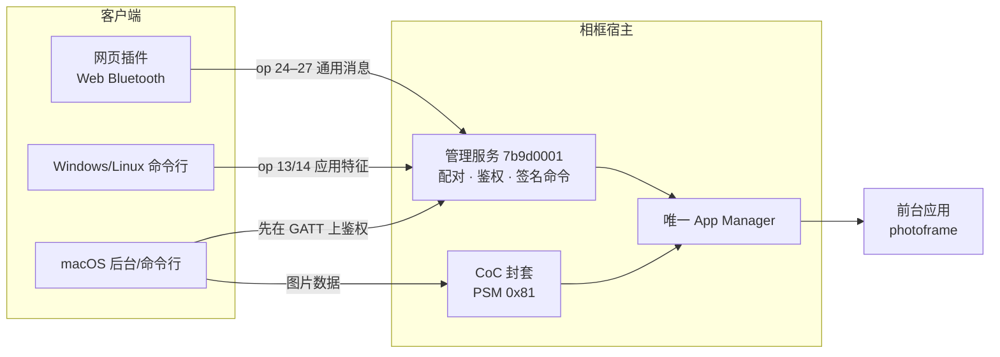
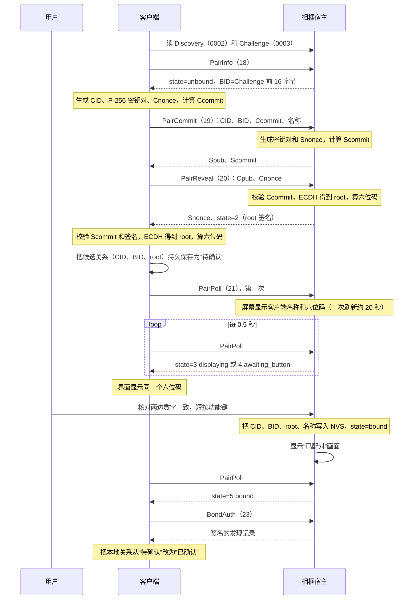
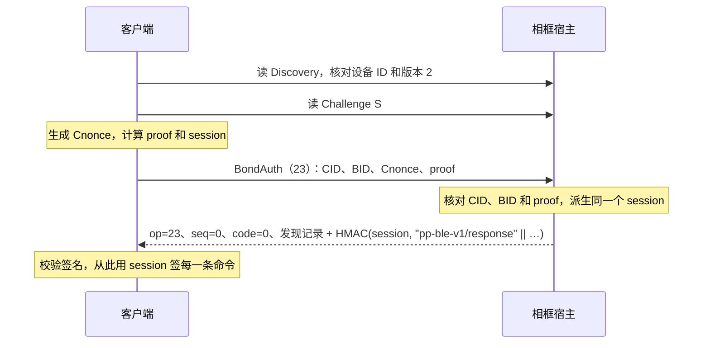
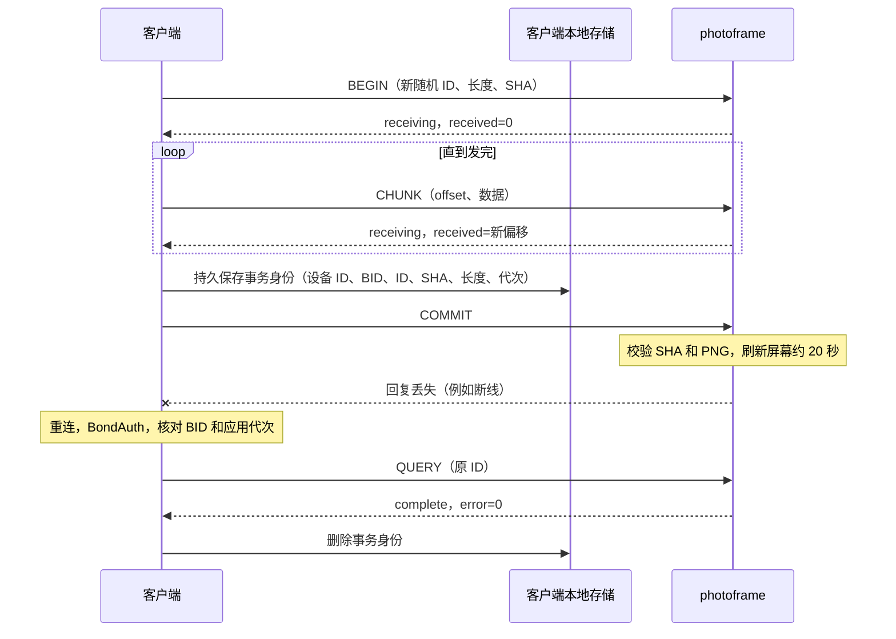

# 蓝牙通信

相框和电脑、手机之间的所有通信都走低功耗蓝牙（BLE）：配对、查看状态、安装和切换应用、推送图片。这一页讲这些通信在协议层面是怎么工作的：相框上有哪些蓝牙服务，怎样发现和配对，签名请求长什么样，管理命令有哪些，图片怎样可靠地送到屏幕上，以及应用想和客户端说话时有哪三种方式可选。

适合读者：要写或调试客户端（命令行、网页插件、控制台）的开发者，以及想让自己的应用通过蓝牙收发数据的应用开发者。应用侧的 C 接口细节见 [应用接口参考](05-app-api-reference.md)；配对的日常操作步骤见 [上手使用](02-getting-started.md)。

文中所有多字节整数都是小端序（little endian）。HMAC 指 HMAC-SHA256，标签都是完整的 32 字节。字符串域名（例如 `pp-ble-v1/request`）按 ASCII 拼接，不带结尾的 NUL。

## 1. 全景

相框只做蓝牙外设（peripheral），同一时间只接受一个连接。蓝牙由**宿主**（常驻固件）负责，不依赖 Wi-Fi，也不依赖有没有应用在运行。宿主在上面挂了几样东西：

| 组成 | 归属 | 作用 | 谁在用 |
|---|---|---|---|
| 管理服务 `7b9d0001-…` | 宿主，常驻 | 发现信息、配对、鉴权、签名命令（状态、安装/激活/切换/回滚/删除应用、应用消息） | 所有客户端 |
| 应用自定义 GATT 服务（ABI 2.1） | 当前前台应用 | 应用自己定义的服务和最多 4 个特征 | photoframe 的图片服务 `a4fe2000-…`；Windows/Linux 原生客户端用它推图 |
| L2CAP CoC 通道（ABI 2.2） | 当前前台应用独占，宿主负责加密封套 | 大块双向数据流，PSM `0x81` | macOS 原生客户端用它推图 |
| 通用消息通道（ABI 2.3） | 当前前台应用，宿主经管理服务转发 | 4 KiB 逻辑消息的一问一答 | 网页插件（Web Bluetooth）用它推图 |



几条贯穿全页的原则：

- **鉴权在宿主。** 配对密钥只存在宿主和客户端里，应用拿不到。应用收到的每一条蓝牙数据都已经通过宿主的签名检查。
- **所有执行都经过唯一的 App Manager。** 蓝牙回调只复制数据；加载应用、写 Flash、调用应用代码、刷新屏幕都由 App Manager 串行执行。蓝牙命令和按键、定时器、其他上传共用同一把“准入锁”，所以会出现“设备忙”（错误码 3）。
- **签名保证身份和完整性，不保证保密。** 图片、安装包、状态在空中是明文，旁边的人能看到内容，但改不了、也冒充不了。

术语（宿主、应用、ABI、槽位等）见 [术语表](10-glossary.md)。

## 2. 广播与发现

相框每 200–300 毫秒广播一次：

- **广播数据**：标志 `0x06`、完整的 128 位服务 UUID `7b9d0001-6c82-4f31-9a48-6f5061696e74`、设备名 `PP-XXXX`。`XXXX` 是设备 ID 的最后四个十六进制数字（大写），例如设备 ID `001122334455` 的广播名是 `PP-4455`。
- **扫描响应**：厂商数据，公司 ID `0xffff`（开发用标识，不是蓝牙联盟分配的），后面跟 20 字节的发现记录。

同样的 20 字节记录也可以在连接后从特征 `7b9d0002` 读到。

| 偏移 | 字节 | 含义 |
|---:|---:|---|
| 0 | 1 | 协议版本，配对 v2 固件为 `2` |
| 1 | 1 | Wi-Fi 状态：0 离线、1 连接中、2 已获得 IPv4、3 Wi-Fi 配置无效 |
| 2 | 6 | 设备 ID：出厂 Wi-Fi 网卡 MAC，显示成 12 位十六进制，例如 `001122334455` |
| 8 | 4 | IPv4 地址（网络字节序），只有状态为 2 时非零 |
| 12 | 8 | SSID 的 SHA-256 前 8 字节，状态为 1 或 2 时非零 |

Wi-Fi 状态变化时，记录会立即更新；连接期间广播暂停，断开后用最新记录恢复广播。

记录里只有公开信息，没有 SSID 明文、密码或任何凭据。它是未签名的，客户端只拿它来**选设备**；真正确认“是这台相框”要等鉴权成功后，从签名回复里再拿一次记录核对。设备 ID 固定不变，意味着附近的人可以通过广播长期识别同一台相框，这是为了方便发现而做的取舍。

## 3. 管理服务的特征

UUID 都以 `-6c82-4f31-9a48-6f5061696e74` 结尾：

| UUID 前缀 | 名称 | 访问 | 内容 |
|---|---|---|---|
| `7b9d0002` | Discovery | 读，公开 | 20 字节发现记录 |
| `7b9d0003` | Challenge | 读 | 本次连接的 32 字节随机数，每次新连接都重新生成 |
| `7b9d0004` | Request | 写（Write Request 和 Write Command 都支持） | 分片写入请求帧 |
| `7b9d0005` | Response | 读（支持长读） | 最近一次请求的完整回复，最多 512 字节 |
| `7b9d0006` | 写入容量 | 读 | 3 字节：`version:u8=1, write_capacity:u16` |
| `7b9d0007` | 消息能力 | 读 | 6 字节：`version:u8=1, request_max:u16=4096, response_max:u16=512, flags:u8=1` |

### 分片写入

一个请求帧（逻辑帧）可能比一次 ATT 写入大，所以每次写 `7b9d0004` 都带 4 字节分片头：

```
offset:u16 | total:u16 | 至少 1 字节帧数据
```

- 单次写入（含 4 字节头）最多 `write_capacity` 字节，即 `min(512, ATT_MTU - 3)`。MTU 247 时每片能放 240 字节帧数据；最小 MTU 23 时是 16 字节。客户端每次连接都应先读 `7b9d0006`。
- 逻辑帧一般最多 512 字节。只有 op 26（通用消息交换）可以用到 4096 字节，前提是 `7b9d0007` 存在。
- 完全相同的重复分片会被接受；空洞、冲突的重叠、越界会得到 ATT 错误。
- `flags` 第 0 位为 1 表示可以用 Write Command（无应答写）发分片。网页插件发大消息时，前面的分片用 Write Command，最后一片用 Write Request，相当于给整条消息加了一道“对方已收到”的栅栏。

### 读取回复

写完最后一片后，反复读 `7b9d0005`：

- 读到**单个 `0x00` 字节**表示设备还在处理，等一会儿再读（客户端用 25 毫秒间隔）。这个字节只表示“还没好”，成功与否要看完整回复。
- 读到更长的内容就是完整回复。回复在下一个请求完成前保持不变。

同一时间只能有一个请求在途：必须读到回复后才能发下一个。

## 4. 配对 v2

配对解决的问题是：**相框怎么确认对面的客户端是主人同意过的那一个。** 方案是一次性的“当面确认”加长期保存的共享密钥：

1. 客户端和相框用椭圆曲线密钥交换（ECDH，P-256）算出一个只有双方知道的根密钥 `root`。
2. 双方从同一份通信记录算出一个六位数字，相框显示在屏幕上，客户端显示在电脑或手机上。
3. 用户核对两边数字一致后，短按相框的**功能键**（GPIO4）批准。相框把这段关系存进 NVS（设备上的非易失存储）。
4. 以后每次连接，客户端用 `root` 证明身份（BondAuth），不需要再按键。

六位码的作用是防中间人：如果有人在中间分别和两边做了密钥交换，两边算出的数字会不一样。

### 一个主人

相框同一时间**只认一个主人**。“主人”是一个保存了关系的客户端实例：电脑上的 `ai-quota-frame` 后台算一个，某个浏览器里的网页插件算一个，同一台电脑上的两个浏览器算两个。

- 已有主人时，新的配对请求会被拒绝（错误码 8），没有任何远程命令能替换或清除主人。
- 换主人：在相框上**按住功能键至少 8 秒再松开**。相框立即撤销当前连接的授权，等正在进行的刷新结束后清除配对关系，屏幕显示“可以配对”。之后新客户端才能配对。
- 长按重置只清除配对关系，不清除 Wi-Fi 配置、已安装的应用和最后一张画面的缓存。它也不是出厂重置。

### 编码约定

| 符号 | 含义 |
|---|---|
| `V` | 协议版本字节 `0x02` |
| `D` | 6 字节设备 ID |
| `CID` | 客户端身份，16 字节随机非零值，由客户端生成 |
| `BID` | 关系身份，16 字节，**等于本次连接 Challenge 的前 16 字节**（由相框提出，客户端不能自选） |
| `Cpub` / `Spub` | 客户端 / 相框的 P-256 公钥，65 字节未压缩格式，以 `0x04` 开头 |
| `Cnonce` / `Snonce` | 32 字节随机数 |
| `N`、`L` | 客户端名称（1–32 个可打印 ASCII 字符，首尾不能是空格）及其长度字节 |

配对和 BondAuth 命令都是“裸”请求：`op` 后面直接跟参数，不带序号和签名。回复以 7 字节头开头：`op:u8 | sequence:u32=0 | code:u16`。

### 配对命令

| op | 名称 | 请求（op 之后） | 成功回复（7 字节头之后） | 签名 |
|---:|---|---|---|---|
| 18 | PairInfo | 空 | `2, state, BID:16, CID:16, remaining_ms:u32, L, N` | 无 |
| 19 | PairCommit | `CID:16, BID:16, Ccommit:32, L, N` | `2, BID:16, Spub:65, Scommit:32` | 无 |
| 20 | PairReveal | `BID:16, Cpub:65, Cnonce:32` | `2, BID:16, Snonce:32, state, remaining_ms:u32, Challenge:32` | `root` |
| 21 | PairPoll | `BID:16, proof:32` | `2, BID:16, state, remaining_ms:u32, Challenge:32` | `root` |
| 22 | PairCancel | `BID:16, proof:32` | 同 PairPoll | `root` |
| 23 | BondAuth | `CID:16, BID:16, Cnonce:32, proof:32` | 20 字节发现记录 | 会话密钥 |

PairInfo 是公开信息，只能用来判断“这台相框现在是什么状态”，不能当作配对成功的证据。没有主人也没有候选时，它返回的 BID 就是 Challenge 前 16 字节，CID 和名称为空。

配对状态 `state`：

| 值 | 名称 | 含义 |
|---:|---|---|
| 0 | unbound | 没有主人，可以配对 |
| 1 | waiting_reveal | 收到 PairCommit，等客户端揭示公钥 |
| 2 | waiting_client_ready | 双方都算出了六位码，等客户端保存好候选关系后发第一次 PairPoll |
| 3 | displaying | 屏幕正在刷新配对画面 |
| 4 | awaiting_button | 画面已刷完，等用户短按功能键 |
| 5 | bound | 已有主人 |
| 6 | cancelled | 本次配对已取消 |
| 7 | expired | 本次配对超时 |
| 8 | fault | 存储故障，需要长按重置 |

### 承诺、密钥与六位码

双方先“承诺”自己的公钥和随机数，再揭示，谁都没法在看到对方的值之后再调整自己的值：

```
Ccommit = SHA256("pp-pair-v2/client-commit" || V || D || CID || BID || Cpub || Cnonce || L || N)
Scommit = SHA256("pp-pair-v2/server-commit" || V || D || CID || BID || Ccommit || Spub || Snonce || L || N)
T       = V || D || CID || BID || Ccommit || Scommit || Cpub || Cnonce || Spub || Snonce || L || N
Z       = P256-ECDH(自己的私钥, 对方公钥)          // 32 字节 x 坐标
salt    = SHA256("pp-pair-v2/salt" || T)
root    = HKDF-SHA256(ikm=Z, salt=salt, info="pp-pair-v2/bond", 32 字节)
code    = LE32(HMAC(root, "pp-pair-v2/code" || T)[0:4]) mod 1000000   // 显示为 6 位，保留前导零
```

带 `root` 签名的回复，在回复末尾追加 `HMAC(root, "pp-pair-v2/response" || 回复头和负载)`。PairPoll / PairCancel 的证明是：

```
proof = HMAC(root, domain || V || D || CID || BID || 当前连接的 Challenge)
domain = "pp-pair-v2/poll" 或 "pp-pair-v2/cancel"
```

证明和回复都绑定当前连接的 Challenge，所以录下来的旧回复没法在新连接上重放。

### 完整流程



几个关键点：

- **先保存，再亮屏。** 客户端必须在第一次 PairPoll 之前把候选关系存好。相框只有收到有效的 PairPoll 证明后才显示六位码，所以“用户按了键但客户端没存下密钥”的情况不会发生。
- **只有短按有效。** 按下和松开都必须发生在 `awaiting_button` 状态内，按住 50–600 毫秒。画面还在刷新时按键不算。
- **写入成功才算批准。** NVS 写入失败时状态变成 fault，客户端不会被认可。
- **批准回复丢了也没关系。** 主人关系已经持久保存，客户端重连后直接 BondAuth 就能证明。
- **取消。** 客户端可以用 PairCancel 取消自己的候选（需要 `root` 证明）。如果取消和用户按键撞在一起、按键先生效，PairCancel 会返回 8，客户端应再试一次 BondAuth 确认关系。

时间限制：

| 阶段 | 限制 |
|---|---|
| waiting_reveal、waiting_client_ready | 各 30 秒 |
| 刷新配对画面（displaying） | 最多 650 秒（显示预算） |
| 等待按键（awaiting_button） | 画面刷完后 120 秒 |
| 两次不同的配对之间 | 至少间隔 60 秒 |
| 网页插件整个配对流程 | 15 分钟 |

同一时间只有一个候选。连接中途断开时，客户端可以在有效期内用同一个 BID 和 `root` 证明继续。相框重启会丢掉还没批准的候选。一个 BID 用过之后（取消或过期）不能再用，新配对需要重新连接拿新的 Challenge。

### 重连鉴权（BondAuth）

已配对的客户端每次连接都这样鉴权，`S` 是本次连接的 Challenge：

```
A       = V || D || CID || BID || S || Cnonce
proof   = HMAC(root, "pp-bond-v2/client"  || A)
session = HMAC(root, "pp-bond-v2/session" || A)
```



每个 Challenge 只允许一次鉴权尝试，格式错误也算一次。失败后要断开重连拿新 Challenge。

客户端保存关系的方式：网页插件把 `root` 存成浏览器里不可导出的 `CryptoKey`（IndexedDB）；电脑端存在私有文件里，并用每台设备一把的跨进程锁防止并发。

旧固件的固定令牌鉴权（op 1）在配对 v2 固件上总是被拒绝。旧的 HTTP 控制接口全部返回 410，只有 `/health` 返回 `{"device":"PhotoPainter","protocol":2,"transport":"paired-ble"}`。


## 5. 会话与签名请求

BondAuth 成功后得到 32 字节会话密钥 `K`。之后的每条命令：

```
请求：op:u8 | sequence:u32 | payload | HMAC(K, "pp-ble-v1/request"  || 前面所有字节)
回复：op:u8 | sequence:u32 | code:u16 | payload | HMAC(K, "pp-ble-v1/response" || 前面所有字节)
```

- 序号从 1 开始，每条命令加 1，不能回绕。回复带回同一个序号。
- 普通命令的帧最多 512 字节，所以负载最多 475 字节（512 − 1 − 4 − 32）。op 26 的帧最多 4096 字节。
- 宿主对格式错误、未鉴权、过期的请求可能返回**未签名的 7 字节错误**。未签名回复永远不能当作成功或身份证明。
- 签名或序号校验失败、传输出错时，客户端应结束会话并断开。不要在新连接上重发旧的签名命令；不确定某个操作是否已生效时，先查状态。

会话有效期：60 秒内没有有效命令就过期，总时长最多 2 小时。正在执行的长操作（例如刷屏）期间不计空闲时间。断开连接会丢弃鉴权状态和已收到一半的安装包。

### 错误码

| 代码 | 含义 |
|---:|---|
| 0 | 成功 |
| 1 | 未授权：签名、序号或鉴权尝试无效 |
| 2 | 没有配对关系 |
| 3 | 设备忙：按键、定时器/网络事件或另一个上传占着准入锁，稍后重试 |
| 4 | 请求无效：长度、ID 或 op 不支持 |
| 5 | 偏移不对：有空洞或冲突的重复数据 |
| 6 | 整包 SHA-256 不匹配 |
| 7 | 内存不足 |
| 8 | 状态冲突：目录或传输状态不允许，或应用不存在 |
| 9 | 安装包被安装器拒绝 |
| 10 | 存储或应用操作失败 |
| 11 | 会话过期 |
| 12 | PNG 无效（在接触屏幕之前就被拒绝） |
| 13 | 物理显示失败 |
| 14 | 图片请求属于相框的上一次开机 |

客户端遇到 3 时短暂等待后重试（网页插件间隔 50 毫秒）。

## 6. 管理命令

以下命令都需要先 BondAuth，并按上一节格式签名。应用 ID 统一编码为 32 字节：1–31 个小写字母、数字、`_` 或 `-`，后面用 NUL 补齐。

| op | 命令 | 请求负载 | 成功回复负载 |
|---:|---|---|---|
| 2 | Discovery（签名版） | 空 | 20 字节发现记录 |
| 3 | 状态 | `offset:u32` | `total:u32, offset:u32, JSON 片段`（每页最多 400 字节） |
| 4 | 开始上传应用包 | `size:u32, sha256:32, app_id:32` | 已收到的偏移 `u32` |
| 5 | 上传数据块 | `offset:u32, data` | 已收到的偏移 `u32` |
| 6 | 提交 | 空 | 空 |
| 7 | 放弃上传 | 空 | 空 |
| 8 | 上传进度 | 空 | `received:u32, total:u32` |
| 9 | 激活待定版本（ACTIVATE） | `app_id:32` | 空 |
| 10 | 切换到该应用（SWITCH） | `app_id:32` | 空 |
| 11 | 回滚（ROLLBACK） | `app_id:32` | 空 |
| 12 | 删除应用（REMOVE） | `app_id:32` | 空 |
| 13 | 读应用特征（ABI 2.1） | `generation:u32, revision:u32, index:u32` | 特征值，最多 128 字节 |
| 14 | 写应用特征（ABI 2.1） | 同样 12 字节定位，后跟 0–128 字节值 | 空（应用处理完写入事件后才回复） |
| 15–17 | 宿主图片命令 | 见下文“宿主自带的图片命令” | |
| 24–27 | 通用消息（ABI 2.3） | 见第 8 节 | |

### 状态分页读取

状态是一段 JSON。`offset=0` 时宿主把当前状态冻结成一份快照，后续页都读同一份快照，所以分页期间状态变化不会让内容错位。客户端从 0 开始，每次用已拼好的长度作为下一页的 `offset`，直到拼够 `total` 字节。

JSON 里常用的字段：

| 字段 | 含义 |
|---|---|
| `apps[]` | 每个已安装应用：`id`、`bank`（0–4）、`active`/`previous`/`pending`/`trial` 槽号、`versions`（A/B 两槽的版本号，空槽为 null）、`abi`、`name` |
| `loaded_app`、`runtime_ready`、`phase`、`last_result` | 当前加载的应用编号、是否启动完成、阶段和最近结果 |
| `generation` | 当前应用的运行代次，每次加载应用都变 |
| `payload_abi`、`payload_abi_minor` | 当前应用声明的 ABI 版本，例如 2 和 3 表示 2.3 |
| `ble_service_uuid`、`ble_service_revision`、`ble_characteristics` | 当前应用的 GATT 服务（ABI 2.1） |
| `coc_version`、`coc_psm`、`coc_state` | 当前应用的 CoC 通道（ABI 2.2） |
| `uptime_ms`、`reset_reason` | 开机时长和上次复位原因，用来区分“蓝牙断了”和“设备重启了” |
| `free_psram`、`free_internal_ram` 等 | 内存情况 |

### 安装和管理应用

应用目录和 A/B 槽的机制见 [设备是怎么工作的](03-how-the-device-works.md)。从蓝牙角度看，安装一个应用是这样的：

1. **开始（op 4）**：给出整包长度（4148 到 1048576 字节）、整包 SHA-256 和应用 ID。宿主拿到准入锁，在 PSRAM 里分配缓冲。重复发送参数完全相同的开始命令，会返回当前已收到的偏移。
2. **数据块（op 5）**：从已收到的位置往后追加。完全落在已收范围内、内容一致的重复块会被接受。
3. **提交（op 6）**：校验整包 SHA-256，再交给安装器检查载荷 SHA、ELF、清单、导入表和 ABI。通过后写入该应用的**非当前槽**，成为 `pending`。提交只暂存，不会激活。
4. **激活（op 9）**：让 `pending` 版本进入试运行。启动成功才确认，原来的 active 变成 previous。

上传期间一直占着准入锁，所以期间按键和其他命令会得到“忙”。断开连接会丢掉已收到的部分，重连后要整包重传。

其他管理命令：

- **SWITCH（op 10）**：把前台切到该应用已确认的版本。
- **ROLLBACK（op 11）**：把该应用切回 previous 槽。
- **REMOVE（op 12）**：删除一个应用，只能删当前没在运行的应用。

宿主没有“激活指定槽”或“擦除指定槽”的命令。激活这类操作的结果如果不确定，先读状态再决定下一步。

### 宿主自带的图片命令

op 15 `IMAGE_CAPS`、16 `IMAGE_BEGIN`、17 `IMAGE_RESULT` 是宿主自带的一条 PNG 显示路径，复用 op 5/7/8/6 传数据。它保留用于兼容和回归测试，现有客户端都不用它推图；推图走下一节的 photoframe 图片事务。

## 7. 图片事务

推图由前台应用 **photoframe** 负责：它拥有 PNG 缓冲、SHA-256 计算、接收状态和完成回执；宿主只提供鉴权、调度和同步显示。一套纯 C 的事务核心（`photoframe/main/image_transfer.c`）被三种承载方式共用，命令和回执格式完全一样，区别只在怎么把字节送过去。

### 命令

每条命令：`version:u8=1 | opcode:u8 | request_id:16 | tail`。`request_id` 是客户端为**每一次推图意图**生成的随机非零 128 位值。同一张图片推两次就是两个不同的 ID。

| opcode | 命令 | tail | 作用 |
|---:|---|---|---|
| 1 | BEGIN | `png_size:u32, sha256:32` | 开始接收，申请缓冲 |
| 2 | CHUNK | `offset:u32, data` | 追加数据 |
| 3 | COMMIT | 空 | 校验并显示 |
| 4 | CANCEL | 空 | 取消还没提交的接收 |
| 5 | QUERY | 空 | 查询这个 ID 的接收进度或完成回执 |

规则：

- PNG 长度 8 字节到 5 MiB。最终必须是 800×480、非隔行、每个像素完全不透明、只用精确的黑白红黄绿蓝六种颜色。
- 同一时间只接收一张图。另一个 ID 的 BEGIN 返回“忙”。同一 ID、同样长度和摘要的 BEGIN 返回已有进度或已有结果；同一 ID 但长度或摘要不同会被拒绝。
- CHUNK 必须从已收到的位置往后接。内容一致的重复块可以接受；空块、空洞、部分重叠、冲突重复都会被拒绝，已收到的字节不会被改动。
- 60 秒没有新的 BEGIN 或 CHUNK，接收会被取消（timeout）。QUERY 不会延长这个期限。
- COMMIT 要求收齐且 SHA-256 匹配，然后完整解码、检查颜色，最后调用宿主的显示接口。显示接口在电子纸刷新完成并断电（POWER_OFF）后才返回，一次刷新大约 20 秒。
- 重复 COMMIT 只会返回原来的结果，不会再刷一次。

### 64 字节回执

每条命令的结果都是一份 64 字节回执：

| 偏移 | 字节 | 字段 |
|---:|---:|---|
| 0 | 4 | ASCII `PFI1` |
| 4 | 1 | state |
| 5 | 1 | 本次回复对应的 opcode |
| 6 | 2 | error |
| 8 | 16 | request ID |
| 24 | 4 | PNG 总长度 |
| 28 | 4 | 已接收长度 |
| 32 | 32 | PNG SHA-256 |

| state | 含义 | | error | 含义 |
|---:|---|---|---:|---|
| 0 | idle | | 0 | OK |
| 1 | receiving 接收中 | | 1 | 命令无效 |
| 2 | processing 正在解码和刷新 | | 2 | 忙 |
| 3 | complete 完成 | | 3 | 偏移不对 |
| 4 | failed 失败 | | 4 | 冲突 |
| 5 | canceled 已取消 | | 5 | 内存不足 |
| 6 | missing 找不到这个 ID | | 6 | SHA 不匹配 |
| 7 | rejected 本条命令被拒绝 | | 7 | PNG 无效 |
| | | | 8 | 显示失败 |
| | | | 9 | 超时 |
| | | | 10 | 连接断开 |

**只有 state=3、error=0、ID/长度/摘要与请求完全一致、已接收长度等于总长度的回执，才证明这张图已经刷到屏幕上。** 签名命令本身成功只说明应用处理了这条命令。`rejected` 表示这一条命令被拒绝，正在接收的那张图不受影响；`missing` 只带回查询的 ID，其他字段为零。

应用协议的错误放在回执里返回，蓝牙命令本身仍然是成功的，坏输入不会导致应用被卸载。宿主层面的错误（鉴权、代次、准入）仍用第 5 节的错误码。

photoframe 在内存里保留最近 4 份完成回执，跨连接有效；应用被切走、停止或相框重启后回执就没了。

### 为什么不能重发

推图最难的情况是：COMMIT 已经发出去，回复却丢了（比如蓝牙恰好断开）。此时客户端不知道图片有没有刷上去。如果换个 ID 重发，屏幕可能被刷两次，或者把一张更旧的图刷上去覆盖新的。所以客户端遵守这几条：



1. **先保存，再提交。** COMMIT 发出之前，把事务身份（设备 ID、配对 BID、请求 ID、SHA、长度、应用代次）持久保存。
2. **回执丢了只查询，绝不重发。** 重连后先核对设备 ID、配对 BID、应用代次和服务版本都没变，再用原 ID 发 QUERY。看到 `processing` 就隔一会儿再查（网页插件每 2 秒一次）。
3. **结果不确定就停下来。** 回执显示 missing、元数据对不上、相框重启过、应用被切走或配对关系变了，都意味着结果无法确认。客户端停止对这张图的自动重试，交给人去看屏幕。
4. **COMMIT 之前断开可以重来。** 这时图片肯定还没显示，相框会取消接收。用新的随机 ID 整张重传即可。

网页插件把事务身份存在 IndexedDB 里，浏览器关掉再打开也能接着查询。电脑端（Go）的事务身份保存在进程内存里，同一个后台进程的生命周期内遵守同样的规则，进程重启后无法再查询，见[版本与已知限制](09-versions-and-limits.md)。

### 三种承载方式

| | ABI 2.3 GATT 大消息 | ABI 2.2 CoC | 旧 GATT 小消息（ABI 2.1） |
|---|---|---|---|
| 怎么送 | 管理服务 op 26，每条消息一次往返直接拿回执 | L2CAP CoC 通道，宿主加封套 | op 14 写应用特征，再 op 13 读回执 |
| 每条消息最多带图片字节 | 4025 | 4036 | 106 |
| CHUNK 的回执 | 每条一份，确认累计偏移 | 不逐条回复，靠 CoC 流控背压；出错的块会在 COMMIT/QUERY 时体现 | 每条一份 |
| 大约速度 | 手机网页约 8 KiB/s，66 KiB 约 8 秒 | 约 25 KiB/s | 手机网页约 0.24 KiB/s，66 KiB 要 4–5 分钟 |
| 谁在用 | 网页插件（photoframe 为 ABI 2.3 时自动使用） | macOS 原生后台和命令行 | Windows/Linux 原生客户端；网页插件遇到 ABI 低于 2.3 的 photoframe 时 |

以上速度只是传输阶段，不含连接、鉴权和约 20 秒的刷新。

几条共同的约束：

- 同一时间只能有一个入口在接收图片。一张图正在通过某个通道接收时，其他通道或其他会话发来的命令会得到 `rejected` + 忙。
- 承载通道断开时，photoframe 取消该通道上还没提交的接收，但保留已有的完成回执。COMMIT 已经进入显示时，断开不会打断显示。
- 跨通道接着传（比如 GATT 传了一半换 CoC 继续）不支持。

**ABI 2.3 GATT 大消息。** 客户端读 `7b9d0007` 确认支持 4096 字节逻辑帧，从状态里看到 `payload_abi_minor >= 3`，然后发 CHANNEL_INFO（24）核对服务 ID 和代次、CHANNEL_OPEN（25）拿到 session，再用 CHANNEL_EXCHANGE（26）逐条发送图片命令。每条 op 26 的回复负载就是 64 字节回执。

**ABI 2.2 CoC。** 客户端先在 GATT 上 BondAuth，从状态里读 `coc_version=1` 和 `coc_psm`，然后在同一个连接上打开 CoC。相框先发一条 82 字节的 hello（含应用代次、session、双方最大记录长度、随机数和用会话密钥算的 HMAC），双方据此派生两个方向的密钥。之后每条记录是 `length:u16 | sequence:u32 | payload | tag:32`，记录 payload 里放的是同样的图片命令。只有 BEGIN、COMMIT、CANCEL、QUERY 会回一份回执。

**旧 GATT 小消息。** photoframe 注册了自定义服务 `a4fe2000-1536-4c88-a2ce-32ecdaac0471`：特征 0（`a4fe2001`，可写，最多 128 字节）收命令，特征 1（`a4fe2002`，可读，64 字节）放回执。客户端用签名的 op 14 写命令、op 13 读回执，每 106 字节图片要两次往返，所以很慢。客户端要先从状态核对 `ble_service_uuid`、`generation` 和 `ble_service_revision`，并把它们带进 op 13/14。直接用 GATT 读这个特征也能读到回执，但那不带签名，不能当作完成证据。

## 8. 应用通信的三种方式

应用想和客户端交换数据时，宿主提供三种接口。都只对**当前前台应用**有效，应用切走或停止时宿主会撤销它的服务并丢弃排队数据。

| | ABI 2.1：自定义 GATT 服务 | ABI 2.2：CoC 通道 | ABI 2.3：通用消息 |
|---|---|---|---|
| 清单宏 | `APP_MANIFEST_BLE` | `APP_MANIFEST_COC` | `APP_MANIFEST_CHANNEL` |
| 事件 | `APP_EVENT_BLE`（6） | `APP_EVENT_COC`（7） | `APP_EVENT_CHANNEL`（8） |
| 应用看到的东西 | 一个 128 位服务 UUID，最多 4 个特征（读/写/通知），每个值最多 128 字节 | 一条有序记录流，PSM `0x81`，单条记录最多 4096 字节，应用负载最多 4058 字节 | 一个逻辑服务 ID，完整消息最多 4096 字节（经 GATT 实际最多 4047），每条回复最多 256 字节 |
| 交互模型 | 客户端签名写入（op 14）触发事件；客户端签名读取（op 13）取值 | 双向流，应用自己定协议 | 一问一答：客户端发一条消息，应用回一条 |
| 鉴权 | 宿主签名命令；直接 GATT 读和通知需已鉴权但不带签名 | 宿主用会话密钥派生 CoC 方向密钥，每条记录带 HMAC | 宿主签名命令 |
| 吞吐 | 低，每 128 字节一次往返 | 高，约 25 KiB/s | 中，手机网页约 8 KiB/s |
| 支持的客户端 | 所有：网页、macOS、Windows、Linux | 只有 macOS 原生客户端 | 网页插件（Go 原生客户端不使用这条通道） |
| 应用知道传输细节吗 | 知道 UUID 和值大小 | 知道 PSM、记录长度、流控 | 不知道，看不到 MTU、UUID、PSM |

怎么选：

- **控制类小数据**（几个开关、一段状态），用 **2.1**。所有客户端都支持，接口最简单。
- **传大文件且要照顾网页和所有平台**，用 **2.3**。它和传输方式无关，以后宿主加别的承载方式，应用代码不用改。
- **Mac 上追求最快速度**，加上 **2.2**。photoframe 就是三种同时注册：同一套事务核心，哪个客户端来都能用。

一个应用可以同时注册三种。三种接口的函数签名、配置结构、返回码和使用限制见 [应用接口参考](05-app-api-reference.md)。

### 通用消息命令（op 24–27）

客户端访问 ABI 2.3 通道用的管理命令：

| op | 名称 | 请求负载 | 成功回复负载 |
|---:|---|---|---|
| 24 | CHANNEL_INFO | 空 | `generation:u32, revision:u32, message_max:u32, reply_max:u32, service_id:16` |
| 25 | CHANNEL_OPEN | `generation:u32, revision:u32` | `session:u32` |
| 26 | CHANNEL_EXCHANGE | `generation:u32, revision:u32, session:u32, message:1..4047` | 应用回复，最多 256 字节 |
| 27 | CHANNEL_CLOSE | `generation:u32, revision:u32, session:u32` | 空 |

`generation` 和 `revision` 把请求钉在某一次应用运行、某一次服务注册上；应用重新加载或重新注册后，旧的定位会失效。同一时间只有一个已鉴权的对端能打开通道。op 26 的回复在应用消费完整条消息、给出回复后才返回。

## 相关页面

- [设备是怎么工作的](03-how-the-device-works.md)：应用槽、试运行和启动保护
- [应用接口参考](05-app-api-reference.md)：GATT、CoC、通用消息的 C 接口
- [电脑端、控制台与网页插件](07-clients.md)：各客户端怎么用这些协议
- [版本与已知限制](09-versions-and-limits.md)：版本、兼容关系和已知限制
- [提案：统一消息协议](proposals/unified-message-protocol.md)：把三种承载方式合成一套协议的设想
