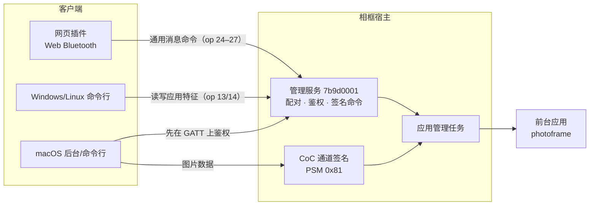
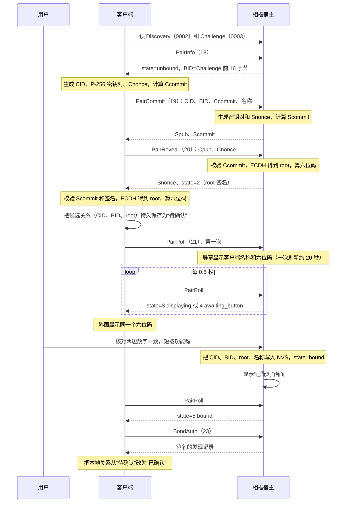
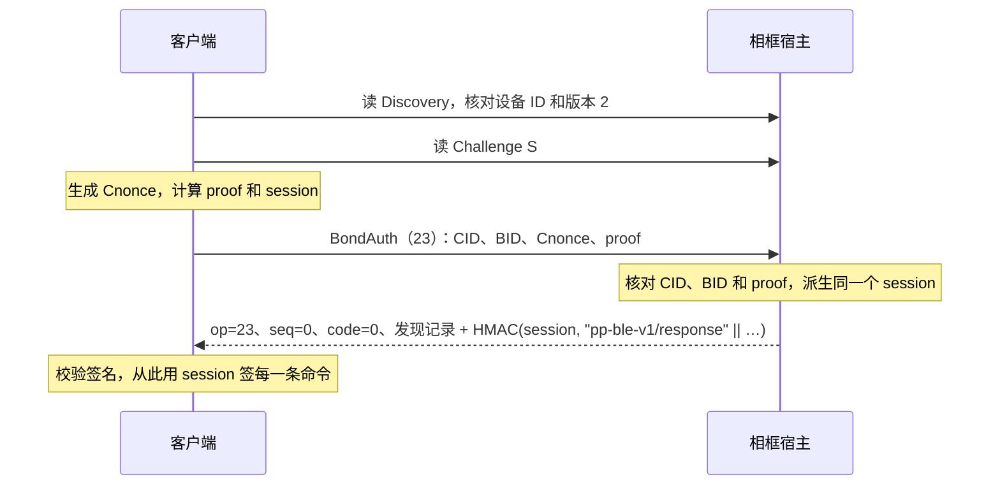
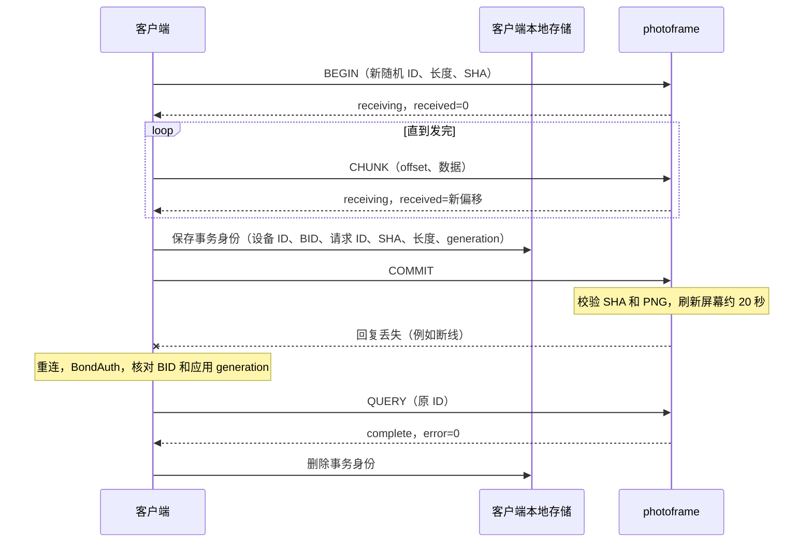

# 蓝牙通信

相框和电脑、手机之间的所有通信都走低功耗蓝牙（BLE），包括配对、查看状态、安装和切换应用、推送图片。这一页讲这些通信在协议层面怎么工作。

适合两类读者：要编写或调试客户端（命令行、网页插件、控制台）的开发者，以及想让自己的应用通过蓝牙收发数据的应用开发者。读完你会知道相框上有哪些蓝牙服务、怎样发现和配对、签名命令的格式、图片怎样可靠地送到屏幕上，以及应用和客户端通信的三种方式。

应用一侧的 C 接口见[应用接口参考](05-app-api-reference.md)，配对的操作步骤见[上手使用](02-getting-started.md)。

本页的书写约定：

- 所有多字节整数都是小端序（低位字节在前）。
- HMAC 指 HMAC-SHA256，签名结果取完整的 32 字节。
- 计算签名时要拼进去的固定字符串（例如 `pp-ble-v1/request`）按 ASCII 拼接，末尾不加 NUL。

## 1. 全景

相框在蓝牙里是外设（被连接的一方），同一时间只接受一个连接。蓝牙由**宿主**（常驻固件）负责，所以即使没有应用在运行、没有连 Wi-Fi，蓝牙也可以用。相框提供下面几种蓝牙接口：

| 组成 | 归属 | 作用 | 谁在用 |
|---|---|---|---|
| 管理服务 `7b9d0001-…` | 宿主，一直存在 | 提供发现信息、配对和鉴权，并接收签名命令。命令用来读状态、管理应用、和应用交换消息 | 所有客户端 |
| 应用自定义 GATT 服务（ABI 2.1） | 前台应用 | 应用自己定义的服务，最多 4 个特征 | photoframe 用它注册了图片服务 `a4fe2000-…`，Windows 和 Linux 原生客户端通过它推图 |
| L2CAP CoC 通道（ABI 2.2） | 前台应用独占，宿主负责签名 | 大块数据的双向传输，通道号（PSM）`0x81` | macOS 原生客户端用它推图 |
| 通用消息通道（ABI 2.3） | 前台应用，宿主通过管理服务转发 | 一问一答地交换最多 4 KiB 的消息 | 网页插件用它推图 |



图中的 op 是命令编号，见[第 6 节](#6-管理命令)。整个协议有三条基本原则：

- **鉴权由宿主完成。** 配对密钥只保存在宿主和客户端里，应用接触不到。应用收到的每一条蓝牙数据，都已经通过了宿主的签名检查。
- **所有操作由应用管理任务依次执行。** 蓝牙收到数据后只做复制，加载应用、写 Flash、调用应用代码、刷新屏幕都交给应用管理任务（App Manager）依次执行。同一时间只能有一项操作在执行，蓝牙命令、按键、定时器和上传都要先拿到这个执行权。拿不到时，客户端会收到“设备忙”（错误码 3）。
- **签名防篡改和冒充，内容是明文。** 图片、安装包和状态在空中以明文传输，附近的人能看到内容，但改不了内容，也冒充不了主人。

术语（宿主、应用、ABI、槽位等）见 [术语表](10-glossary.md)。

## 2. 广播与发现

相框每 200–300 毫秒广播一次：

- **广播数据**：标志 `0x06`、完整的 128 位服务 UUID `7b9d0001-6c82-4f31-9a48-6f5061696e74`、设备名 `PP-XXXX`。`XXXX` 是设备 ID 的最后四个十六进制数字（大写），例如设备 ID `001122334455` 的广播名是 `PP-4455`。
- **扫描响应**：厂商数据。公司 ID 是 `0xffff`，这是留给开发测试用的通用值。后面跟 20 字节的发现记录。

同样的 20 字节记录也可以在连接后从特征 `7b9d0002` 读到。

| 偏移 | 字节 | 含义 |
|---:|---:|---|
| 0 | 1 | 协议版本，配对 v2 固件为 `2` |
| 1 | 1 | Wi-Fi 状态：0 离线、1 连接中、2 已获得 IPv4、3 Wi-Fi 配置无效 |
| 2 | 6 | 设备 ID：出厂 Wi-Fi 网卡 MAC，显示成 12 位十六进制，例如 `001122334455` |
| 8 | 4 | IPv4 地址（网络字节序），只有状态为 2 时非零 |
| 12 | 8 | SSID 的 SHA-256 前 8 字节，状态为 1 或 2 时非零 |

Wi-Fi 状态变化时，记录会立即更新；连接期间广播暂停，断开后用最新记录恢复广播。

发现记录只含公开信息，Wi-Fi 名称只给摘要。记录没有签名，客户端用它来**选设备**。鉴权成功后，客户端再从签名回复里拿一次记录核对，才能确认连上的就是这台相框。

设备 ID 固定不变，所以附近的人可以通过广播一直认出同一台相框。这是为了方便发现设备而做的取舍。

## 3. 管理服务的特征

UUID 都以 `-6c82-4f31-9a48-6f5061696e74` 结尾：

| UUID 前缀 | 名称 | 访问 | 内容 |
|---|---|---|---|
| `7b9d0002` | Discovery | 读，公开 | 20 字节发现记录 |
| `7b9d0003` | Challenge | 读 | 本次连接的 32 字节随机数，每次新连接都重新生成 |
| `7b9d0004` | Request | 写，有应答和无应答两种写法都支持 | 分片写入请求帧 |
| `7b9d0005` | Response | 读（支持长读） | 最近一次请求的完整回复，最多 512 字节 |
| `7b9d0006` | 写入容量 | 读 | 3 字节：`version:u8=1, write_capacity:u16` |
| `7b9d0007` | 消息能力 | 读 | 6 字节：`version:u8=1, request_max:u16=4096, response_max:u16=512, flags:u8=1` |

### 分片写入

一个完整的请求帧可能比一次蓝牙写入能带的字节多，所以要拆成几片写。每次写 `7b9d0004` 都带 4 字节分片头：

```
offset:u16 | total:u16 | 至少 1 字节帧数据
```

- 每次写入连同 4 字节头最多 `write_capacity` 字节，也就是 `min(512, ATT_MTU - 3)`。MTU 是这次连接协商出的单包大小。MTU 为 247 时，每片能放 240 字节帧数据；MTU 为最小值 23 时，只能放 16 字节。客户端每次连接后都要先读 `7b9d0006`。
- 请求帧一般最多 512 字节。存在 `7b9d0007` 特征时，op 26（通用消息交换）的帧可以到 4096 字节。
- 完全相同的重复分片会被接受。分片之间留下空隙、重叠部分内容冲突、超出总长度时，写入会返回蓝牙错误。
- `7b9d0007` 里 `flags` 的第 0 位为 1，表示可以用无应答写入（Write Command）发分片。网页插件发大消息时，前面的分片用无应答写入，最后一片用有应答写入（Write Request）。最后一片得到应答，就说明整条消息已经送到。

### 读取回复

写完最后一片后，反复读 `7b9d0005`：

- 读到**单个 `0x00` 字节**，表示设备还在处理，过一会儿再读。现有客户端每 25 毫秒读一次。
- 读到更长的内容，就是完整回复，成功与否看回复里的错误码。这份回复会一直保留，直到下一个请求完成。

同一时间只能有一个请求在处理：读到回复后，才能发下一个请求。

## 4. 配对 v2

配对要解决的问题是：**相框怎么确认对面的客户端，就是主人当面同意过的那一个。** 做法是先当面确认一次，之后双方长期保存同一把密钥：

1. 客户端和相框用椭圆曲线密钥交换（ECDH，P-256）算出一个只有双方知道的根密钥 `root`。
2. 双方从同一份通信记录算出一个六位数字，相框显示在屏幕上，客户端显示在电脑或手机上。
3. 用户核对两边数字一致后，短按相框的**功能键**（GPIO4）批准。相框把这个配对关系存进 NVS（Flash 上的键值存储，断电不丢）。
4. 以后每次连接，客户端用 `root` 证明自己的身份，这一步叫 BondAuth，不用再按键。

六位码用来发现中间人攻击。如果有人夹在中间，分别和两边做了密钥交换，两边算出的数字就会不一样。

### 一个主人

相框同一时间**只认一个主人**，主人的含义和日常操作见[上手使用](02-getting-started.md#一台相框只认一个主人)。协议层面的行为如下：

- 已有主人时，新的配对请求返回错误码 8。清除主人只能在相框上操作。
- 在相框上**按住功能键至少 8 秒再松开**，相框立即撤销当前连接的授权。等正在进行的刷新结束后，相框清除配对关系，屏幕显示“可以配对”，新客户端就可以配对了。
- 长按重置只清除配对关系。Wi-Fi 配置、已安装的应用和最后一张画面的缓存都保留。

### 编码约定

| 符号 | 含义 |
|---|---|
| `V` | 协议版本字节 `0x02` |
| `D` | 6 字节设备 ID |
| `CID` | 客户端身份，16 字节随机非零值，由客户端生成 |
| `BID` | 配对关系的身份，16 字节，**等于本次连接 Challenge 的前 16 字节**，由相框决定 |
| `Cpub` / `Spub` | 客户端 / 相框的 P-256 公钥，65 字节未压缩格式，以 `0x04` 开头 |
| `Cnonce` / `Snonce` | 32 字节随机数 |
| `N`、`L` | 客户端名称（1–32 个可打印 ASCII 字符，首尾不能是空格）及其长度字节 |

配对和 BondAuth 命令发生在鉴权之前，所以请求格式最简单：`op` 后面直接跟参数，没有序号和签名。回复以 7 字节头开头：`op:u8 | sequence:u32=0 | code:u16`。

### 配对命令

| op | 名称 | 请求（op 之后） | 成功回复（7 字节头之后） | 签名 |
|---:|---|---|---|---|
| 18 | PairInfo | 空 | `2, state, BID:16, CID:16, remaining_ms:u32, L, N` | 无 |
| 19 | PairCommit | `CID:16, BID:16, Ccommit:32, L, N` | `2, BID:16, Spub:65, Scommit:32` | 无 |
| 20 | PairReveal | `BID:16, Cpub:65, Cnonce:32` | `2, BID:16, Snonce:32, state, remaining_ms:u32, Challenge:32` | `root` |
| 21 | PairPoll | `BID:16, proof:32` | `2, BID:16, state, remaining_ms:u32, Challenge:32` | `root` |
| 22 | PairCancel | `BID:16, proof:32` | 同 PairPoll | `root` |
| 23 | BondAuth | `CID:16, BID:16, Cnonce:32, proof:32` | 20 字节发现记录 | 会话密钥 |

PairInfo 返回的是公开信息，用来查看相框当前的配对状态。确认配对成功要靠 BondAuth。没有主人、也没有正在进行的配对时，PairInfo 返回的 BID 就是 Challenge 的前 16 字节，CID 和名称为空。

配对状态 `state`：

| 值 | 名称 | 含义 |
|---:|---|---|
| 0 | unbound | 没有主人，可以配对 |
| 1 | waiting_reveal | 收到 PairCommit，等客户端揭示公钥 |
| 2 | waiting_client_ready | 双方都算出了六位码，等客户端保存好候选关系后发第一次 PairPoll |
| 3 | displaying | 屏幕正在刷新配对画面 |
| 4 | awaiting_button | 画面已刷完，等用户短按功能键 |
| 5 | bound | 已有主人 |
| 6 | cancelled | 本次配对已取消 |
| 7 | expired | 本次配对超时 |
| 8 | fault | 存储故障，需要长按重置 |

### 承诺、密钥与六位码

双方先发送自己公钥和随机数的摘要（叫“承诺”），之后才公开原值。这样谁都没法在看到对方的值之后，再调整自己的值：

```
Ccommit = SHA256("pp-pair-v2/client-commit" || V || D || CID || BID || Cpub || Cnonce || L || N)
Scommit = SHA256("pp-pair-v2/server-commit" || V || D || CID || BID || Ccommit || Spub || Snonce || L || N)
T       = V || D || CID || BID || Ccommit || Scommit || Cpub || Cnonce || Spub || Snonce || L || N
Z       = P256-ECDH(自己的私钥, 对方公钥)          // 32 字节 x 坐标
salt    = SHA256("pp-pair-v2/salt" || T)
root    = HKDF-SHA256(ikm=Z, salt=salt, info="pp-pair-v2/bond", 32 字节)
code    = LE32(HMAC(root, "pp-pair-v2/code" || T)[0:4]) mod 1000000   // 显示为 6 位，保留前导零
```

带 `root` 签名的回复，在回复末尾追加 `HMAC(root, "pp-pair-v2/response" || 回复头和负载)`。PairPoll / PairCancel 的证明是：

```
proof = HMAC(root, domain || V || D || CID || BID || 当前连接的 Challenge)
domain = "pp-pair-v2/poll" 或 "pp-pair-v2/cancel"
```

证明和回复都包含当前连接的 Challenge。每次连接的 Challenge 都不同，所以录下来的旧消息在新连接上无效。

### 完整流程



几个关键点：

- **先保存，再显示。** 客户端在发第一次 PairPoll 之前，就要把待确认的配对关系保存好。相框收到有效的 PairPoll 证明后才显示六位码，所以用户按键批准时，客户端一定已经存下了密钥。
- **按键时机。** 按下和松开都要在 `awaiting_button` 状态内，按住 50–600 毫秒。画面还在刷新时的按键无效。
- **写入成功才算批准。** 写 NVS 失败时，状态变成 fault，这次配对不生效。
- **批准的回复丢失时**，主人关系已经保存在相框上，客户端重新连接后直接做 BondAuth 即可。
- **取消。** 客户端可以用 PairCancel 取消自己的配对请求，需要附上 `root` 证明。如果用户按键先生效，PairCancel 会返回 8，这时客户端再做一次 BondAuth，确认配对已经完成。

时间限制：

| 阶段 | 限制 |
|---|---|
| waiting_reveal、waiting_client_ready | 各 30 秒 |
| 刷新配对画面（displaying） | 最多 650 秒（显示预算） |
| 等待按键（awaiting_button） | 画面刷完后 120 秒 |
| 两次不同的配对之间 | 至少间隔 60 秒 |
| 网页插件整个配对流程 | 15 分钟 |

同一时间只能有一个配对在进行。连接中途断开时，客户端可以在时限内用同一个 BID 和 `root` 证明接着进行。相框重启后，还没批准的配对作废。一个 BID 取消或过期后就作废了，新的配对要重新连接，拿新的 Challenge。

### 重连鉴权（BondAuth）

已配对的客户端每次连接都这样鉴权，`S` 是本次连接的 Challenge：

```
A       = V || D || CID || BID || S || Cnonce
proof   = HMAC(root, "pp-bond-v2/client"  || A)
session = HMAC(root, "pp-bond-v2/session" || A)
```



每个 Challenge 只允许尝试一次鉴权，格式错误也算一次。失败后，客户端要断开重连，拿新的 Challenge。

客户端这样保存配对关系：

- 网页插件把 `root` 存成浏览器 IndexedDB 里的 `CryptoKey`，这把密钥设为不可导出。
- 电脑端把它存在只有本用户能读的文件里。同一台相框的配对文件同一时间只允许一个进程使用。

相框只接受这一种鉴权方式。旧版本的令牌鉴权命令（op 1）总是返回失败，HTTP 接口的情况见[旧接口返回 410](08-maintenance.md#旧接口返回-410)。

## 5. 会话与签名请求

BondAuth 成功后得到 32 字节会话密钥 `K`。之后的每条命令：

```
请求：op:u8 | sequence:u32 | payload | HMAC(K, "pp-ble-v1/request"  || 前面所有字节)
回复：op:u8 | sequence:u32 | code:u16 | payload | HMAC(K, "pp-ble-v1/response" || 前面所有字节)
```

- 序号从 1 开始，每条命令加 1，到最大值后要重新鉴权。回复带回同一个序号。
- 普通命令的帧最多 512 字节，所以负载最多 475 字节（512 − 1 − 4 − 32）。op 26 的帧最多 4096 字节。
- 遇到格式错误、未鉴权或会话过期的请求，宿主可能回一个**不带签名的 7 字节错误**。只有签名正确的回复才能当作成功的证明。
- 回复的签名或序号校验失败、传输出错时，客户端结束会话并断开。重新连接后，先读状态，确认上一个操作是否已经生效，再决定下一步。

会话 60 秒内没有收到有效命令就过期，总时长最多 2 小时。执行刷屏这类长操作的时间不算空闲。断开连接后，鉴权状态和收到一半的安装包都会被丢弃。

### 错误码

| 代码 | 含义 |
|---:|---|
| 0 | 成功 |
| 1 | 未授权：签名、序号或鉴权尝试无效 |
| 2 | 没有配对关系 |
| 3 | 设备忙：按键处理、定时器、网络事件或另一个上传正在执行，稍后重试 |
| 4 | 请求无效：长度、ID 或 op 不支持 |
| 5 | 偏移不对：有空洞或冲突的重复数据 |
| 6 | 整包 SHA-256 不匹配 |
| 7 | 内存不足 |
| 8 | 状态冲突：目录或传输状态不允许，或应用不存在 |
| 9 | 安装包被安装器拒绝 |
| 10 | 存储或应用操作失败 |
| 11 | 会话过期 |
| 12 | PNG 无效，屏幕保持原样 |
| 13 | 物理显示失败 |
| 14 | 图片请求属于相框的上一次开机 |

客户端遇到 3 时短暂等待后重试（网页插件间隔 50 毫秒）。

## 6. 管理命令

以下命令都要先完成 BondAuth，并按上一节的格式签名。应用 ID 统一编码为 32 字节：1–31 个小写字母、数字、`_` 或 `-`，后面用 NUL 补齐。

| op | 命令 | 请求负载 | 成功回复负载 |
|---:|---|---|---|
| 2 | Discovery（签名版） | 空 | 20 字节发现记录 |
| 3 | 状态 | `offset:u32` | `total:u32, offset:u32, JSON 片段`（每页最多 400 字节） |
| 4 | 开始上传应用包 | `size:u32, sha256:32, app_id:32` | 已收到的偏移 `u32` |
| 5 | 上传数据块 | `offset:u32, data` | 已收到的偏移 `u32` |
| 6 | 提交 | 空 | 空 |
| 7 | 放弃上传 | 空 | 空 |
| 8 | 上传进度 | 空 | `received:u32, total:u32` |
| 9 | 激活待定版本（ACTIVATE） | `app_id:32` | 空 |
| 10 | 切换到该应用（SWITCH） | `app_id:32` | 空 |
| 11 | 回滚（ROLLBACK） | `app_id:32` | 空 |
| 12 | 删除应用（REMOVE） | `app_id:32` | 空 |
| 13 | 读应用特征（ABI 2.1） | `generation:u32, revision:u32, index:u32` | 特征值，最多 128 字节 |
| 14 | 写应用特征（ABI 2.1） | 和 op 13 相同的 12 字节，后跟 0–128 字节的值 | 空，应用处理完写入事件后才回复 |
| 15–17 | 宿主图片命令 | 见[宿主自带的图片命令](#宿主自带的图片命令) | |
| 24–27 | 通用消息（ABI 2.3） | 见第 8 节 | |

### 状态分页读取

状态是一段 JSON，要分几页读。读取步骤：

1. 用 `offset=0` 读第一页。这时宿主把当前状态保存成一份快照，后面各页都从这份快照里读，所以分页期间状态变化也不会让内容错位。
2. 每次用已经拼好的长度作为下一页的 `offset`，直到拼够 `total` 字节。

排错时常看的字段解释见[读懂设备状态](08-maintenance.md#读懂设备状态)。下面是客户端协议常用的字段：

| 字段 | 含义 |
|---|---|
| `apps[]` | 每个已安装的应用，包括 `id`、`bank`（0–4）、四个槽位字段 `active`、`previous`、`pending`、`trial`，以及 `versions`（两个槽的版本号，空槽为 null）、`abi`、`name` |
| `generation` | 当前应用的加载次数，每次加载应用都会变 |
| `payload_abi`、`payload_abi_minor` | 当前应用声明的 ABI 版本，例如 2 和 3 表示 2.3 |
| `ble_service_uuid`、`ble_service_revision`、`ble_characteristics` | 当前应用注册的 GATT 服务（ABI 2.1） |
| `coc_version`、`coc_psm`、`coc_state` | 当前应用的 CoC 通道（ABI 2.2） |
| `uptime_ms`、`reset_reason` | 开机时长和本次开机的复位原因。客户端靠它们分辨是蓝牙断了，还是相框重启了 |

### 安装和管理应用

应用目录和 A/B 槽的机制见[设备是怎么工作的](03-how-the-device-works.md#应用目录与-ab-槽)。在蓝牙上安装一个应用分四步：

1. **开始（op 4）**：给出整包长度（4148 到 1048576 字节）、整包 SHA-256 和应用 ID。宿主占住执行权，在 PSRAM 里分配缓冲。再次发送参数完全相同的开始命令，会返回已经收到的字节数。
2. **数据块（op 5）**：从已经收到的位置往后追加数据。如果重复发送已经收到的数据块，只要内容一致，也会被接受。
3. **提交（op 6）**：宿主先校验整包 SHA-256，再检查 ELF 的摘要、结构、清单、用到的函数和 ABI。检查通过后，安装包写入该应用的**非当前槽**，成为 `pending`。这一步只保存，不运行。
4. **激活（op 9）**：让 `pending` 版本进入试运行。启动成功后确认新版本，原来的 `active` 变成 `previous`。

上传期间宿主一直占着执行权，这时按键和其他命令都会得到“忙”。连接断开后，已收到的部分会被丢弃，重连后要从头上传。

其他管理命令：

- **SWITCH（op 10）**：把前台切到该应用已确认的版本。
- **ROLLBACK（op 11）**：有 `pending` 时丢弃它，否则把 `active` 和 `previous` 互换。
- **REMOVE（op 12）**：删除一个当前没在运行的应用。

这些命令的回复丢失时，客户端重新连接并读状态，确认命令是否已经执行，再决定下一步。

### 宿主自带的图片命令

op 15 `IMAGE_CAPS`、16 `IMAGE_BEGIN`、17 `IMAGE_RESULT` 是宿主自带的一条 PNG 显示通道，传数据时借用 op 5、7、8、6。它保留用于兼容和测试。现有客户端都用下一节的图片事务推图。

## 7. 图片事务

**图片事务**是客户端向相框发一张图的完整过程：声明图片、分块发送、提交显示、拿到回执。这件事由前台应用 photoframe 负责，它管理图片缓冲、接收进度和回执；宿主负责鉴权、调度和刷新屏幕。

图片事务的处理代码在 `photoframe/main/image_transfer.c`，三种蓝牙传输方式共用这一份代码。三种方式的命令和回执格式完全一样，区别只在字节怎么送过去。

### 命令

每条命令的格式是 `version:u8=1 | opcode:u8 | request_id:16 | tail`。`request_id` 是客户端为**每一次推图**生成的 128 位非零随机数。同一张图片推两次，就用两个不同的 ID。

| opcode | 命令 | tail | 作用 |
|---:|---|---|---|
| 1 | BEGIN | `png_size:u32, sha256:32` | 开始接收，申请缓冲 |
| 2 | CHUNK | `offset:u32, data` | 追加数据 |
| 3 | COMMIT | 空 | 校验并显示 |
| 4 | CANCEL | 空 | 取消还没提交的接收 |
| 5 | QUERY | 空 | 查询这个 ID 的接收进度或完成回执 |

规则：

- PNG 长度在 8 字节到 5 MiB 之间。图片必须是 800×480、非隔行、每个像素完全不透明，并且只用黑、白、红、黄、绿、蓝六种精确的颜色。
- 同一时间只接收一张图，另一个 ID 的 BEGIN 返回“忙”。
- 用同一个 ID 再发 BEGIN 时，长度和摘要都相同，就返回已有的进度或结果；长度或摘要不同，就返回拒绝。
- CHUNK 必须从已收到的位置接着往后发。内容一致的重复块可以接受。空块、留下空隙、部分重叠或内容冲突的块会被拒绝，已经收到的字节保持不变。
- 60 秒没有新的 BEGIN 或 CHUNK，接收会因超时而取消。QUERY 不会延长这个期限。
- COMMIT 要求数据收齐、SHA-256 一致。之后 photoframe 完整解码图片、检查颜色，再调用宿主的显示接口。显示接口等电子纸刷新完、面板断电后才返回，一次刷新大约 20 秒。
- 重复的 COMMIT 只返回原来的结果，屏幕不会再刷一次。

### 64 字节回执

每条命令的结果都是一份 64 字节回执：

| 偏移 | 字节 | 字段 |
|---:|---:|---|
| 0 | 4 | ASCII `PFI1` |
| 4 | 1 | state |
| 5 | 1 | 本次回复对应的 opcode |
| 6 | 2 | error |
| 8 | 16 | request ID |
| 24 | 4 | PNG 总长度 |
| 28 | 4 | 已接收长度 |
| 32 | 32 | PNG SHA-256 |

| state | 含义 | | error | 含义 |
|---:|---|---|---:|---|
| 0 | idle | | 0 | OK |
| 1 | receiving 接收中 | | 1 | 命令无效 |
| 2 | processing 正在解码和刷新 | | 2 | 忙 |
| 3 | complete 完成 | | 3 | 偏移不对 |
| 4 | failed 失败 | | 4 | 冲突 |
| 5 | canceled 已取消 | | 5 | 内存不足 |
| 6 | missing 找不到这个 ID | | 6 | SHA 不匹配 |
| 7 | rejected 本条命令被拒绝 | | 7 | PNG 无效 |
| | | | 8 | 显示失败 |
| | | | 9 | 超时 |
| | | | 10 | 连接断开 |

**证明这张图已经显示在屏幕上的回执，要同时满足：state 为 3，error 为 0，请求 ID、长度、摘要都和请求一致，已接收长度等于总长度。** 签名命令返回成功，只说明应用处理了这条命令。

- `rejected` 表示只有这一条命令被拒绝，正在接收的那张图照常继续。
- `missing` 只带回查询的 ID，其他字段都是 0。

图片事务的错误写在回执里，这时外层的蓝牙命令仍然返回成功，应用也继续运行。鉴权失败、应用已重新加载、设备忙这类宿主层面的错误，用[第 5 节](#错误码)的错误码。

photoframe 在内存里保留最近 4 份完成回执，断开重连后仍然可以查询。应用被切走、停止或相框重启后，这些回执就清空了。

### 提交后回复丢失怎么办

推图最难处理的情况是：COMMIT 已经发出，回复却丢了，比如蓝牙恰好断开。这时客户端不知道图片有没有显示出来。如果换个 ID 重新发送，屏幕可能刷两次，还可能用一张旧图盖掉新图。所以客户端按下面的流程处理：



1. **先保存，再提交。** 发 COMMIT 之前，把这次事务的身份信息保存下来：设备 ID、配对 BID、请求 ID、SHA-256、长度和应用的 generation。
2. **回复丢失后，用原 ID 查询。** 重新连接后，先核对设备 ID、配对 BID、应用 generation 和服务版本都没变，再用原来的 ID 发 QUERY。看到 `processing` 就过一会儿再查，网页插件每 2 秒查一次。
3. **查不到结果就交给人。** 以下情况说明结果已经无法确认：回执显示 `missing`，回执内容和保存的信息对不上，相框重启过，应用被切走过，或配对关系变了。这时客户端停止对这张图的自动重试，请用户看一眼屏幕。
4. **COMMIT 之前断开，可以重新发。** 这时图片还没有显示，相框也会取消接收。客户端用新的随机 ID 整张重新发送即可。

网页插件把事务身份存在 IndexedDB 里，关掉浏览器再打开也能接着查询。电脑端把它保存在后台进程的内存里，进程重启后就无法再查询，见[版本与已知限制](09-versions-and-limits.md#已知限制)。

### 三种承载方式

| | ABI 2.3 GATT 大消息 | ABI 2.2 CoC | 旧 GATT 小消息（ABI 2.1） |
|---|---|---|---|
| 怎么送 | 管理服务 op 26，每条消息一次往返，回复里直接带回执 | L2CAP CoC 通道，宿主给每条记录加签名 | 先用 op 14 写应用特征，再用 op 13 读回执 |
| 每条消息最多带图片字节 | 4025 | 4036 | 106 |
| CHUNK 的回执 | 每条一份，确认已收到的总字节数 | 不逐条回复，发送速度由 CoC 自带的流量控制调节；出错的块在 COMMIT 或 QUERY 的回执里体现 | 每条一份 |
| 大约速度 | 手机网页约 8 KiB/s，66 KiB 约 8 秒 | 约 25 KiB/s | 手机网页约 0.24 KiB/s，66 KiB 要 4–5 分钟 |
| 谁在用 | 网页插件（photoframe 支持 ABI 2.3 时） | macOS 原生后台和命令行 | Windows 和 Linux 原生客户端；photoframe 低于 ABI 2.3 时的网页插件 |

以上速度只算传输阶段，不包括连接、鉴权和约 20 秒的刷新。

三种方式共同遵守这些规则：

- 同一时间只有一个通道能接收图片。一张图正在某个通道上接收时，其他通道或其他会话发来的命令会得到 `rejected` 和“忙”。
- 通道断开时，photoframe 取消这个通道上还没提交的接收，已有的完成回执保留。如果 COMMIT 已经开始显示，显示会照常完成。
- 一张图从头到尾要在同一个通道上传完。换通道时，用新 ID 重新发送整张图。

**ABI 2.3 GATT 大消息**按这个顺序使用：

1. 读 `7b9d0007`，确认支持 4096 字节的请求帧；从状态里确认 `payload_abi_minor` 不小于 3。
2. 发 CHANNEL_INFO（op 24），核对服务 ID 和 generation。
3. 发 CHANNEL_OPEN（op 25），拿到 session。
4. 用 CHANNEL_EXCHANGE（op 26）逐条发送图片命令。每条 op 26 的回复负载就是一份 64 字节回执。

**ABI 2.2 CoC**按这个顺序使用：

1. 在 GATT 上完成 BondAuth，从状态里读到 `coc_version=1` 和 `coc_psm`。
2. 在同一个连接上打开 CoC 通道。
3. 相框先发一条 82 字节的问候消息，里面有应用的 generation、session、双方的最大记录长度、随机数，以及用会话密钥算出的 HMAC。双方据此为两个方向各算出一把密钥。
4. 之后每条记录的格式是 `length:u16 | sequence:u32 | payload | tag:32`，`payload` 里放的就是图片命令。BEGIN、COMMIT、CANCEL、QUERY 各回一份回执，CHUNK 不回。

**旧 GATT 小消息**用 photoframe 注册的自定义服务 `a4fe2000-1536-4c88-a2ce-32ecdaac0471`。特征 0（`a4fe2001`，可写，最多 128 字节）接收命令，特征 1（`a4fe2002`，可读，64 字节）存放回执。

客户端先从状态里读出 `ble_service_uuid`、`generation` 和 `ble_service_revision`，带进 op 13 和 op 14。之后用签名的 op 14 写命令，用 op 13 读回执。每发 106 字节图片要两次往返，所以很慢。直接用 GATT 读这个特征也能读到回执，但它没有签名，判断是否显示完成要以 op 13 读到的回执为准。

## 8. 应用通信的三种方式

应用想和客户端交换数据时，宿主提供三种接口。三种接口都只属于**当前的前台应用**；应用被切走或停止时，宿主撤销它注册的服务，并丢弃排队的数据。

| | ABI 2.1：自定义 GATT 服务 | ABI 2.2：CoC 通道 | ABI 2.3：通用消息 |
|---|---|---|---|
| 清单宏 | `APP_MANIFEST_BLE` | `APP_MANIFEST_COC` | `APP_MANIFEST_CHANNEL` |
| 事件 | `APP_EVENT_BLE`（6） | `APP_EVENT_COC`（7） | `APP_EVENT_CHANNEL`（8） |
| 应用看到的东西 | 一个 128 位服务 UUID，最多 4 个特征（读/写/通知），每个值最多 128 字节 | 一条有序记录流，PSM `0x81`，单条记录最多 4096 字节，应用负载最多 4058 字节 | 一个逻辑服务 ID，完整消息最多 4096 字节（经 GATT 实际最多 4047），每条回复最多 256 字节 |
| 交互模型 | 客户端签名写入（op 14）触发事件；客户端签名读取（op 13）取值 | 双向流，应用自己定协议 | 一问一答：客户端发一条消息，应用回一条 |
| 鉴权 | 通过宿主的签名命令读写。直接 GATT 读取和通知要求连接已鉴权，但数据本身不带签名 | 宿主用会话密钥算出每个方向的密钥，每条记录带 HMAC | 通过宿主的签名命令 |
| 吞吐 | 低，每 128 字节一次往返 | 高，约 25 KiB/s | 中，手机网页约 8 KiB/s |
| 支持的客户端 | 全部：网页、macOS、Windows、Linux | macOS 原生客户端 | 网页插件 |
| 应用要处理的传输细节 | UUID 和值的大小 | 通道号、记录长度、流量控制 | 无，底层细节全部由宿主处理 |

怎么选：

- **控制类小数据**（几个开关、一段状态），用 **2.1**。所有客户端都支持，接口最简单。
- **传大文件且要照顾网页和所有平台**，用 **2.3**。它和传输方式无关，以后宿主加别的承载方式，应用代码不用改。
- **Mac 上追求最快速度**，加上 **2.2**。photoframe 就是三种同时注册：同一套事务核心，哪个客户端来都能用。

一个应用可以同时注册三种。三种接口的函数签名、配置结构、返回码和使用限制见 [应用接口参考](05-app-api-reference.md)。

### 通用消息命令（op 24–27）

客户端访问 ABI 2.3 通道用的管理命令：

| op | 名称 | 请求负载 | 成功回复负载 |
|---:|---|---|---|
| 24 | CHANNEL_INFO | 空 | `generation:u32, revision:u32, message_max:u32, reply_max:u32, service_id:16` |
| 25 | CHANNEL_OPEN | `generation:u32, revision:u32` | `session:u32` |
| 26 | CHANNEL_EXCHANGE | `generation:u32, revision:u32, session:u32, message:1..4047` | 应用回复，最多 256 字节 |
| 27 | CHANNEL_CLOSE | `generation:u32, revision:u32, session:u32` | 空 |

`generation` 指定是应用的哪一次加载，`revision` 指定是哪一次服务注册。应用重新加载或重新注册后，带旧值的请求会被拒绝。同一时间只有一个已鉴权的客户端能打开通道。op 26 要等应用读完整条消息、给出回复后才返回。

## 相关页面

- [设备是怎么工作的](03-how-the-device-works.md)：应用槽、试运行和启动保护
- [应用接口参考](05-app-api-reference.md)：GATT、CoC、通用消息的 C 接口
- [电脑端、控制台与网页插件](07-clients.md)：各客户端怎么用这些协议
- [版本与已知限制](09-versions-and-limits.md)：版本、兼容关系和已知限制
- [提案：统一消息协议](proposals/unified-message-protocol.md)：把三种承载方式合成一套协议的设想
