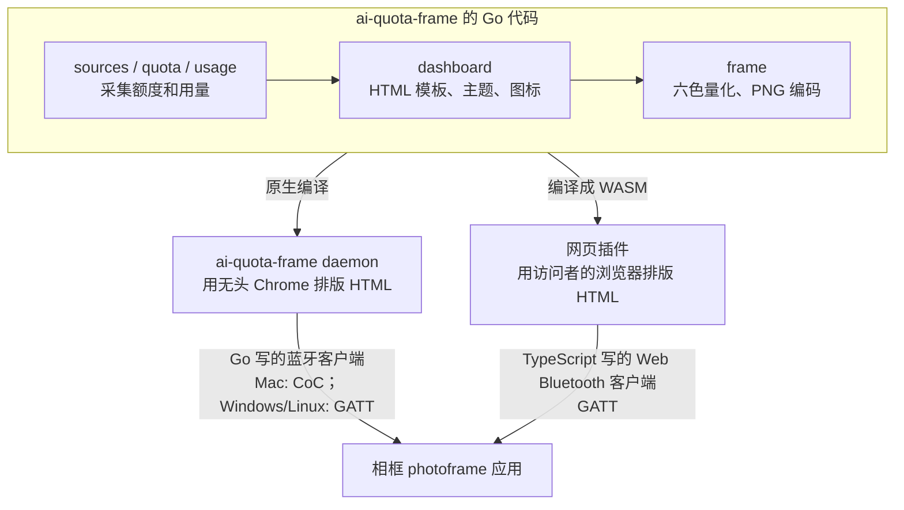
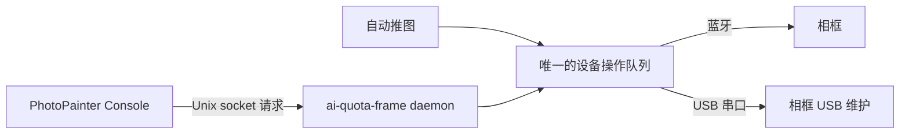
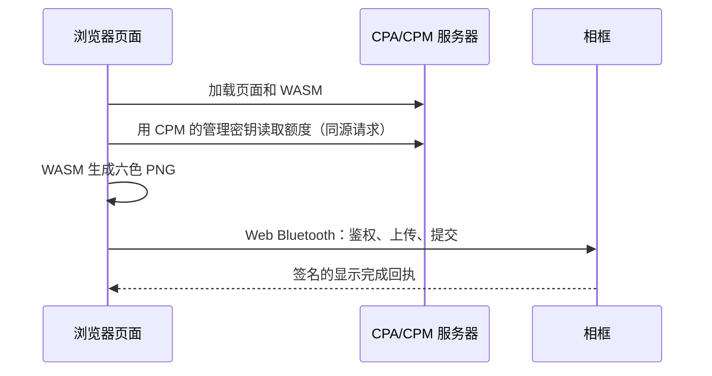

# 电脑端、控制台与网页插件

这一页讲相框的三种“控制端”是怎么组成的、各有哪些命令和按钮：电脑上的 `ai-quota-frame` 程序（命令行和常驻后台）、macOS 上的图形控制台 `photopainter-console`，以及挂在 CPM 管理中心里的网页插件。使用者可以把它当成命令和配置手册；想改代码或发布插件的开发者，可以从这里了解各部分的分工。

只想快速推上第一张图，先看[上手使用](02-getting-started.md)。蓝牙协议本身（配对、签名、图片事务）在[蓝牙通信](06-bluetooth.md)里讲。

## 整体结构

所有控制端做的事情都一样，分三步：

1. **采集**：从 CLIProxyAPI（简称 CPA，一个代理多家 AI 服务的程序）的管理接口读取各账号的额度；如果配置了 cpa-manager-plus（CPAMP），还会读取今日和近 7 日的 token 用量。
2. **渲染**：把额度数据套进 HTML 模板，排版成 800×480 的画面，再量化成相框能显示的六色 PNG。
3. **推送**：通过蓝牙把 PNG 发给相框上的 `photoframe` 应用，等它刷新完电子纸并回传签名的完成回执。

采集和渲染是同一套 Go 代码，编译成两种形态：



- **原生程序**：`ai-quota-frame daemon` 在电脑上常驻，用无头 Chrome 把 HTML 排成图片，再用 Go 实现的蓝牙客户端推送。
- **浏览器**：`cmd/web-frame` 把采集、模板和量化编译成 WebAssembly（WASM）。页面在浏览器里排版同一份 HTML，蓝牙部分由页面里的 TypeScript 代码通过 Web Bluetooth 完成。

因为模板和量化完全共用，同样的数据在两边生成的画面一致。

相框只接受通过配对建立了关系的控制端，同一时间只有一个主人。详见[上手使用](02-getting-started.md#一台相框只认一个主人)。

## ai-quota-frame 命令行

`ai-quota-frame` 是一个带子命令的程序。不带参数时只打印帮助，不会连接任何东西。

| 子命令 | 作用 |
|---|---|
| `daemon` | 启动常驻服务：采集 → 渲染 → 推送。配置全部从环境变量读取，不接受其他参数 |
| `ble` | 通过蓝牙配对、查看和管理相框（不需要 Chrome、数据源密钥或运行中的后台） |
| `console` | 在 macOS 上通过本机 socket 向正在运行的后台发请求 |
| `source-check` | 只检查一次数据源能否正常采集，然后退出 |
| `help` | 打印帮助 |

### `ble` 子命令

```text
ai-quota-frame ble <命令> [--device-id ID] [--app APP] [--file 文件] [--name 名称] [--characteristic N] [--text 文本]
```

通用参数：

| 参数 | 默认值 | 说明 |
|---|---|---|
| `--device-id` | 环境变量 `PHOTOFRAME_DEVICE_ID`，否则用最近一次配对的设备 | 12 位十六进制设备 ID |
| `--app` | `photoframe` | 应用 ID，用于推图和应用管理命令 |
| `--file` | 无 | `push` 用的 PNG，或 `install`/`inspect` 用的应用包 |
| `--name` | `PhotoPainter desktop` | 配对时显示在相框上的控制端名字 |
| `--characteristic` | `0` | `app-read`/`app-write` 的应用特征序号，0–3 |
| `--text` | 空 | `app-write` 写入的 UTF-8 文本，最多 128 字节 |

命令列表：

| 命令 | 作用 | 会改变相框状态吗 |
|---|---|---|
| `scan` | 扫描 10 秒，列出附近相框的设备 ID 和广播信息（未鉴权） | 否 |
| `pair` | 和相框配对：打印六位码，等你在相框上短按功能键 | 是，建立主人关系 |
| `paired` | 显示本机保存的配对摘要（不含密钥） | 否 |
| `pair-status` | 读取相框公开的配对状态 | 否 |
| `forget` | 删除本机保存的配对。相框那边的关系只能用长按功能键清除 | 只改本机 |
| `info` | 鉴权连接后输出设备信息（ID、协议版本、IP、Wi-Fi 名称摘要） | 否 |
| `status` | 读取完整的签名状态：当前应用、各应用槽、版本、复位原因等 | 否 |
| `push` | 推一张 PNG 并等待完成回执 | 刷新屏幕 |
| `inspect` | 只在本地检查应用包的格式、应用 ID、版本、ABI，不连接相框 | 否 |
| `install` | 把应用包上传到该应用的备用槽，**不激活** | 写备用槽 |
| `activate` | 试运行刚上传的待激活版本，启动成功后确认 | 切换应用 |
| `switch` | 把指定应用切到前台运行（使用它已确认的版本） | 切换应用 |
| `rollback` | 回到可回退槽的版本 | 切换版本 |
| `remove` | 删除一个非运行中的应用 | 删除应用 |
| `app-read` / `app-write` | 读写当前应用自定义的 GATT 特征（见[应用接口参考](05-app-api-reference.md)） | 取决于应用 |

`bind` 和 `unbind` 是 `pair` 和 `forget` 的旧名字，仍然能用。

几点行为：

- `push` 先在本地检查 PNG：不超过 5 MiB、800×480、非隔行、完全不透明、只含六种颜色、CRC 正确、没有尾随数据。不合格就不连接相框。
- `push` 不会自动切换应用。相框前台必须是 `photoframe`，否则会报收图服务不可用。
- `install` 和 `push` 的超时是 90 分钟（照顾很慢的连接），其他命令是 11 分钟。
- `activate`、`switch`、`rollback`、`remove` 发出后如果回复丢了，程序会重新连接，读一次签名状态，看目标状态是否已经达到；**不会重发命令**。超时时会提示你先查 `status` 再决定。
- 成功时输出 JSON 到标准输出，进度和提示输出到标准错误。

想先生成一张画面再手动推送，可以用 `cmd/render-frame`：它读同样的环境变量，采集一次并把 PNG 写到 `--output` 指定的文件（默认 `frame.png`），不连接相框。

```sh
set -a; . ./.env; set +a
go run ./cmd/render-frame --output frame.png
./dist/ai-quota-frame ble push --file frame.png
```

### `console` 子命令

只在 macOS 上有用。后台在 macOS 且使用蓝牙推送时，会在 `~/Library/Application Support/ai-quota-frame/console/bridge.sock` 开一个只有本用户能访问的 Unix socket。`console` 子命令和 macOS 控制台都通过它给后台发请求。

```text
ai-quota-frame console snapshot|status|refresh|pause|resume|switch|activate|rollback|cancel-trial|inspect|install [应用或文件] [摘要]
ai-quota-frame console request '<JSON>'
```

常用的几个：

| 命令 | 作用 |
|---|---|
| `snapshot` | 返回后台当前状态（是否自动推送、最近采集、最近发送进度和结果），**不连接相框** |
| `status` | 排队连接相框，读取签名状态，结果在下一次 `snapshot` 里 |
| `refresh` | 立即采集一次额度 |
| `pause` / `resume` | 暂停或恢复自动推送，设置会持久保存 |

请求先排队，再由后台按顺序执行；返回的是排队后的状态，结果要再用 `snapshot` 看。后台没在运行时会返回“后台服务未连接”。

### `source-check` 子命令

```sh
set -a; . ./.env; set +a
./dist/ai-quota-frame source-check            # 按配置检查
./dist/ai-quota-frame source-check --static   # 强制用管理密钥模式检查
```

它采集一次额度和用量，输出 JSON：鉴权模式、各密钥是否已配置、`quota_ok`、`usage_ok`、账号数量和状态统计、有问题的服务商、耗时。输出里没有密钥、账号名和额度数值，可以放心贴给别人看。不启动渲染器，也不连接相框。采集失败时退出码为 1。

## 配置项

`daemon`、`render-frame` 和 `source-check` 从环境变量读配置。仓库里的 `.env.example` 是模板，复制成 `.env` 后填写。

### 数据源

| 变量 | 默认值 | 说明 |
|---|---|---|
| `CLIPROXY_BASE_URL` | `http://127.0.0.1:8317` | CPA 管理接口地址 |
| `SOURCE_AUTH_MODE` | 自动判断 | `management-key`（用管理密钥）或 `google-id-token`（管理接口在 Google 登录网关后面时） |
| `CLIPROXY_MANAGEMENT_KEY` | 无 | CPA 管理密钥，`management-key` 模式必填 |
| `CPAMP_BASE_URL` | 设置了 `CPAMP_ADMIN_KEY` 时为 `http://127.0.0.1:18317` | 可选，cpa-manager-plus 地址，用于显示 token 用量 |
| `CPAMP_ADMIN_KEY` | 无 | cpa-manager-plus 管理密钥；设置了 `CPAMP_BASE_URL` 就必填 |
| `GOOGLE_SERVICE_ACCOUNT_FILE` | 无 | `google-id-token` 模式的服务账号私钥文件，权限应为 0600 |
| `GOOGLE_ID_TOKEN_AUDIENCE` | 无 | `google-id-token` 模式的网关 client_id |

不写 `SOURCE_AUTH_MODE` 时：只配了服务账号文件就用 `google-id-token`，否则用 `management-key`；两种凭据都配了会报错，要求你明确选择。

### 相框与推送

| 变量 | 默认值 | 说明 |
|---|---|---|
| `PHOTOFRAME_PUSH_TRANSPORT` | `ble` | 推送方式。当前宿主固件只支持 `ble` |
| `PHOTOFRAME_DEVICE_ID` | 最近一次配对的设备 | 指定推给哪台相框，必须已经和它配对过 |
| `PHOTOFRAME_BLE_BINDING_FILE` | 用户配置目录下的 `ai-quota-frame/ble-device.json` | 可选，改设备选择文件的位置（绝对路径） |
| `PHOTOFRAME_BLE_BOND_DIR` | 上面文件旁边的 `ble-bonds/` | 可选，改配对密钥目录的位置（绝对路径） |
| `LAST_FRAME_PATH` | 无 | 可选，每次确认显示成功后把 PNG 另存到这里 |

### 画面

| 变量 | 默认值 | 说明 |
|---|---|---|
| `FRAME_THEME` | `classic` | `classic`、`arcade`、`pop`、`mint-skin`；旧值 `mint` 按 `mint-skin` 处理 |
| `DISPLAY_PROVIDERS` | `codex,xai,kimi` | 要显示的服务商，1–5 行，格式见下 |
| `TZ` | `Asia/Shanghai` | 画面上时间使用的时区 |

`DISPLAY_PROVIDERS` 用逗号分隔，每一项是 `ID[+ID...][:显示名]`。可用 ID 是 `codex`、`claude`（也可写 `anthropic`）、`antigravity`、`xai`（也可写 `grok`）、`kimi`。显示名省略时用默认大写名称，最长 12 个字符。同一个服务商不能出现两次。`gemini`、`gemini-cli`、`google` 会报错。

### 采集节奏

| 变量 | 默认值 | 说明 |
|---|---|---|
| `REFRESH_INTERVAL` | `5m` | 采集间隔，最少 `1m` |
| `REQUEST_TIMEOUT` | `20s` | 单个请求超时，1 秒到 2 分钟 |
| `MAX_CONCURRENCY` | `4` | 同时查询的账号数，1–32 |
| `PASSIVE_MAX_AGE` | `24h` | 主动查询失败时，被动缓存数据最多能用多久 |
| `DEMO_MODE` | `false` | 设为 `true` 时用演示数据，不访问数据源 |
| `CHROME_BIN` | 自动查找 | Chrome/Chromium 的路径 |

### 主题与服务商

| 主题 | 网页名称 | 说明 |
|---|---|---|
| `mint-skin` | 薄巧 | 插画背景，最多 3 行；超过 3 行时这一帧改用 `classic` 布局 |
| `classic` | 经典 | 基础布局 |
| `arcade` | 街机 | 像素画装饰 |
| `pop` | 波普 | 像素画装饰 |

| 服务商 ID | 画面默认名称 |
|---|---|
| `codex` | CODEX（ChatGPT） |
| `claude` | CLAUDE |
| `antigravity` | ANTIGRAVITY |
| `xai` | GROK |
| `kimi` | KIMI |

所有主题最终都量化成六色（黑、白、红、黄、绿、蓝），图标和装饰按整像素绘制，所以电子纸上不会出现噪点。

## 后台是怎么推图的

- 每次采集成功，后台把最新快照交给一个单独的推送线程。队列只留最新一份，还没来得及发的旧快照会被替换。
- 采集失败时不推图，屏幕保留上一张。
- 画面内容没变时不重复推送。
- 推送前先读相框状态，确认前台是 `photoframe` 应用并且收图服务就绪。后台不会自动切换应用。
- 推送使用[图片事务](06-bluetooth.md)：上传、提交、等完成回执。提交后如果连接断了，只查询原来那次请求的结果，绝不重发。查不到结果（例如相框重启了）就把这张图标为“结果未知”，停止对它的自动重试，等下一次新快照。
- 没有配对关系时，后台直接报“需要配对”，不会反复打开蓝牙去试。

## 各平台差异

| 平台 | 蓝牙实现 | 图片通道 | 构建方式 |
|---|---|---|---|
| macOS | CoreBluetooth（需 CGO） | 相框应用支持时走 L2CAP CoC 通道，约 25 KiB/s；否则走 GATT | `make build`，默认启用 CGO，需要 Xcode Command Line Tools |
| Windows | WinRT GATT | GATT，每块 106 字节 | `GOOS=windows GOARCH=amd64 CGO_ENABLED=0 go build ./cmd/ai-quota-frame` |
| Linux | BlueZ（D-Bus） | GATT，每块 106 字节 | `make build`，静态编译 |

- **CoC**（L2CAP 面向连接通道）是蓝牙里一种能连续发大块数据的通道，比 GATT 一问一答快得多。目前只有 Mac 客户端实现了它。
- Windows 和 Linux 的原生客户端走 GATT，每个图片块 106 字节，每块都要等相框回复，所以比 Mac 慢很多。
- 在 macOS 上用 `BUILD_CGO_ENABLED=0` 构建会得到没有蓝牙功能的版本，只能用于旧的 HTTP 模式。
- macOS 的蓝牙权限按应用授予，所以常驻运行要用 `deploy/install-macos.py` 安装成 `PhotoPainter Renderer.app`，命令行操作用 `deploy/pp.py`。见[上手使用](02-getting-started.md#4-在-mac-上装成常驻服务)。
- `console` 本机控制接口和 macOS 控制台只在 macOS 上可用。其他平台暂停自动推送的方法是停止服务。

### Mac 上的文件位置

| 内容 | 位置 |
|---|---|
| 程序、`.env`、`start.sh`、USB 维护脚本 | `~/Library/Application Support/ai-quota-frame/` |
| 配对关系 | 同目录下的 `ble-device.json` 和 `ble-bonds/` |
| 控制接口 socket、暂停设置、USB 备份 | 同目录下的 `console/` |
| 应用身份 | `~/Applications/PhotoPainter Renderer.app` |
| LaunchAgent | `~/Library/LaunchAgents/com.m1ntch0c0.ai-quota-frame.plist` |
| 日志 | `~/Library/Logs/photopainter-render.log`、`photopainter-render.error.log` |

`install-macos.py` 的参数只有三个：`--env-file`（必填）、`--binary`（默认 `dist/ai-quota-frame`）、`--no-start`（装好但禁用服务）。每次升级后台都要重新运行它，它会停掉旧服务、替换文件、重新生成应用身份和 LaunchAgent。

## macOS 控制台

`photopainter-console` 是一个独立的 SwiftUI 应用（`PhotoPainter Console.app`），要求 Apple Silicon 和 macOS 14 或更新版本。它本身不连接蓝牙，所有操作都通过上面的 Unix socket 交给正在运行的后台执行。



后台只有一个设备操作队列，控制台的手动操作和自动推图在里面排队，一次只做一件事，所以不会两个操作同时连相框。控制台需要后台在运行；后台没运行时，界面会提示未连接。

控制台的页面：

| 页面 | 能做什么 |
|---|---|
| 运行总览 | 自动推送开关、立即采集、当前通道（GATT 或 CoC）、发送进度、速率、最近确认的画面 |
| 设备与应用 | 完整设备状态、各应用 A/B 槽和版本、检查/安装应用包、激活、切换、回滚、删除、结束试运行、使用指定槽版本、打包 ELF |
| 连接与发现 | 扫描、配对（显示六位码进度）、查看配对状态、忘记本机配对、启停后台服务 |
| 图片推送 | 检查自选 PNG，确认后单次推送，显示实际通道和结果 |
| 应用通信 | 读写当前应用的 0–3 号特征，支持文本、十六进制和 Base64 |
| Wi-Fi 配置 | 编辑 SD 卡或本地私有文件里的 `wifi.json`（增删、调整优先级） |
| USB 维护 | 枚举端口、完整 Flash 备份、更新宿主、从备份恢复、串口启动诊断、生成和写入 NVS 配置。详见[维护与排错](08-maintenance.md) |
| 诊断 | 本机环境检查、设备诊断、能力清单（每项能力是否可用及原因）、导出诊断 |

几个细节：

- 安装、推图前，控制台先让后台检查文件并算出摘要；你确认后，后台执行前会再核对一次摘要，文件变了就拒绝。
- 有一张图片的结果还没确定时，切换应用、安装、结束试运行、USB 写入都会被拒绝，以免把那次结果弄丢。
- “使用指定槽版本”：如果想用的版本在当前槽、待激活槽或可回退槽里，控制台用对应的切换、激活或回滚命令完成。如果它在一个没有被记录的备用槽里，宿主没有命令能直接选中它，控制台会要求你选择同一应用、同一版本的安装包，重新上传后再激活。
- USB 写操作开始前，后台会自动暂停自动推送。

构建方法：在 `photopainter-console` 仓库里运行 `sh build.sh`，产物是 `dist/PhotoPainter Console.app`。

## CPM 网页插件

### 它是什么

CPM 是 CPA 的网页管理中心。网页插件是一个 CPA 插件：用 Go 写、编译成 Linux 动态库（`.so`），由 CPA 加载。插件本身只做两件事：

1. 提供三个静态资源：页面 `panel`、`frame.wasm`（gzip 压缩）和 `wasm_exec.js`，路径在 `/v0/resource/plugins/photopainter/` 下。CPM 的插件菜单里会出现“发送到相框”。
2. 提供一个受管理鉴权保护的只读接口 `GET /v0/management/plugins/photopainter/account-subject?name=...`，只返回 xAI 账号的 subject 字段（采集 Grok 额度需要它），不返回 OAuth 文件或令牌。

插件不监听新端口，也不代理蓝牙。采集、渲染、配对和推图全部发生在访问页面的那个浏览器里。



### 数据源和存储

- 页面优先读取同源 CPM 已保存的登录信息（浏览器本地存储里的 `cli-proxy-auth`），所以在 CPM 登录过就不用再填密钥。如果 CPM 连的是别的服务器，页面会拒绝使用。
- 没有保存登录时，可以在“数据源”里手动填管理密钥，并选择是否在这个浏览器里记住。记住的密钥用和 CPM 相同的本地混淆格式保存，这不是加密。“清除手动配置”只清除插件自己的配置，不会退出 CPM。
- 和相框的配对密钥保存在浏览器的 IndexedDB 里，是不可导出的 WebCrypto 密钥。清除浏览器数据会丢失配对，之后要在相框上长按重置再重新配对。
- 管理密钥只用于同源请求，不会发给相框，也不会存到服务器。

### 页面功能

| 区域 | 按钮或设置 | 作用 |
|---|---|---|
| 顶部 | 数据源 | 查看或设置管理密钥；可以导入 `ai-quota-frame` 导出的快照 JSON，或者直接载入一张 PNG |
| 相框画面 | 更新画面 | 采集最新额度并生成预览 |
| | 显示设置 | 主题、显示的服务（1–5 个）、时区、更新间隔 |
| | 下载 PNG | 下载当前预览，和发送给相框的是同一份文件 |
| 相框 | 添加 / 添加相框 | 选择设备并配对 |
| | 连接 / 断开 | 用已有配对连接或断开 |
| | 打开相框应用 | 相框前台不是相框应用时出现，点击后让相框切到 `photoframe` |
| | 相框信息 | 设备标识、配对标识、配对时间、相框应用版本，以及“设备运行诊断”（完整状态的安全字段） |
| | 移除此相框 | 删除本浏览器里的配对记忆，5 秒内再点一次确认。相框那边的主人关系不受影响 |
| 上次发送未确认 | 核对结果 / 核对画面后清除 | 见[维护与排错](08-maintenance.md#发送结果未知) |
| 定时推送 | 启用、检查间隔（1–1440 分钟）、保持屏幕唤醒 | 页面在前台时按间隔自动采集和发送 |
| 发送状态 | 发送到相框 / 取消发送 | 发送当前预览；上传阶段可以取消 |

页面使用细节见[上手使用](02-getting-started.md#方式一浏览器网页插件)。

传输方式：相框应用支持 ABI 2.3 的消息通道时，页面在 GATT 上用最大 4 KiB 的消息传图，手机上 66 KiB 约 8 秒。相框应用只支持到 ABI 2.2 时，页面退回每块 106 字节的旧接口，同样一张图要 4–5 分钟。设备运行诊断里的 `payload_abi_minor` 就是当前应用的 ABI 次版本号。

### 开发者工具

相框卡片下方的“开发者工具”默认折叠。它用已有的配对关系直接管理相框上的应用槽，不需要电脑。每个应用有 A、B 两个槽：上传总是写到非当前的那个槽，激活后旧版本变成可回退槽。槽的完整规则见[设备是怎么工作的](03-how-the-device-works.md)。

| 按钮 | 作用 |
|---|---|
| **读取槽位** | 读取签名状态，列出每个应用的 A/B 槽版本和标记：当前、可回退、待激活、运行中、试运行 |
| **选择安装包** | 在本地检查 `.pkg`：大小不超过 1 MiB、包头标识、格式和 ABI、应用 ID、载荷 SHA-256、里面是不是 Xtensa ELF。不合格不能上传 |
| **上传并激活** | 上传到备用槽，然后激活。应用会重新启动，启动成功后确认新版本 |
| **仅上传** | 只上传到备用槽，标记为待激活，不运行 |
| 应用（下拉框） | 选择下面四个按钮要操作的应用 |
| **激活待定版本** | 激活该应用已上传的待激活版本（宿主的 ACTIVATE） |
| **切换到此应用** | 把该应用切到前台，运行它已确认的版本（SWITCH） |
| **回滚** | 回到该应用可回退槽的版本（ROLLBACK） |
| **删除此应用** | 删除该应用（REMOVE），只能删非运行中的应用。点一次后按钮变成“确认删除”，5 秒内再点才执行 |

规则：

- 有未确认的图片、正在配对或正在发送时，这些按钮不可用。
- 每个改变状态的命令只发一次。回复丢失时，页面重新连接并读取签名状态，让你按槽位核对结果，不会重发。
- 宿主没有“擦除某一个槽”或“激活指定槽”的命令。想让 A、B 两个槽都是同一个版本，就用同一个安装包“上传并激活”两次。

### 构建插件

需要 Node 22.18+、Go 1.26+、Chrome/Chromium，以及目标平台的 C 编译器。

```sh
# 网页部分的测试和检查
cd web
npm ci --ignore-scripts
npm run check                 # 单元测试 + 构建
node tools/check-frame.mjs    # 与原生渲染对照
node tools/check-ui.mjs       # 隔离浏览器里的界面检查

# 构建完整插件
cd ..
./plugins/photopainter/build.sh
```

`build.sh` 先构建网页，把 `panel.html`、`frame.wasm.gz`、`wasm_exec.js` 复制到 `plugins/photopainter/`，再调用 `build-native.sh` 运行 Go 测试、编译出 `plugins/photopainter/dist/photopainter-v<版本>.so`。版本号取自 `plugins/photopainter/main.go` 里的 `const version`，网页的版本在 `web/package.json`。

检查工具找不到 Chrome 时会直接失败，可以用 `CHROME_BIN` 指定路径。这些检查只用本地测试数据，不访问真实的 CPM 或蓝牙。

`.so` 必须和运行 CPA 的服务器是同一平台（通常是 Linux amd64），并且和服务器的 glibc 版本兼容。推荐的做法是在本地构建好网页资源后，在和服务器相同发行版的 Go 容器里、断网运行 `./build-native.sh`。在 macOS 上可以用 Zig 交叉编译 Linux 产物，但只能在 Linux 上运行它的测试。

构建后可以核对导出的 C 接口和内嵌资源是否和网页产物一致：

```sh
python3 plugins/photopainter/verify-native.py \
  plugins/photopainter/dist/photopainter-v<版本>.so web/dist/panel.html
```

### 发布到 CPA

1. 先备份 CPA 的配置文件和现有插件。
2. 把新的 `.so` 放进 CPA 配置里 `plugins.dir` 指向的目录下的 `linux/amd64/`，文件权限 0644，CPA 运行用户可读。每个版本用新文件名，旧版本留着方便回滚。
3. 在 CPA 配置里启用 `plugins.configs.photopainter`。CPA 检测到配置变化后会扫描并热加载新版本，不需要重启。
4. 改配置文件时要原地写入，保留原来的文件（inode）。如果用“写临时文件再重命名”的方式覆盖，CPA 会丢失对配置文件的监听，之后的修改都不生效，只能重启 CPA。
5. 发布后核对：CPM 插件菜单出现“发送到相框”；页面能打开且显示的版本正确；不带管理鉴权访问 `account-subject` 接口返回 401；其他插件不受影响。

停用插件：把它的 `enabled` 关掉，确认菜单和资源路由消失。回滚：撤下新的 `.so`，恢复这个插件对应的配置改动，触发热加载。只回退插件自己的改动，不要整体恢复旧的 CPA 配置，以免覆盖别人之后做的修改。浏览器里还没确认的图片记录不会因为插件回滚而消失，仍按[发送结果未知](08-maintenance.md#发送结果未知)处理。
