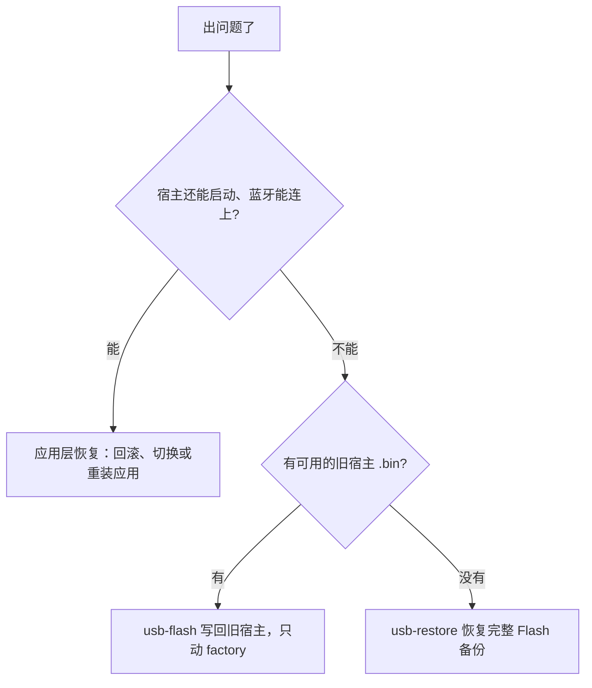

# 维护与排错

这一页写给维护相框的人。读完你会知道：怎么在刷写前完整备份，怎么通过 USB 更新宿主固件，出了问题怎么恢复，以及常见症状怎么排查。日常推图和配对见[上手使用](02-getting-started.md)，应用槽和启动保护的原理见[设备是怎么工作的](03-how-the-device-works.md)。

维护时最重要的两条原则：

1. **先备份再写入。** 任何写 Flash 的操作之前，都要有一份完整的 16 MiB Flash 备份。机内有 microSD 卡时，还要备份整张卡。
2. **结果不确定时先查询。** 管理命令和图片提交都只发一次。回复丢了，就重新连接读取状态，确认实际发生了什么。

## 哪些操作会让相框重启

| 操作 | 会重启吗 | 说明 |
|---|---|---|
| 打开相框的 USB 串口（串口监视器、`idf.py monitor`、esptool） | 可能 | 打开串口时的控制信号可能触发复位。日常检查相框是否在线，请用蓝牙读状态 |
| `usb-maintenance.py` 的 `usb-backup`、`usb-flash`、`usb-restore`、`usb-provision` | 会 | 连接时复位进入下载模式，结束时再硬复位一次 |
| `usb-maintenance.py` 的 `usb-ports`、`usb-inspect` | 不会 | 只列出串口或检查本地文件 |
| `tools/doctor.py --probe-serial`、控制台的“串口启动诊断” | 可能 | 会打开串口读取启动日志 |
| 激活、切换、回滚应用 | 只重新加载应用 | 宿主卸载当前应用、加载新应用并画首屏，设备本身继续运行 |
| 应用处理一个事件超过时限 | 会 | 宿主的看门狗重启设备，复位原因是软件复位 |
| 长按功能键 8 秒重置配对 | 不会 | 只清除配对关系 |
| 蓝牙扫描、读取状态、推图 | 不会 | |

启动保护会把 USB 维护触发的复位当成正常复位。其他复位如果发生在应用启动期间，下次开机会被当成启动失败，退回可回退槽，见[启动保护](03-how-the-device-works.md#启动保护)。

## 维护前的准备

1. **停掉自动推送。** 网页插件关掉定时推送并断开连接。Mac 后台执行 `console pause`，或用 `launchctl bootout` 停掉服务。其他平台停掉服务。
2. **处理未确认的图片。** 网页上没有“上次发送未确认”卡片；Mac 后台 `console snapshot` 输出里 `transfer.uncertain` 为 `false`，并且没有正在进行的 `operation`。有未确认的图片时，按[发送结果未知](#发送结果未知)处理完再继续。
3. **关掉其他连接。** 关闭浏览器里连着相框的页面、其他蓝牙客户端和串口监视器。
4. **准备工具。** USB 维护需要装有 `esptool` 和 `pyserial` 的 Python，ESP-IDF 自带的 Python 环境就可以。

## 备份

### 完整 Flash 备份

相框的 Flash 是 16 MiB，分区如下。各分区的用途见[应用目录与 A/B 槽](03-how-the-device-works.md#目录结构)。

| 分区 | 起始地址 | 大小 | 内容 |
|---|---|---|---|
| bootloader、分区表 | `0x0` | `0x9000` | 启动程序和分区表 |
| `nvs` | `0x9000` | `0x6000` | Wi-Fi 配置、配对主人 |
| `phy_init` | `0xf000` | `0x1000` | 射频校准数据 |
| `factory` | `0x10000` | `0x500000`（5 MiB） | 宿主固件 |
| `elf_a`、`elf_b` | `0x510000`、`0x610000` | 各 1 MiB | bank 0 的 A、B 槽，通常装 `photoframe` |
| `elf_state` | `0x710000` | `0x6000` | 应用目录和启动记录 |
| `app_slots` | `0x720000` | 8 MiB | bank 1–4 的 A、B 槽，各 1 MiB |

用 `ai-quota-frame/deploy/usb-maintenance.py` 备份，工具的完整用法见[下一节](#usb-maintenancepy)：

```sh
python3 deploy/usb-maintenance.py --action usb-backup \
  --expected-id 001122334455 --port /dev/cu.usbmodemXXXX \
  --output-root ~/PhotoPainter-backups
```

工具按这个顺序工作：

1. 核对芯片是 ESP32-S3，芯片 MAC 和 `--expected-id` 一致；
2. 读出完整的 16 MiB；
3. 让设备自己算一遍 MD5，和读出的数据对照。

成功后，工具在 `--output-root` 下新建一个以时间命名的目录，里面有：

| 文件 | 内容 |
|---|---|
| `flash.bin` | 完整 16 MiB Flash 镜像 |
| `manifest.json` | 设备 ID、大小、SHA-256、创建时间 |
| `maintenance.log` | 这次操作的日志 |

目录权限 0700，文件权限 0600。`flash.bin` 里有 Wi-Fi 密码和配对密钥，要像保管密钥一样保管它，放在代码仓库之外。读完整个 Flash 需要几分钟。

### microSD 卡备份

Flash 备份只包含板载 Flash。机内有 microSD 卡时，正常关机后取出卡，用读卡器接到电脑上，制作整卡镜像。

macOS：

```sh
diskutil list external physical      # 根据容量和读卡器确认是哪块盘，记下 diskN
diskutil unmountDisk /dev/diskN
sudo dd if=/dev/rdiskN of=microsd.img bs=4m
sudo shasum -a 256 microsd.img /dev/rdiskN   # 两个摘要应该相同
diskutil eject /dev/diskN
```

Linux：

```sh
lsblk                                # 确认卡对应的整盘设备，例如 /dev/sdX
sudo dd if=/dev/sdX of=microsd.img bs=4M status=progress
sudo sha256sum microsd.img /dev/sdX
```

执行 `dd` 之前一定要先确认盘号，选错盘可能毁掉系统盘。镜像大小应该等于整张卡的字节数，两个摘要一致才算备份成功。备份完把卡装回相框，再开机。

## usb-maintenance.py

`ai-quota-frame/deploy/usb-maintenance.py` 是 USB 维护工具，只提供下面几个固定的动作。每个动作都会先核对设备身份；写入类动作会先自动做一次完整备份。macOS 控制台的 USB 维护页面调用的也是它。

```text
python3 usb-maintenance.py --action <动作> --expected-id <设备ID> --output-root <备份目录>
                           [--port 串口] [--baud 115200|230400|460800]
                           [--path 文件] [--digest SHA256] [--credentials-confirmed]
```

| 参数 | 说明 |
|---|---|
| `--action` | 要执行的动作，见下表 |
| `--expected-id` | 必填。目标相框的 12 位设备 ID，也就是芯片 MAC。和实际芯片一致时才会写入 |
| `--output-root` | 必填。备份和日志的存放目录，每次操作新建一个子目录 |
| `--port` | 串口，例如 macOS 的 `/dev/cu.usbmodem…`、Windows 的 `COM5`。先用 `usb-ports` 找 |
| `--baud` | 波特率，默认 115200，这个值最稳定 |
| `--path` | 要检查或写入的文件 |
| `--digest` | 写入时必填，填 `usb-inspect` 给出的文件 SHA-256。工具写入前会再核对一次，确保文件没被替换 |
| `--credentials-confirmed` | 只用于 `usb-provision`，表示你确认它会替换 Wi-Fi 配置并清除配对 |

| 动作 | 打开串口 | 作用 |
|---|---|---|
| `usb-ports` | 否 | 列出 USB 串口，并标出 USB 序列号和 `--expected-id` 一致的那个 |
| `usb-inspect` | 否 | 检查本地文件，输出文件类型和 SHA-256。可以检查三种文件：宿主固件 `.bin`（ESP32-S3 镜像，不超过 5 MiB）；本工具生成的备份（传 `manifest.json`，或同目录有 `manifest.json` 的 `flash.bin`）；NVS 镜像 |
| `usb-backup` | 是 | 完整备份 16 MiB Flash |
| `usb-flash` | 是 | 先完整备份，核对分区表，然后**只把宿主固件写到 factory 分区 `0x10000`** |
| `usb-restore` | 是 | 先完整备份当前内容，然后把选定的完整备份写回整片 Flash |
| `usb-provision` | 是 | 先完整备份，然后只写 NVS 分区（`0x9000`） |

工具每一步输出一行 JSON 表示进度，最后一行是结果。`complete=true` 表示成功，同时给出这次备份的 `backup_manifest` 和 `backup_directory`。最后一行的 `digest` 是**写入前那份完整备份**的 SHA-256。

写入过程中出错时，工具会自动用刚才的备份，把改动过的区域写回去。结果里的 `restored` 字段说明恢复情况：

- `restored=true`：相框已经恢复到操作前的状态。
- `restored=false`：要结合 `error` 判断，可能是还没开始写，也可能是自动恢复也失败了。这时保持 USB 连接，留好备份目录，按[恢复](#恢复)一节处理。

在 Mac 上，后台运行时也可以让后台来执行这些动作。后台会先自动暂停推图；有未确认的图片时，后台会等你处理完再执行：

```sh
RUNTIME="$HOME/Library/Application Support/ai-quota-frame"
"$RUNTIME/ai-quota-frame" console request '{"action":"usb-ports"}'
"$RUNTIME/ai-quota-frame" console request '{"action":"usb-backup","port":"/dev/cu.usbmodemXXXX","confirmed":true}'
"$RUNTIME/ai-quota-frame" console snapshot     # 看 operation_result 里的结果
```

这种方式自动使用后台当前配对的设备 ID，备份存放在 `console/usb-backups/` 下。

## 用 USB 更新宿主固件

宿主固件通过 USB 更新。正常的宿主更新只写 factory 分区，Wi-Fi、配对和已安装的应用都保留。

1. 在 `photopainter-host` 里用固定版本的 ESP-IDF 构建，得到 `photopainter_host.bin`：

   ```sh
   . /path/to/pinned-esp-idf/export.sh
   idf.py -B build-host -DSDKCONFIG=build-host/sdkconfig build
   ```

2. 按[维护前的准备](#维护前的准备)停掉自动推送、断开其他连接。机内有 microSD 时先备份卡。
3. 找到串口：

   ```sh
   python3 deploy/usb-maintenance.py --action usb-ports \
     --expected-id 001122334455 --output-root ~/PhotoPainter-backups
   ```

   选 `matches_expected` 为 `true` 的那个端口。有多个候选，或者读不到序列号时，拔插一次 USB 线，看哪个端口消失又出现。

4. 检查固件文件，记下输出的 `digest`：

   ```sh
   python3 deploy/usb-maintenance.py --action usb-inspect \
     --expected-id 001122334455 --output-root ~/PhotoPainter-backups \
     --path build-host/photopainter_host.bin
   ```

5. 写入：

   ```sh
   python3 deploy/usb-maintenance.py --action usb-flash \
     --expected-id 001122334455 --output-root ~/PhotoPainter-backups \
     --port /dev/cu.usbmodemXXXX \
     --path build-host/photopainter_host.bin --digest <上一步的 digest>
   ```

   工具会依次执行：

   1. 读芯片 MAC，核对身份；
   2. 完整备份 16 MiB 并校验；
   3. 检查分区表：factory 在 `0x10000`、大小 `0x500000`，NVS 在 `0x9000`、大小 `0x6000`；
   4. 把固件写到 `0x10000` 并校验；
   5. 确认 factory 以外的区域和备份完全一致；
   6. 硬复位。

6. 相框重启后，用平常的控制端连接，读状态、推一张图，确认屏幕正常。

更新正在使用的相框，请只用 `usb-flash`。`idf.py flash` 这类整片刷写命令会覆盖分区表、NVS 和应用数据。

## photopainter-host 里的工具

这些工具都在 `photopainter-host/tools/` 下。

| 工具 | 用途 |
|---|---|
| `doctor.py` | 检查本机开发环境：工具链、ESP-IDF 版本、同级目录里的其他仓库、串口列表。默认不打开串口。加 `--probe-serial --serial 端口` 会打开串口读几秒启动日志，可能复位设备。`--json` 输出 JSON，`--strict` 在有检查项失败时返回非零 |
| `module.py package` | 把应用 ELF 打包成 `.pkg`：`--app ID --version N --input app.elf --output app.pkg`。安装用 `ai-quota-frame ble install` 或网页开发者工具 |
| `provision.py` | 从私有配置生成 NVS 镜像。`--generate-only 输出文件` 只生成不写设备；带 `--port` 时直接写入 NVS |
| `wifi_profiles.py` | 编辑 SD 卡上的 `config/wifi.json`：`status`、`upsert`、`remove`、`move` |

`module.py` 的其他动作（`status`、`stage`、`activate` 等）和 `wifi_device.py` 使用旧的 HTTP 接口，宿主对这些接口都返回 410。应用管理请用蓝牙客户端。

### 修改 Wi-Fi

推图走蓝牙，相框不连 Wi-Fi 也能正常使用。只有需要联网的应用才要配置 Wi-Fi，有两种方法：

- **改 SD 卡（推荐）。** 关机取卡，编辑卡上的 `config/wifi.json`，插回去重启生效。这种方式保留配对关系。

  ```sh
  # private-network.env 里写 WIFI_SSID 和 WIFI_PASSWORD
  python3 tools/wifi_profiles.py upsert --file /Volumes/SD/config/wifi.json --config private-network.env
  python3 tools/wifi_profiles.py move   --file /Volumes/SD/config/wifi.json --index 2 --to 1
  python3 tools/wifi_profiles.py status --file /Volumes/SD/config/wifi.json
  ```

  文件最多 10 个网络，数组顺序就是优先级。

- **重写 NVS。** 没有 SD 卡时，先用 `provision.py --generate-only` 生成 NVS 镜像，再用 `usb-maintenance.py --action usb-provision --credentials-confirmed` 写入。**整块 NVS 会被替换，配对关系也会被清除**，写完要重新配对。

相框启动时优先读 SD 卡上的 `config/wifi.json`。没有卡或没有这个文件时，读 NVS 里的配置。

## 恢复

先判断问题出在哪一层，再选改动最小的恢复方式：



### 应用层

宿主正常、只是应用有问题时，用网页开发者工具或 `ai-quota-frame ble` 处理：

| 情况 | 做法 |
|---|---|
| 新版本有问题，可回退槽里有旧版本 | `ble rollback --app photoframe`，或开发者工具里点“回滚” |
| 前台被切到了别的应用 | `ble switch --app photoframe`，或网页“打开相框应用”，或短按功能键直到回到相框应用 |
| 想要的版本不在可回退槽里 | 重新上传那个版本的安装包并激活：先 `ble install` 再 `ble activate`，或在开发者工具里点“上传并激活” |
| 想让 A、B 两个槽都是同一个版本 | 用同一个安装包“上传并激活”两次 |

可回退槽被清空后，另一个槽里的版本要重新上传才能使用。

### 宿主层

新宿主固件有问题时，用保存的旧版 `photopainter_host.bin`，按[更新宿主](#用-usb-更新宿主固件)的流程再刷一次。这只改 factory 分区，Wi-Fi、配对和应用都保留。`usb-flash` 只接受宿主固件 `.bin`；完整备份 `flash.bin` 要用下面的 `usb-restore` 写回。

### 整机恢复

需要把整台设备恢复到某次备份时的状态，才用 `usb-restore`：

```sh
python3 deploy/usb-maintenance.py --action usb-inspect \
  --expected-id 001122334455 --output-root ~/PhotoPainter-backups \
  --path /path/to/backup/manifest.json
# 确认输出 type=backup，记下 digest

python3 deploy/usb-maintenance.py --action usb-restore \
  --expected-id 001122334455 --output-root ~/PhotoPainter-backups \
  --port /dev/cu.usbmodemXXXX \
  --path /path/to/backup/manifest.json --digest <digest>
```

`--path` 传备份目录里的 `manifest.json`，也可以传同目录有 `manifest.json` 的 `flash.bin`。工具会核对格式、设备 ID、大小和 SHA-256，并在恢复前先备份当前内容。

整机恢复会把 Wi-Fi、配对主人、应用目录和所有应用都换回备份时的样子。备份之后建立的配对会失效。如果备份时的主人已经不用了，恢复后长按功能键重置，再重新配对。

## 读懂设备状态

`ai-quota-frame ble status`、网页的“设备运行诊断”和控制台显示的都是同一份签名状态。排错时最常看这些字段：

| 字段 | 含义 |
|---|---|
| `loaded_app` | 当前前台应用所在的目录编号（bank），-1 表示没有加载应用 |
| `loaded` | 当前运行的是哪个槽，0 是 A，1 是 B |
| `version` | 当前运行的应用发布版本 |
| `payload_abi`、`payload_abi_minor` | 当前应用声明的 ABI 主版本和次版本。相框应用的次版本小于 3 时，网页插件只能用慢速的旧接口 |
| `runtime_ready` | 应用已经加载并完成启动 |
| `confirmed` | 当前版本已确认，没有处于试运行 |
| `trial_app` | 正在试运行的应用编号，-1 表示没有 |
| `apps[]` | 每个应用的 `id`、`bank`、`active`、`previous`、`pending`、`trial` 和两个槽的 `versions` |
| `reset_reason` | 本次开机的复位原因，见下表 |
| `uptime_ms` | 开机到现在的毫秒数。比上次读到的小，说明中间重启过 |
| `runtime_diagnostic` | 启动过程诊断，形如 `reset=1 previous=ready current=ready guard=complete_journal` |
| `phase`、`last_result` | 宿主最近一次应用操作所处的阶段和结果码 |

`reset_reason` 是 ESP-IDF 的复位原因编号，常见的有：

| 值 | 含义 |
|---|---|
| 1 | 上电（包括断电后重新上电、供电掉电） |
| 3 | 软件复位（包括应用看门狗触发的重启） |
| 4 | 程序异常崩溃 |
| 5、6、7 | 各类看门狗超时 |
| 9 | 欠压 |
| 11 | USB 触发的复位（USB 维护） |

`runtime_diagnostic` 里 `previous=` 和 `current=` 是上次和这次启动走到的阶段，`ready` 表示已完成。阶段名的顺序见[编写一个应用](04-writing-an-app.md#看状态)。`guard=` 后面是启动保护的状态：

| 值 | 含义 |
|---|---|
| `complete_journal` | 应用正常启动完成 |
| `fallback_attempt` | 这次开机发现上次启动没完成，已经退回可回退槽 |
| `fallback_exhausted` | 回退过的版本也没能启动，宿主停在故障空闲，等你通过蓝牙处理 |

## 常见症状

### 连不上相框

| 可能原因 | 怎么查 | 怎么处理 |
|---|---|---|
| 相框没开机或离得太远 | 看屏幕和电源；`ble scan` 能不能扫到 | 开机，靠近一些再试 |
| 浏览器不支持 Web Bluetooth | 网页提示不支持 | 用 Chrome，并通过 HTTPS 打开 CPM |
| 另一个控制端正连着相框 | 有没有别的浏览器标签页、电脑后台、控制台在用 | 关掉其他连接，同一时间只让一个控制端连接 |
| Mac 上没给蓝牙权限 | 系统设置 → 隐私与安全性 → 蓝牙 | 允许 `PhotoPainter Renderer`，并用 `deploy/pp.py` 执行 `ble` 命令 |
| 安卓浏览器重新加载页面后，需要重新授权设备 | 点连接时弹出设备选择框 | 在选择框里再选一次相框，已有的配对仍然有效 |
| 页面刚刷新后，第一次连接失败 | 重试一次能否成功 | 重试 |
| Windows 蓝牙报错 | 见下文 | 见下文 |

### 鉴权失败或配对失败

| 可能原因 | 怎么查 | 怎么处理 |
|---|---|---|
| 相框已经有别的主人 | 配对时提示相框已被占用，或网页提示“长按功能键 8 秒” | 停掉原来的主人，长按功能键至少 8 秒再松开，重新配对 |
| 相框被重置过，本地还留着旧配对 | 网页提示“相框未认可这次连接，请重新配对”；电脑报 BLE 鉴权失败 | 本端删掉旧记录（“移除此相框”或 `ble forget`），重新配对 |
| 本地配对记录丢了（清除了浏览器数据、换了电脑） | `ble paired` 报找不到；网页显示尚未添加相框 | 长按重置后重新配对 |
| 六位码没核对就按了键，或者等太久超时 | 配对窗口报错 | 重新发起配对，看到数字一致再短按功能键 |
| 电脑后台没有配对就启动 | 日志提示需要配对 | 先 `ble pair`，再启动 `daemon` |

主人关系只能在相框上长按功能键清除。

### 传输很慢

各种传输方式的正常速度见[三种承载方式](06-bluetooth.md#三种承载方式)。如果网页传一张图要好几分钟，按下表排查：

| 可能原因 | 怎么查 | 怎么处理 |
|---|---|---|
| 相框应用被启动保护退回了旧版本 | 读取槽位，看运行中的槽是不是旧版本；看状态里的 `runtime_diagnostic` 是否出现 `fallback_attempt` | 用新版本的安装包“上传并激活”。连做两次，两个槽都是新版本，以后即使被退回，运行的也是新版本 |
| 当前相框应用不支持大消息 | “设备运行诊断”里 `payload_abi_minor` 小于 3 | 安装支持 ABI 2.3 的相框应用 |
| 用的是 Windows 或 Linux 原生客户端 | 看运行的平台 | 这些客户端每块只发 106 字节，速度本来就慢。需要更快时，用 Mac 或手机网页 |
| Mac 没有走 CoC | 看控制台运行总览里显示的通道 | 确认相框应用支持 CoC。相框应用不支持时，Mac 会自动改用 GATT |

普通断电也可能让启动保护切槽，原因见[启动保护](03-how-the-device-works.md#为什么只是重启一下也会切槽)。

### 相框应用未就绪

网页提示“相框应用未加载或未完成启动”或“图片接收服务尚未就绪”，电脑报 `photoframe BLE image service is unavailable`。

| 可能原因 | 怎么查 | 怎么处理 |
|---|---|---|
| 前台是别的应用 | 屏幕显示的内容；状态里 `loaded_app` 对应的不是 `photoframe` | 网页点“打开相框应用”；电脑 `ble switch --app photoframe`；或短按功能键切回去 |
| 应用刚切换或刚开机，还在画首屏 | `runtime_ready` 是 `false`，`phase` 在变化 | 等 30 秒左右再读状态 |
| 应用启动失败，回退后也失败 | `runtime_diagnostic` 里 `guard=fallback_exhausted`；`loaded_app` 为 -1 | 通过蓝牙重新安装并激活一个可用的版本 |
| 有应用正在试运行 | `trial_app` 不是 -1 | 等试运行结束；控制台可以“结束试运行” |

### 发送结果未知

图片已经提交，但没有收到相框的完成回执，比如中途断线、相框重启或页面被关掉。这时控制端**只查询原来那次请求的结果**，避免相框重复刷新。原理见[提交后回复丢失怎么办](06-bluetooth.md#提交后回复丢失怎么办)。

| 情况 | 怎么处理 |
|---|---|
| 网页显示“上次发送未确认” | 点“核对结果”，页面会重连并查询原请求。查到成功就自动清除 |
| 查询提示相框已重启，或回执已经找不到 | 看相框屏幕，确认画面是不是预期的那张，然后点“核对画面后清除” |
| 电脑后台日志或控制台显示结果未知 | 后台已经停止这张图的自动重试，等下一次采集出新画面时再推 |
| 相框明确回复刷新失败 | 页面同样保留这条记录。检查相框供电，核对屏幕后清除记录，再重新发送 |

相框把最近几次图片的回执保存在内存里，重启后就清空了，所以重启后要靠人眼核对。

有未确认的图片时，网页开发者工具和控制台会暂停切换应用、安装应用和 USB 写入，等你处理完这张图。

### 相框意外重启

| 可能原因 | 怎么查 | 怎么处理 |
|---|---|---|
| 供电不稳，比如用电脑的 USB 口供电 | `reset_reason` 为 1（上电），并且 `uptime_ms` 变小 | 换用独立的 USB 电源适配器 |
| 应用卡住被看门狗重启 | `reset_reason` 为 3，`runtime_diagnostic` 里 `previous=` 显示重启前停在哪个阶段 | 检查应用代码，或回滚到旧版本 |
| 程序崩溃 | `reset_reason` 为 4–7 | 通过串口看崩溃日志（打开串口可能再复位一次） |
| 打开了串口或做了 USB 维护 | `reset_reason` 为 11 | 正常现象 |

固件不上报电池电压和电源芯片的关机原因，所以供电问题只能通过复位原因间接判断。重启如果发生在应用启动期间，还可能触发启动保护切槽，所以重启后先读一次槽位。

### Windows 蓝牙连接失败

原生客户端报 `Windows service discovery failed: 1`，或者传输中途报 `BLE characteristic read failed`。这类错误来自 Windows 的蓝牙系统组件。上传在提交前中断时，相框上的数据保持原样，可以放心重试。

1. 关掉所有连着相框的浏览器页面和客户端。
2. 用管理员权限重启蓝牙适配器：在设备管理器里禁用再启用它，或在管理员 PowerShell 里对该适配器执行 `Disable-PnpDevice` 和 `Enable-PnpDevice`。
3. 重新连接并重试。

### Wi-Fi 没有 IP

`ble info` 显示的 `ip` 是 `0.0.0.0`，表示相框当前没有拿到 IPv4 地址。推图和应用管理都走蓝牙，只有需要 Wi-Fi 的应用才受影响。

| 可能原因 | 怎么查 | 怎么处理 |
|---|---|---|
| 没有配置 Wi-Fi | SD 卡上没有 `config/wifi.json`，NVS 里也没配 | 按[修改 Wi-Fi](#修改-wi-fi) 配置 |
| 密码错误或网络不在范围内 | `wifi_profiles.py status` 查看列表 | 修正 SD 卡上的配置并重启 |
| 只配了 5 GHz 网络 | 网络名称 | ESP32-S3 只支持 2.4 GHz，换成 2.4 GHz 网络 |
| SD 卡上的配置文件损坏 | `wifi_profiles.py status` 报错 | 手动修复这个文件，相框会保留它原样 |

相框按列表顺序逐个尝试连接，每个网络最多等 20 秒。全部失败后，等 5 秒再从头试，配置一直保留。

### 旧接口返回 410

用旧工具访问相框的 HTTP 接口（`/api/push`、`/api/module`、`/api/wifi`）会得到 410，这是正常行为。宿主只通过已配对的蓝牙接受控制。HTTP 只保留 `GET /health`，用来探测相框是否在线，它返回 `{"device":"PhotoPainter","protocol":2,"transport":"paired-ble"}`。
