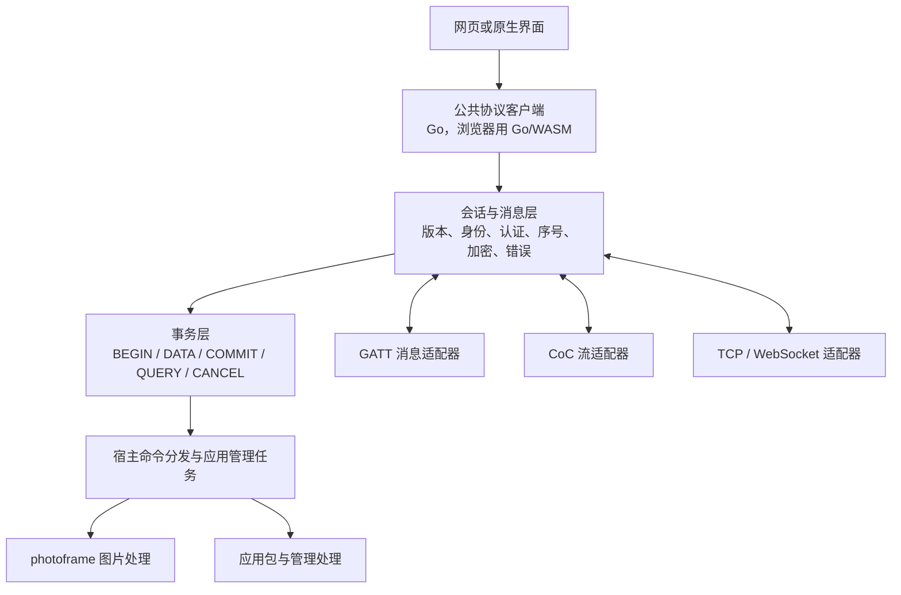

# 提案：统一消息协议

> **这是一份设计提案，还没有实现。** 文中的消息格式、加密方式和接口名称都是设想。现有固件和客户端使用的蓝牙协议见[蓝牙通信](../06-bluetooth.md)。

相框现在有三种和应用通信的方式：GATT 小消息、CoC 和 ABI 2.3 通用消息，以后可能还要加 Wi-Fi。这份提案讨论的问题是：能不能让它们共用**一套**会话、消息格式和传输事务，让应用和客户端的业务逻辑都只写一次。

适合打算改动宿主协议、客户端协议代码或 photoframe 传输层的开发者阅读。

## 1. 要解决的问题

现在每加一种承载方式，就要在好几个地方各写一遍：

| 位置 | 现状 |
|---|---|
| 宿主 | GATT 管理命令、CoC 通道、通用消息各有一套帧格式和签名代码 |
| photoframe | 三个适配器分别接收图片命令，再交给共用的图片事务代码 |
| 电脑端（Go） | GATT 小消息和 CoC 各有一条发送路径 |
| 网页插件（TypeScript） | 自己又实现了一遍会话、签名和图片事务状态机 |

结果是：

- **同一个规则要在多处保持一致。** 例如“COMMIT 的回复丢失后只查询原请求”这条规则，Go 和 TypeScript 各写了一遍，任何一边写错都可能导致屏幕重复刷新。
- **业务受限于最慢的通道。** 旧 GATT 每次只能带 106 字节图片，还要额外读一次回执，速度只有 CoC 的百分之一左右。
- **内容是明文。** 现有会话只做 HMAC 签名，能防篡改和冒充，但空中的数据可以被看到。所以 Wi-Fi 密码只能通过 SD 卡或 USB 写入，蓝牙配网要等加密会话。
- **换通道要从头传。** 一张图在 GATT 上传了一半，换到 CoC 时要从头再传。

现有基础：photoframe 的图片事务已经是一份与传输方式无关的纯 C 代码，宿主也提供了 ABI 2.3 通用消息通道和 GATT 大消息适配器。本提案在此基础上描述完整方案。

## 2. 目标与范围

目标：

- 应用只实现一次图片接收、校验和显示。
- GATT、CoC、Wi-Fi TCP/WebSocket 共用同一套会话、消息格式和事务。
- 客户端的协议代码只有一份，用 Go 实现，浏览器通过编译成 WASM 的 Go 代码复用它。JavaScript 只负责 Web Bluetooth 和 WebSocket 驱动、界面，以及调用 WebCrypto。

第一版只做：

- 一个已授权的写入者、一个进行中的大文件事务；
- 可靠、有序的承载通道。

第一版不做：

- 多条链路并发拼包；
- 自己实现 UDP 重传；
- 跨重启的“恰好显示一次”保证。

网络发现、Wi-Fi 连接、证书配置和系统权限，仍由连接管理器和各传输适配器负责。各平台能用哪些通道保持不变，例如浏览器仍然只能用 GATT。

## 3. 方案

### 3.1 分层



相框和客户端两端都实现会话层和事务层。固件里这两层是纯 C 代码，和蓝牙协议栈 NimBLE、网络协议栈 lwIP 分开；客户端里是 Go 代码。

### 3.2 传输适配器

每种承载方式只需要实现一个很小的接口：发一条完整消息、收一条完整消息、报告限制、关闭。

```go
type LinkLimits struct {
    MaxTxMessage, MaxRxMessage, RxBudgetBytes uint32
    ServerPush bool
}
type MessageLink interface {
    SendMessage(ctx context.Context, frame []byte) error
    ReceiveMessage(ctx context.Context) ([]byte, error)
    Limits() LinkLimits
    Close() error
}
```

适配器的约定：

- `SendMessage` 成功，表示适配器收下了整条消息。设备是否处理完，要看之后的回执。
- `ReceiveMessage` 返回一条完整消息，或者一个明确的错误。
- GATT 适配器在内部处理 MTU、分片、重组和读回复，上层只看到完整消息。GATT 上设备无法主动推送，所以适配器报告 `ServerPush=false`，由公共客户端用 QUERY 查结果。
- CoC 和 TCP 是字节流。适配器先读公共帧头，再按头里的长度读数据，并处理读写不完整和连接结束的情况。WebSocket 本身按消息传输，也要校验同样的帧头。
- 每条链路单独协商消息上限和接收预算。初步设想是 GATT 512 B、CoC 4 KiB、TCP 和 WebSocket 16 KiB，实测后再定。
- TCP 和 CoC 本身保证可靠送达，适配器直接使用。可能已经执行的 COMMIT 只能由事务层用 QUERY 确认，适配器只发一次。

### 3.3 公共消息格式

固定 24 字节头，逐字段按小端编码（不直接发送 C 结构体）：

| 字段 | 字节 | 含义 |
|---|---:|---|
| magic | 2 | 协议标识 `PP` |
| version | 1 | 线上协议的版本，和应用 ABI 版本相互独立 |
| kind | 1 | 握手、请求、响应、DATA、ACK、事件、关闭 |
| flags | 4 | 第一版必须为零 |
| session_id | 8 | 本次认证连接的随机会话标识 |
| sequence | 4 | 每个方向单调递增，溢出前必须重建会话 |
| payload_length | 4 | 消息体长度，分配内存前先检查 |

认证之后的消息都用 AEAD（带认证的加密）保护：帧头参与认证但不加密，消息末尾附 16 字节认证标签。每条消息的 nonce（一次性随机数）由 `session_id` 和 `sequence` 组成。两个方向用不同的密钥，每次重建会话都生成新的随机数和密钥。

帧头、标签和事务字段都占空间，所以 512 字节的帧装不下 512 字节图片。实际每条 DATA 能带多少数据，由协商上限减去这些开销得出。

### 3.4 身份与会话

- 继续使用现有的配对 v2（按键批准）以及设备 ID、CID、BID。Wi-Fi 通道也用同一个配对关系认证。
- 每条新连接依次执行 HELLO、AUTH、READY 三步。认证记录包含双方随机数、设备和客户端身份、BID、`boot_id`（本次开机的编号）、连接绑定信息、选定的版本和能力摘要。这样旧消息无法重放，攻击者也无法逼双方降到更旧的版本。
- 同一个配对关系可以授权多条通道。每条通道都单独认证，算出自己的方向密钥。身份只由配对密钥证明，IP 地址、SSID 或通过蓝牙告知的地址都只用来找到设备。
- 浏览器里的配对密钥保持为不可导出的 `CryptoKey`，Go/WASM 代码通过一个密码服务接口调用 WebCrypto。原生客户端用各自平台的密钥存储实现同一个接口。长期密钥只保存在密钥存储里，URL、日志、设备网络配置和服务器插件配置里都不出现。
- Wi-Fi 凭据在认证并加密的控制消息里传递。

### 3.5 统一事务

事务身份由五部分组成：`binding_id + boot_id + app_id + app_generation + transaction_id`。`transaction_id` 是每次推送生成的 128 位随机数。同一张图可能推送多次，所以它要和图片的 SHA 分开。

| 命令 | 作用 |
|---|---|
| BEGIN | 目标、事务 ID、内容类型、总长度、SHA-256；先检查授权和可用资源 |
| DATA | 事务 ID、偏移、数据；只接受连续数据或内容一致的重复数据 |
| ACK | 应用已经收下并计入校验的总字节数，以及剩余的接收预算。业务是否完成，看最终回执 |
| COMMIT | 检查完整性后交给业务处理；发送端在发出前持久保存事务身份 |
| QUERY | 查询同一事务的目标 generation、已收字节数和最终结果 |
| CANCEL | 取消还没进入不可逆执行的事务 |

状态：RECEIVING → VERIFIED → EXECUTING → COMPLETED，另有 FAILED、CANCELLED、OUTCOME_UNKNOWN。

最终回执包含事务 ID、目标和 generation、总长度、SHA、结果码和**完成程度**。完成程度说明业务做到了哪一步：图片成功显示是 DISPLAYED（屏幕刷新完成、面板断电）；应用包保存成功是 STAGED，激活成功是 ACTIVATED。客户端按自己需要的完成程度判断成功。

传输框架只负责字节、授权、事务和调度。PNG 解码、六色校验和显示由图片处理器负责；ELF 校验和槽位管理由应用包处理器负责。

### 3.6 流控

消息大小、在途数据量、文件总大小是三个独立的限制。

- GATT 第一版一次只发一条消息，等到回复再发下一条。
- CoC 和 TCP 可以在接收预算内连续发送多条，用累计 ACK 确认，块大小和 GATT 分开设定。
- 接收预算（也叫 credit）按应用缓冲里真正空着的字节数计算。数据写进 TCP 的系统缓冲区，还不算应用收到。
- 控制消息有单独的小预算，数据预算用完时，仍然可以发 QUERY 和 CANCEL。
- 宿主每次只处理有限几条消息，就把控制权交还应用管理任务，让按键和管理操作在大流量期间也能及时执行。
- 连续传数据期间，DATA 和 ACK 只在内存里处理，不读 Flash 应用槽、不重算目录、不逐包生成状态 JSON。

### 3.7 断线与换通道

第一版里，换通道由客户端明确发起，步骤如下：

1. 在旧通道上停发 DATA，在新通道上用原配对关系重新认证。
2. 用原 `transaction_id` 发 QUERY，核对 `boot_id`、应用 generation、长度和 SHA。
3. 如果事务仍在 RECEIVING，并且缓冲还在，就领取一个新的写入者编号（epoch），从已确认的位置接着发。
4. 带旧编号的数据还在排队时，应用管理任务会在执行前丢弃它们。
5. COMMIT 已发出但回复丢失时，客户端只 QUERY 原事务，事务 ID 保持不变，屏幕也不会自动重刷。
6. 设备重启、事务丢失或回执被清除时，返回 OUTCOME_UNKNOWN，交给人处理。

事务跟着授权身份和应用的生命周期走，和具体的 GATT 或 CoC 连接无关。链路断开后，接收中的事务只保留一段有限的时间；应用卸载或配对撤销时，事务立即失效。

## 4. 拟定接口

下面的名称只用来说明职责，正式签名在实现时再定。

### 客户端

| 接口组 | 拟定接口 | 约定 |
|---|---|---|
| 发现与能力 | `Discover`、`GetCapabilities`、`ListServices` | 返回设备身份、服务、协议版本、消息和队列的限制，只列出当前平台可用的能力 |
| 会话 | `Connect`、`Authenticate`、`Disconnect` | 用现有配对关系建立独立的密钥和序号。连接成功之后还要认证成功，会话才可用 |
| 请求响应 | `Call(service, method, request)` | 统一处理请求 ID、授权、错误和截止时间 |
| 传输 | `BeginTransfer`、`WriteData`、`CommitTransfer` | Begin 先检查授权和资源；链路收下数据不代表应用已确认；Commit 可能返回“处理中” |
| 确认与等待 | `QueryTransfer`、`WaitResult` | 结果带完成程度，图片只有 DISPLAYED 才算成功 |
| 取消与恢复 | `CancelTransfer`、`ResumeTransfer` | 已经开始显示的事务无法撤销。只恢复同一次开机、同一 generation、同一授权下仍在接收的事务 |
| 换通道 | `Reconnect`、`AttachTransfer` | 新通道重新认证，并领取新的写入者编号 |
| 事件 | `WatchTransfer`、`WatchState` | 统一的进度、完成、失败事件。在不能推送的链路上，客户端定期查询，次数有上限 |
| 诊断 | `GetMetrics`、`GetLastError` | 分别统计发现、连接、认证、上传、执行的耗时，输出中不含密钥 |

配对由独立的 `PairingService` 负责，仍然要求用户在相框上按键批准。建立 Wi-Fi 网络、让相框入网，是连接管理器按平台完成的操作。业务层的便捷接口（`Image.Send`、`Apps.Install/Activate/Switch/Rollback`、`Device.Status`）都由上面的公共接口组合而成。`Image.Send` 拿到 DISPLAYED 回执才返回成功。

### 应用 SDK

现有 ABI 2.3 已经提供了 `app_host_channel_register_v23`、`info`、`recv`、`send`、`close` 和 `APP_EVENT_CHANNEL`（见 [应用接口参考](../05-app-api-reference.md)）。完整方案在此基础上扩展：

- `info` 额外报告已认证的客户端、配对和会话标识，以及还能写多少字节；
- 注册时声明服务协议的版本；
- 事务的收尾工作交给公共事务层，应用只处理业务内容。

应用仍然只在应用管理任务派发的事件里运行，现有的指针和资源生命周期规则保持不变。

### 传输驱动

驱动只实现 `MessageLink`，以及平台上的连接和释放。设备搜索、地址解析、Windows 建立 Wi-Fi 网络、相框入网，由连接管理器统一安排。GATT UUID、MTU、CoC 通道号和接收预算、TCP 读写不完整、WebSocket 分帧这些细节，都封装在驱动里，图片和应用包服务看不到。

## 5. 迁移步骤

| 现有代码 | 迁移方向 |
|---|---|
| `photopainter-host/main/ble_protocol.c` | 提取独立的会话和消息代码，以及命令分发；和 NimBLE 打交道的代码留在适配器里 |
| `ai-quota-frame/internal/ble/protocol.go` | 提取通用的协议客户端，原生程序和 Go/WASM 共用 |
| `ai-quota-frame/internal/ble/coc.go` | 复用公共封帧、密码和事务，只保留流 I/O |
| `ai-quota-frame/web/src/ble/session.ts`、`web/src/photoframe/sender.ts` | 改用公共的 Go/WASM 代码，JavaScript 只保留驱动和界面 |
| `photoframe/main/ble_image.c` | 去掉按传输方式分支的代码 |

ABI 2.1 和 2.2 的接口原样保留，包括 `APP_BLE_MAX_VALUE=128` 和 140 字节的 `app_ble_event_v2_t`。新能力通过新的接口加入。

建议顺序：

1. 把图片命令处理提成纯逻辑代码，让现有适配器跑同一套测试。现有代码已经是这样。
2. 提取公共的会话和消息代码，以及 Go 客户端；建立各语言共用的标准测试数据，先接模拟的 `MessageLink` 测试。
3. 接入 GATT。双方协商一致后才启用新协议，能力不符时直接报错。
4. 让 photoframe 通过 ABI 2.3 通用通道收发所有消息。ABI 2.3 通道和 GATT 适配器已经可用。
5. 加入 CoC、Wi-Fi TCP 和 WebSocket 适配器，复用同一套事务测试，最后实现由客户端发起的换通道恢复。

## 6. 验收设想

- C、Go、Go/WASM 共用一组握手、加密、帧格式和事务的标准测试数据。
- 同一个业务用例，在模拟的 GATT、CoC、TCP 适配器上得到一致的结果和最终回执。
- 人为制造故障并检查处理是否正确：读写不完整、分片重复或越界、队列满、认证重放、旧的写入者编号、COMMIT 回复丢失、应用被切走、设备重启、回执被清除。
- 结果不确定时，屏幕保持原样，等人处理；显示缓存或断线状态时，同时显示采集时间和 `boot_id`。
- 分别记录发现、连接、认证、上传、执行的耗时，统计空中传输的字节数、DATA 和 ACK 的数量、排队时间、目录读取次数和内存峰值。连续传数据期间，Flash 目录读取次数应为零。
- 用同样的输入（约 60 KiB 的图片和一个应用包）测试各通道的性能。
- 先在各平台上分别验收连续重连和传图，再验收换通道。

## 7. 未决问题

- **加密算法和握手细节。** AEAD 选哪种算法、HELLO/AUTH 的具体字节格式、能力摘要怎么算，都还没定。
- **各通道的消息上限。** GATT 512 B、CoC 4 KiB、TCP/WebSocket 16 KiB 只是起点，需要实测内存和吞吐后确定。
- **接收中事务的保留期限。** 链路断开后事务保留多久、占用的 PSRAM 怎么回收，要和现有的 60 秒接收超时一起考虑。
- **Wi-Fi 的连接方式。** 可以让相框加入现有的路由器网络，也可以让电脑建立一个网络让相框加入（Windows 上的 Wi-Fi Direct 或热点）。各平台能力不同，需要分别测试。
- **浏览器的能力。** 浏览器用不了 CoC，访问本地网络也受限制。只用网页，还是配合一个本机程序，由客户端部署方式决定。
- **Windows CoC。** Windows 原生客户端能否打开 CoC 需要实测。
- **和现有协议的共存期。** 旧客户端和 ABI 2.1/2.2 应用要继续工作多久，新旧协议在同一个连接上怎么协商。
