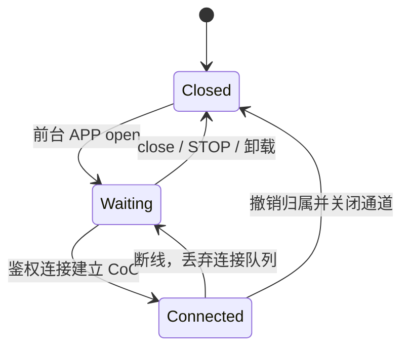

# ABI 2.2：单所有权 CoC

[返回首页](Home.md) · [ABI](ABI-and-Versioning.md) · [GATT 小消息](Application-BLE.md)

L2CAP CoC 是 NimBLE 提供的面向连接通道，负责分段重组和额度流控。宿主把它封装成当前前台 APP 独占的非阻塞记录接口；APP 定义业务协议，宿主不解析 PNG。没有多应用 socket 表，也不把 NimBLE 回调交给可卸载 ELF。

## 分层


先鉴权，再根据签名状态中的 `coc_version`、`coc_psm`、`generation` 建立 CoC。设备声明能力与本次实际选用通道是两件事；控制台展示后台实际选择的 `channel`。

## 注册与接口

```c
APP_MANIFEST_COC("my-app", "My app", 0, 0);

// 在 START 事件的初始化函数中调用：
static int32_t start_coc(void) {
    const app_coc_config_v22_t cfg = {sizeof(cfg), 4096, 4, 4};
    return app_host_coc_open_v22(&cfg);
}

int32_t app_host_coc_info_v22(app_coc_info_v22_t *info);
int32_t app_host_coc_recv_v22(uint32_t session, void *dst,
                            uint32_t capacity, uint32_t *received);
int32_t app_host_coc_send_v22(uint32_t session, const void *src,
                            uint32_t bytes);
int32_t app_host_coc_close_v22(void);
```

这些函数只能在有效的当前 APP 事件内调用；STOP 允许查询、关闭，不允许打开或收发。宿主从上下文确定所有者，不要求 APP 提供 owner 或通道句柄。

| 项目 | 当前契约 |
|---|---|
| 同时注册/连接数 | 全局 1 / 1 |
| `rx_sdu_bytes` | 请求接收预算 128–4096 字节 |
| RX/TX 队列 | 各 1–8 槽；photoframe 使用各 4 槽 |
| 数据所有权 | send 复制入宿主队列；recv 复制完整记录到 APP 缓冲 |
| 实际记录长度 | 通过 info/hello 查询；4 KiB 预算扣除 38 字节封套后为 4058 字节 |
| 新事件 | `APP_EVENT_COC=7`，24 字节元数据，无固定 128 字节载荷数组 |
| PSM | 宿主固定 `0x81`，客户端从签名能力查询 |

默认队列约 32 KiB，另外还要计入 NimBLE mbuf 和协议缓冲。它们是可失败的有界资源，不是无限缓存。

## 状态与事件



`app_coc_event_v22_t.type` 是 CONNECTED、DISCONNECTED、RX_READY、TX_READY、ERROR 位集。连接边界废弃旧队列；最新 CONNECTED 同样要求应用清理旧接收。session 每次连接更新，旧 session 不可操作新连接。普通断线保留当前 APP 注册；切出/卸载释放归属与队列。

| I/O 返回值 | 含义 |
|---|---|
| OK=0 | 已读取一条记录或已复制入发送队列 |
| AGAIN=1 | 暂无数据/空间，等待就绪事件 |
| CLOSED=2 | 当前未连接 |
| STALE=3 | session 已失效 |
| TOO_SMALL=4 | 返回所需长度，不消费记录 |
| BUSY=5 | 注册等资源当前已占用 |

负值沿用 APP 参数/上下文错误。正数 I/O 状态必须由 APP 处理，不能直接当作 `app_complete` 的事件结果。一次入口只处理有限批次再返回，photoframe 当前最多四条记录。

## 传输与业务确认

CoC credits 表示宿主能接收的数据量。RX 队列满时宿主停止供应下一份接收 mbuf，APP 消费后恢复；TX credits 不足时等待协议栈事件，不重复发送已接纳的 SDU。

Mac CoreBluetooth 提供字节流，宿主增量解析长度封套以适配拆分/合并。每次连接派生方向独立的密钥；记录校验长度、序号与 HMAC，APP 不接触凭据。它仍不是内容加密。完整字段见宿主 `docs/abi-2-2-coc.md`。

图片 BEGIN、COMMIT、QUERY、CANCEL 返回业务回执，成功 CHUNK 不逐块往返确认。send 成功只表示复制入队；只有 APP 在完整 PNG 校验、实体刷新和最终 POWER_OFF 完成后返回的匹配回执，才是显示成功。

## 已有证据

2026-10-27 的一次实机推图：67,509 字节，发送阶段 2.477 秒、平均 26.6 KiB/s，01:49:21（UTC+8）收到完整显示回执。发送计时不含全部连接和刷屏时间；这是一次成功观测，不是各种距离、尺寸和断线场景的性能保证。详情见 [状态页](Status-and-Evidence.md)。
