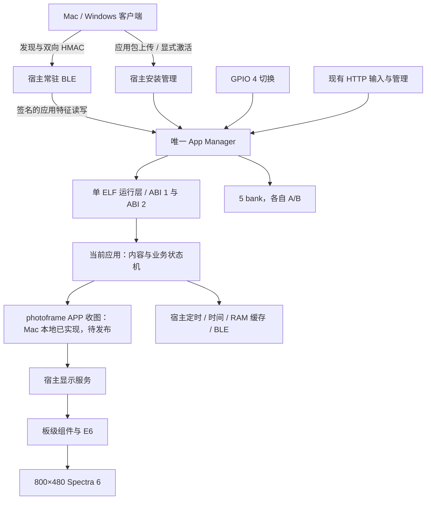

# 架构与职责

[返回首页](Home.md)

## 程序分层

| 层 | 产物和运行位置 | 负责 | 边界 |
|---|---|---|---|
| 宿主 `photopainter-host` | ESP32-S3 factory 中的 `.bin` | Wi-Fi、NimBLE、鉴权、目录、A/B、加载、调度、ABI 服务、ABI 2 板级显示 | 不承载应用页面和新应用的专用业务协议 |
| APP，如 `photoframe` | A/B 数据槽的独立 `.app.elf` | 内容、解码、业务状态、首屏和恢复策略；通过 SDK 使用显示和 BLE | 不自行启动后台任务、接管无线栈或导入未允许的系统函数 |
| 电脑端 `ai-quota-frame` | Windows / Mac / Linux 进程 | 采集、排版、严格六色 PNG、主动发送、设备管理客户端 | 不监听健康端口，不决定抢占当前应用 |
| 文档 `esp32s3` | 本 Wiki 与架构说明 | 开发规则、设计决定和导航 | 不参与固件构建 |

## 目标运行链路

下图中 APP 收图状态机及配套客户端已合入 main，通过有效图与回执测试；剩余实机验收见 [状态页](Status-and-Evidence.md)。通用应用 BLE 桥接和显示接口由宿主提供。

已经安装的宿主还保留了专用 PNG opcode 15/16/17，直接调用现有 manager PNG 入口。该路径有实测证据，后续停止扩展；[APP 收图路线](BLE-Image-App-Roadmap.md)逐步接替它作为新开发方向。不要把旧通道成功或 Mac 部分实测当作新路线已完成全部验收和发布。

## 调度和资源

任何时刻只加载一个业务 ELF。切换是 STOP → 清理宿主受管资源 → 卸载 → 加载目标 → START → 就绪与确认，不是让两个 APP 同时常驻。BLE 发现和应用 OTA 始终由宿主维持；切到其他应用后，相框的专用 BLE 服务应消失。

HTTP、BLE 和按键通过同一管理边界执行应用操作。APP 不可重入、不创建独立线程；事件入口由 manager 串行调用。独立 Wi-Fi / NimBLE 等系统任务属于宿主，不是 APP 的后台执行环境。

## 当前限制

- N16R8、16 MiB Flash / 8 MiB PSRAM，现有五 bank 布局保持不变。
- 每 APP 有两个 1 MiB 槽，包头占 4096 字节，APP 数量最多五个。
- ELF 是受信任原生代码，与宿主共享地址空间；导入校验不是内存沙箱。
- ABI 暴露网络连接状态和受管 BLE，当前没有 APP 通用 Wi-Fi 网络请求服务。
- 没有宿主 OTA 分区和整机 OTA；应用 OTA 与串口更新宿主是不同流程。

实现依据：[manager](https://github.com/M1nt-Ch0c0/photopainter-host/blob/b4709c0/main/app_manager.c)、[运行层](https://github.com/M1nt-Ch0c0/photopainter-host/blob/b4709c0/main/photoframe_plugin.c)、[分区表](https://github.com/M1nt-Ch0c0/photopainter-host/blob/b4709c0/partitions.csv)。
