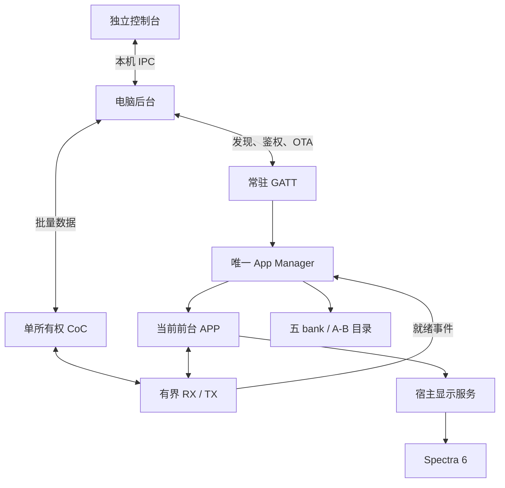

# 架构与职责

[返回首页](Home.md) · [完整架构图](../ARCHITECTURE.md)

## 程序分层

| 层 | 运行位置 | 责任 |
|---|---|---|
| photopainter-console | macOS SwiftUI APP | 可视化设备操作与诊断，通过 Unix socket 请求后台 |
| ai-quota-frame | 电脑 Go 后台 | 采集、渲染、唯一串行设备队列、GATT/CoC 客户端 |
| photopainter-host | ESP32-S3 factory | 通信、鉴权、目录、ELF、Manager、ABI 和板级显示 |
| photoframe | 唯一前台 ELF | 图片协议、缓冲、SHA/PNG 校验、首屏和业务回执 |
| esp32s3 | 文档仓库 | Wiki、架构与跨仓导航 |

配对 v2 由 host 负责物理批准、NVS owner 和功能键重置，APP ABI 仍为 2.2。浏览器插件通过 Go/WASM 复用原采集和渲染。当前配对发布**尚未实机验证**。

## 当前通道

GATT 与 CoC 都由宿主管理；CoC 绑定同一已认证连接和前台运行代次。APP 控制业务，宿主控制缓冲、流控和生命周期。窗口关闭不停止后台，APP 切出则必须撤销它的通信资源。

## 执行与资源

同一时刻只执行一个 ELF。切换先 STOP、清理 timer/GATT/CoC/旧事件，再卸载、加载和 START。APP 不创建 FreeRTOS 任务，不保留跨事件借用指针，不直接调用 NimBLE；宿主不会把已卸载 ELF 的回调留给无线任务。

当前 N16R8 设备有 16 MiB Flash / 8 MiB PSRAM。每个应用两槽各 1 MiB，最多五个已安装应用；这是框架容量，实际设备目录见 [状态页](Status-and-Evidence.md)。原生 ELF 共享地址空间，ABI 约束不构成恶意代码沙箱。

## 更新边界

- 修改额度页面：更新电脑渲染器。
- 修改业务协议/首屏：更新独立 APP 包。
- 修改通用 CoC、ABI 或硬件驱动：更新宿主并同步 SDK。
- 修改可视化操作：更新独立控制台及其后台 IPC。

旧 HTTP 控制只属于 v1 历史兼容，v2 返回 410；宿主 PNG opcode 仍是兼容路径；当前相框图片由 APP 自己处理。ABI 2.2 已有真实 CoC 推图证据，但没有通用 APP Wi-Fi socket/HTTP client、宿主整机 OTA或多进程隔离。

实现入口：宿主 `main/app_manager.c`、`main/app_coc.c`、`main/ble_coc.c`、`main/photoframe_plugin.c`；源码发布与验证范围见 [状态页](Status-and-Evidence.md)。
