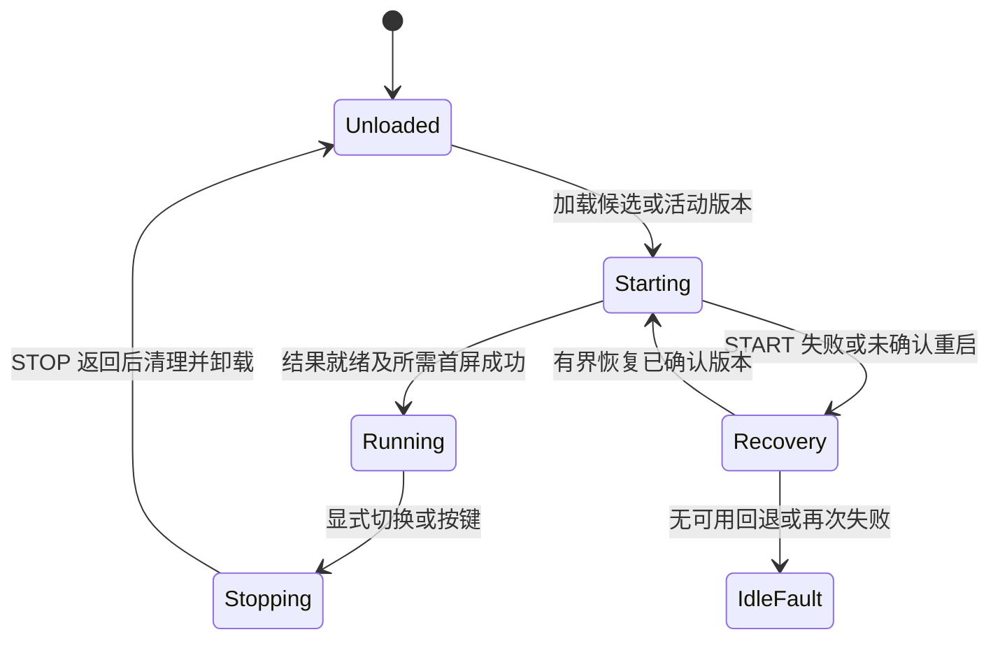

# 生命周期与调度

[返回首页](Home.md)

ABI 2 是合作式事件运行层：宿主调用 APP 的 ELF 入口，APP 通过 `app_host_context_v2()` 得到本次事件，完成工作、报告结果并返回。静态变量在同一次加载期间保持，卸载后不能继续使用原数据或函数地址。

## 事件表

| 事件 | 数值 | 适用范围 | APP 应做什么 |
|---|---:|---|---|
| START | 1 | 2.0+ | 初始化自身状态、注册服务、准备首屏；成功报告 APP_READY |
| INPUT | 2 | 2.0+，声明相应输入 | 验证借用输入，处理 PNG 等；不支持的输入明确拒绝 |
| TIMER | 3 | 2.0+ | 根据 timer_id 推进工作，避免长时间阻塞 |
| NETWORK | 4 | 2.0+ | 读取 network_connected；只含连接状态，不提供凭据或 socket |
| STOP | 5 | 2.0+ | 取消自身状态、释放内存；禁止显示或注册新服务 |
| BLE | 6 | 显式声明 2.1 | 检查事件长度后处理连接、断开、写入、错误 |

SDK 常量名为 `APP_EVENT_NETWORK`，部分说明中称 NETWORK_CHANGED，指同一类事件。context 带 `size`、ABI、`event_id`、`generation`、输入指针和长度等；BLE 数据布局见 [应用 BLE](Application-BLE.md)。

## 完成结果是强制契约

每次有效入口调用都必须**恰好一次**调用 `app_host_complete_v2()`，推荐用 `app_complete(c, status, flags)`。单纯 `return APP_OK` 无法替代结果报告，因为当前 elf_loader 的入口请求不传播业务返回值。

结果必须匹配本次 event_id 和 generation，size 正确，status 为允许结果码。重复、遗漏、过期代次或错误 flag 都属于运行错误。APP_READY 只可在成功 START 中设置；其他事件 flags 为 0。

显示 APP 的 START 需要同时满足成功结果、APP_READY 和宿主观察到的实际显示完成。无显示 APP 不声明首屏标志，可以不触碰面板便确认就绪。

## 时限与输入所有权

- 普通事件逻辑预算 5 秒。分块接收只处理本块，不在一次事件里等待整包到齐。
- 同步显示由宿主延长看门狗预算至 650 秒；旧 ABI 1 调用也有对应预算。不得自行更改 E6 等待时间掩盖问题。
- 看门狗超时通过设备重启恢复，不会强行卸载仍执行的 ELF。
- context、INPUT 数据、BLE 事件数据都只借用到本次入口返回。需要保留的内容复制进 APP 自有缓冲。
- 已开始显示时，即使客户端断开，输入与执行仍需保留到操作返回，不能提前释放内存或立即再次显示。

## 切换与资源清理

APP 必须在 STOP 中释放自有堆内存、传输状态和协议缓存；宿主取消它的定时器、BLE 注册和队列事件，然后卸载 ELF。宿主受管资源的取消不会自动释放 APP 通过 malloc 分配的内存。

APP 不创建 FreeRTOS 任务、系统回调、ISR 或后台定时器，也不把 ELF 函数指针交给外部长期保存。应用切出后不会继续收到自己的定时或 BLE 事件。

## 忙碌、按键和并发

App Manager 是唯一应用执行任务；操作接纳与安装/显示共享管理边界。队列上限 8 个作业描述符；应用 BLE 事件也有独立的 8 项上限，二者不能当作同一条无限队列。

GPIO 4 短按循环选择已安装、具有 active 版本的 ABI 2 应用；不激活 pending。只有一个候选不重复刷新。上传、显示或切换期间的按键手势会被忽略，不在结束后补刷。ABI 1 应用需要 CLI 选择。

一个 APP 内部多事件传输需要自己的状态机：manager 的串行调用不等于整个传输跨事件持有独占锁。必须定义 HTTP 输入、STOP、断开和应用 OTA 到来时如何终止或拒绝当前业务。

依据：[事件派发](https://github.com/M1nt-Ch0c0/photopainter-host/blob/b4709c0/main/photoframe_plugin.c)、[manager](https://github.com/M1nt-Ch0c0/photopainter-host/blob/b4709c0/main/app_manager.c)、[服务时限](https://github.com/M1nt-Ch0c0/photopainter-host/blob/b4709c0/main/app_services.c)。
