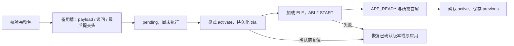

# 打包、应用 OTA 与恢复

[返回首页](Home.md)

应用更新写的是数据分区中的 ELF 包，不是 factory 宿主固件。同一套目录和状态机同时服务 HTTP 与 BLE；传输层不得自己另外实现激活、确认或回滚。

## 包和目录

- 五个固定 bank，每 APP 一个 bank，每 bank A/B 两槽，各 1 MiB。
- 包最大 1 MiB，前 4096 字节是包头，后面是 ELF；不能把整个 1 MiB 当 payload 容量。
- format 1 仅保留旧 photoframe ABI 1 兼容；format 2 带 APP ID，支持 ABI 1/2。
- 包含 uint32 发布版本、payload 长度和 SHA-256；ABI 2 另校验只读 manifest 与允许导入。
- 发布版本是标签，不是作者签名或反降级安全计数器。升级通常选新的版本号，不能把 SHA 当签名。

用官方工具打包，禁止手改头绕过校验：

```sh
# 在 photopainter-host，先构建对应应用
python3 tools/module.py package --app lifecycle --version 1 \
  --input ../photoframe/examples/lifecycle/build-app/lifecycle.app.elf \
  --output /tmp/lifecycle-v1.pkg
```

## 更新状态机



stage/install 不执行 APP。activate 试运行 pending；switch 选择已确认 active，不消费 pending。rollback 取消候选或恢复 previous。remove 只移除非当前、非全局试运行中的 APP，释放目录项；它不是安全擦除旧 Flash 内容。

ABI 2 在 START 满足就绪和声明的首屏后确认；ABI 1 保留首次成功 PNG 输入确认。管理命令成功、已加载和一次物理显示成功是不同事实，应读取完整状态判断。

## BLE 与 HTTP 管理示例

停止自动 pusher，确认设备与令牌，按已授权的测试范围执行：

```sh
ai-quota-frame ble status
ai-quota-frame ble inspect --file /tmp/lifecycle-v1.pkg
ai-quota-frame ble install --file /tmp/lifecycle-v1.pkg
ai-quota-frame ble activate --app lifecycle
ai-quota-frame ble status
# 只有状态确认且确需回退时：
ai-quota-frame ble rollback --app lifecycle
```

首次安装没有 previous，不能假定最后一条回退一定可用。安装前核对目录、容量和活动版本；不要覆盖当前已确认槽。

HTTP 管理同样使用原端口 80 和设备 Bearer：

```sh
python3 tools/module.py status --url http://DEVICE_IP
python3 tools/module.py stage --app lifecycle --url http://DEVICE_IP --input /tmp/lifecycle-v1.pkg
python3 tools/module.py activate --app lifecycle --url http://DEVICE_IP
```

CLI 私下加载令牌；不要把令牌放参数。以上是框架管理命令，应用业务输入另按 APP 文档执行。

## 失败与恢复

| 场景 | 必须保持的结果 |
|---|---|
| 包损坏、不支持的 ABI/导入 | 执行前拒绝，不触碰显示 |
| 断线或未完成上传 | 不产生有效候选，释放接收资源 |
| 写 payload 或包头中断 | 当前 active 不被替换；不完整数据不能当作有效包 |
| 激活失败或确认前重启 | 恢复先前确认版本/选择，不盲目重复业务输入 |
| 启动 active 失败 | 有界尝试 previous；再次失败停在可管理的故障空闲，避免无限刷屏 |
| 激活响应丢失或 GATT 服务变化 | 重连读取签名状态，比对 APP/槽/版本；不重放变更 |

宿主更新需要另外核对硬件、授权、完整 Flash 备份和 SHA-256；当前项目不提供宿主整机 OTA。已具备五 bank 布局的设备进行框架更新只写 `0x10000` 的宿主 bin，不动分区表/NVS/APP 槽。历史迁移文档不是本轮刷写指令。

依据：[目录和格式](https://github.com/M1nt-Ch0c0/photopainter-host/blob/codex/framework-wiki/docs-multi-apps.md)、[当前部署指南](https://github.com/M1nt-Ch0c0/photopainter-host/blob/codex/framework-wiki/docs-module-slots.md)、[启动保护](https://github.com/M1nt-Ch0c0/photopainter-host/blob/b4709c0/main/app_boot.c)。
